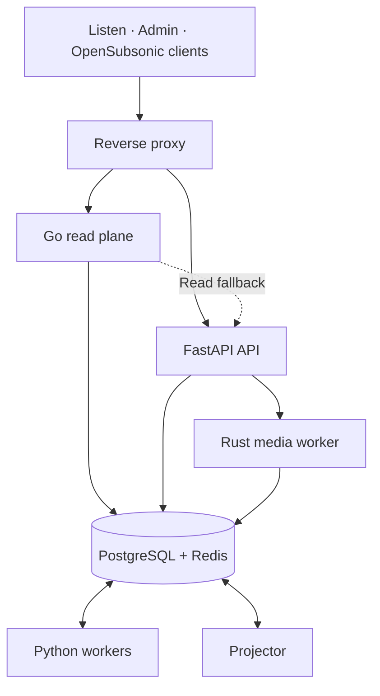

<p align="center">
  
</p>

<p align="center">
  <a href="https://github.com/thecrateapp/crate/actions/workflows/test-backend.yml"></a>
  <a href="https://github.com/thecrateapp/crate/actions/workflows/test-frontend.yml"></a>
  <a href="https://github.com/thecrateapp/crate/actions/workflows/build-images.yml"></a>
  <a href="https://github.com/thecrateapp/crate/releases/latest"></a>
  <a href="LICENSE"></a>
  <a href="https://docs.cratemusic.app"></a>
</p>

<h1 align="center">Crate</h1>

<p align="center"><strong>Own your music.</strong></p>

<p align="center">
  A self-hosted music platform for collecting, organizing, discovering and listening to your music.
</p>

<p align="center">
  <a href="https://cratemusic.app">Website</a> ·
  <a href="docs/README.md">Documentation</a> ·
  <a href="https://github.com/thecrateapp/crate/releases/latest">Downloads</a> ·
  <a href="https://github.com/thecrateapp/crate/issues">Issues</a>
</p>

---

Crate indexes the audio files you own, enriches them with metadata, analyzes their
sound and makes them available through **Listen**. **Admin** manages the shared
library, imports, analysis and operations. Both apps use the same Crate visual
identity, tokens and components from `@crate/ui`.

Listen runs on the web, as a PWA, in native Android/iOS shells and on macOS,
Windows and Linux through Tauri. Crate also supports Google Cast and OpenSubsonic
clients. Each installation works independently; pairing approved federation peers
extends its catalog, playback and imports.

## Features

### Listen

- Gapless playback, configurable crossfade, pause/resume fades, queue, shuffle,
  repeat, radio and Infinite Playback.
- Equalizer, synced lyrics, audio visualizer, media-session controls and keyboard
  shortcuts.
- Offline downloads with platform-specific storage for web, Capacitor and Tauri.
- Personal library with saved albums, likes, playlists and **Crates**: collections
  of albums that can be shared and downloaded.
- Home recommendations, genre radios, artist connections and **Music Paths**
  between artists or genres, with optional waypoints.
- Listening stats with period comparisons, heatmaps, highlights and replay;
  **Crate Pulse** for instance-wide activity with privacy thresholds.
- Upcoming concerts, probable setlists, profiles and follows.
- Bandcamp collection and purchase cards, support links and user contributions
  from owned purchases or audio uploads.
- Google Cast playback and an OpenSubsonic API for compatible third-party clients.

### Admin and library management

- Filesystem watching and periodic scans; metadata and audio-analysis pipelines.
- Library health checks and repair, duplicate resolution, trash and a folder
  organizer with configurable naming patterns.
- Album and track tag editing, artwork from multiple providers, manual image
  uploads and cropping.
- Download/import queues, contribution attribution, portable exports and
  withdrawal controls.
- Genre taxonomy editor and wheel, relationships, aliases, reusable facets and
  raw-tag classification as genre, facet, hybrid or ignored.
- Rule-based smart playlists using genre, artist, year, format, popularity and
  audio features; rules can also require Smart Mix profiles.
- Discography completeness, new-release monitoring and upcoming shows with
  library-matched setlists.
- **Insights** with Listening, Collection and Sonic explorer tabs: compare library
  holdings with listening activity and explore tempo, energy and loudness regions.
- Operations and queue monitoring, analysis coverage and backfill controls,
  system health, containers, logs, schedules and audit records.
- Multi-user administration with roles and capabilities, persisted sessions,
  Google/Apple sign-in and scoped access tokens.

### Metadata and acquisition

- **Last.fm** — biographies, tags, similar artists, popularity signals and scrobbling.
- **MusicBrainz** — identifiers, discographies, credits, country and artist relationships.
- **Fanart.tv / Cover Art Archive / Deezer / iTunes** — artwork and image fallbacks.
- **Discogs** — labels, catalog numbers and editions.
- **Setlist.fm / Ticketmaster** — probable setlists and upcoming shows.
- **Spotify** — popularity and artwork enrichment.
- **Bandcamp** — account connection, collection/wishlist/following sync, owned
  downloadable purchases and matching against the instance library.
- **Tidal / Soulseek** — acquisition through `tiddl` / `slskd`, quality filtering,
  queue management and retries.
- **Uploads** — audio files and ZIP archives with contributor attribution.

Imports pass through indexing, enrichment, analysis and artwork processing.

### Audio analysis and Smart Mix

Crate combines Essentia/librosa signal processing, PANNs CNN14 classification
and signal-based fallbacks to derive tempo, key, loudness, dynamic range, energy,
danceability and mood. The Rust `crate-cli` computes 20-dimensional **Bliss**
similarity vectors used alongside genres and other signals for discovery.

**Smart Mix** adds versioned track profiles, beat grids, cues, compatibility
scores and transition plans. Android's native mixer can execute adaptive
crossfades, beatmatching and bass handoff when the server enables them and the
tracks meet the planner's requirements. Unsupported or unsuitable transitions
fall back to simpler playback modes.

These capabilities are opt-in and default to off. Enable the applicable flags
in dependency order: `CRATE_SMART_MIX_ENABLED`,
`CRATE_ANDROID_NATIVE_CROSSFADE_ENABLED`, `CRATE_ANDROID_BEATMATCH_ENABLED`,
`CRATE_ANDROID_BASS_HANDOFF_ENABLED`. See
[Smart Mix operation](docs/technical/smart-mix-operations.md) for profiles,
coverage, backfill and playback requirements.

### Federation

- A global artist, album, track and genre catalog with stable human-readable routes.
- Bilateral signed pairing, scoped grants, key rotation and replay protection.
- Snapshot and durable delta synchronization, resumable checkpoints and tombstones.
- Signed taxonomy releases with provenance and local overlays.
- Owner-authorized streaming with quotas, revocation and HTTP Range support.
- Approved imports with signed manifests, disk reservations, hash verification
  and source provenance.
- Global likes, playlists and radio, opt-in remote scrobbling and global
  OpenSubsonic identifiers.

### Agents and MCP

The opt-in MCP server exposes scoped operations to external agents.
**Crate Agent** is a read-only Telegram assistant for health, jobs, logs and
schedules. **Crate Operator** can propose changes, which require a bound admin's
approval and verification that the stack runs official images. Its supervisor
can also send health, failed-task and new-release alerts.

Installer users start with `crate configure agent`; checkout-based deployments
use `make agent-init`. MCP requires `CRATE_MCP_ENABLED=true`; Operator actions
also require `CRATE_MCP_ACTIONS_ENABLED=true`. See
[Crate Agent and Crate Operator](docs/technical/crate-agent.md).

## Architecture



The Go read plane accelerates selected read routes, relays SSE and remote
federation streams, and falls back to FastAPI for unhandled reads. FastAPI owns
mutations, authorization and signing. A projector warms snapshots from domain
events so common surfaces do not rebuild expensive aggregates on every request.

| Component                           | Implementation                             | Responsibility                                                     |
| ----------------------------------- | ------------------------------------------ | ------------------------------------------------------------------ |
| `crate-api`                         | Python 3.13, FastAPI                       | API, auth, federation policy, playback preparation and control     |
| `crate-readplane`                   | Go                                         | Snapshot/catalog reads, SSE relay and media delivery               |
| `crate-worker`, `crate-fast-worker` | Python, Dramatiq                           | Default/fast queues, service loop, indexing and imports            |
| `crate-maintenance-worker`          | Python, Dramatiq                           | Repair, enrichment, sync and maintenance                           |
| `crate-analysis-worker`             | Python, native DSP tools                   | Audio analysis, Bliss vectors and Smart Mix profiles               |
| `crate-playback-worker`             | Python, ffmpeg                             | Playback preparation and transcoding                               |
| `crate-projector`                   | Python                                     | Domain events and precomputed read models                          |
| `crate-media-worker`                | Rust                                       | Album ZIPs and track download artifacts with progress/cancellation |
| `crate-ui`, `crate-listen`          | React 19, TypeScript, Vite, Tailwind CSS 4 | Admin and Listen, sharing `@crate/ui`                              |
| `crate-listen-desktop`              | Tauri 2, Rust                              | macOS, Windows and Linux client                                    |
| `crate-cast-receiver`               | TypeScript, Google Cast CAF                | Cast receiver                                                      |
| PostgreSQL 15 + pgvector            | SQLAlchemy, Alembic                        | Source data, similarity vectors, snapshots and rollups             |
| Cache Redis / durable Redis         | Redis 7                                    | Disposable cache / broker, replay and event streams                |

The API and media worker mount the music library **read-only**. Workers perform
changes to original files; download packaging writes only staged copies and
cached outputs. See the [system overview](docs/technical/01-system-overview.md)
for service boundaries and data flows.

The shared design system supplies tokens, primitives, forms, dialogs, toasts and
domain components to both apps. Statistical charts use Nivo; instruments such
as the genre wheel, audio meters and EQ curve use custom SVG/HTML/Canvas.
The [component showcase](tools/crate-ui-showcase/README.md) and visual checks
document and protect those shared contracts.

## Quickstart

### Self-hosted installation

On Linux or macOS with Docker and Docker Compose v2:

```bash
curl -fsSL https://cratemusic.app/install.sh | bash
```

The bootstrap downloads a checksummed Go binary, `crate`, and opens its setup
wizard. It checks Docker, resources and ports, asks for your music directory,
access mode and admin password, writes the configuration and starts the stack.
Images are available for **amd64 and arm64**; 8 GB RAM or more is recommended
for audio analysis.

| Access mode  | Address                                                                        |
| ------------ | ------------------------------------------------------------------------------ |
| `ports`      | Admin at `http://localhost:8580`, Listen at `http://localhost:8581` by default |
| `hosts`      | Local HTTP subdomains using `/etc/hosts`                                       |
| `dnsmasq`    | Local HTTP wildcard subdomains                                                 |
| `cloudflare` | Public HTTPS at `https://admin.<domain>` and `https://listen.<domain>`         |

```bash
crate install                 # Install or update an installation
crate configure               # Configure integrations
crate configure agent         # Configure a Telegram assistant
crate doctor --json           # Check the installation and configured integrations
crate mcp                     # Let an MCP client drive setup
```

Release installers pin images to their own release, replacing `latest` or an
older version while preserving pinned SHAs, custom tags and newer versions.
Use `crate install --dir <install-folder>` to select an existing installation,
`--skip-start` to write configuration without starting services, or `--dry-run`
to review the setup without writing it. MCP-assisted setup collects secrets
through a private local page rather than sending them to the agent.

For unattended installation, access-mode examples and backup requirements, see
[Quickstart](docs/technical/00-quickstart.md) and
[Deployment profiles](docs/technical/deployment-profiles.md).

### Clients

- **Web/PWA:** open your instance's Listen URL; install the PWA from your browser.
- **Desktop:** download the macOS, Windows or Linux package from
  [GitHub Releases](https://github.com/thecrateapp/crate/releases/latest).
  macOS builds are ad-hoc signed.
- **Android:** download `crate.apk` from the release and enter your server's API
  URL on first launch.
- **iOS:** build the Capacitor project with Xcode; requires iOS 16.4 or later.
- **OpenSubsonic:** point a compatible client at your API host. See
  [OpenSubsonic](docs/technical/opensubsonic.md) for authentication and compatibility.

### Local development

Prerequisites: Docker Compose v2, Node.js **20.x (20.19+) or 22.12+** with npm, and
`mkcert` for the local TLS proxy. Native builds additionally need the relevant
Xcode, Android Studio or Tauri toolchains.

```bash
git clone https://github.com/thecrateapp/crate.git
cd crate
mkdir -p test-music
# Add your own audio files under test-music/; this directory is not committed.
npm install
make trust-local-ca
make dev
```

`make dev` starts PostgreSQL, both Redis roles, API, read plane, workers,
projector, media worker, Cast receiver, slskd and Caddy, plus the four web dev
servers. It installs dependencies for Docs and the Astro website separately
from the root npm workspaces. Development state lives under `./data`; provider
keys can be added to a local `.env` when needed.

| Surface    | Local URL               |
| ---------- | ----------------------- |
| Admin      | `http://localhost:5173` |
| Listen     | `http://localhost:5174` |
| Docs       | `http://localhost:5175` |
| Website    | `http://localhost:5176` |
| API        | `http://localhost:8585` |
| Read plane | `http://localhost:8686` |

The local account is `admin@cratemusic.app` / `admin`. Development hostnames,
TLS/resolver setup and federation harnesses are described in
[Development setup](docs/technical/00b-development-setup.md).

```bash
make dev-back                  # Backend only, including the read plane
make dev-admin                 # Admin dev server
make dev-listen                # Listen dev server
make dev-logs s=worker         # Worker logs
make dev-down                  # Stop development services
make cap-ios                   # Build and run Listen in iOS Simulator
make cap-android               # Build and run Listen in Android Emulator
make tauri-dev                 # Run the desktop client
npm run design-system:storybook # Shared component showcase on :6006
npm run design-system:preview  # Persistent visual checkpoint mockup on :5186
```

### Validation

Run checks scoped to changed behavior during development. For example:

```bash
cd app && ../.venv/bin/python -m pytest tests/test_capabilities.py -q
```

```bash
npm run --workspace=app/listen test -- src/lib/equalizer.test.ts
npm run --workspace=app/ui test -- src/pages/Tasks.operations.test.tsx
npm run design-system:showcase:check
npm run check:docs --prefix app/docs
```

PostgreSQL-backed tests use an isolated test database or Testcontainers. Go,
Rust and frontend checks also run in CI. `make dev-test` runs the combined
Python, Go, Rust and frontend validation; reserve full validation for the end
of development or a phase. See the [developer guide](docs/technical/developer-guide.md).

## Configuration

Home installations use the generated `.env` and `config.yaml`; configure
integrations with `crate configure`. The
[integration catalog](deploy/install/integrations.yaml) documents their inputs.
Checkout-based project deployments use [`.env.example`](.env.example). See
[Deployment profiles](docs/technical/deployment-profiles.md) for the differences.

| Variable                                               | Purpose                                                                                            |
| ------------------------------------------------------ | -------------------------------------------------------------------------------------------------- |
| `MUSIC_DIR` / `MEDIA_DIR`                              | Home library path / project media root (`MEDIA_DIR/music`)                                         |
| `DATA_DIR`                                             | Persistent service state                                                                           |
| `DOMAIN`                                               | Base domain for routed deployments                                                                 |
| `JWT_SECRET`, `REDIS_PASSWORD`, `CRATE_CREDENTIAL_KEY` | Session signing, Redis authentication and stored-credential encryption; generated by the installer |
| `DEFAULT_ADMIN_PASSWORD`                               | Initial admin password                                                                             |
| `LASTFM_APIKEY`, `LASTFM_API_SECRET`                   | Last.fm enrichment and scrobbling                                                                  |
| `SLSKD_URL`, `SLSKD_API_KEY`                           | Soulseek integration                                                                               |
| `CRATE_IMAGE_TAG`                                      | Release version or immutable image SHA                                                             |
| `CRATE_MCP_ENABLED`, `CRATE_MCP_ACTIONS_ENABLED`       | MCP server and approval-gated actions; disabled by default                                         |
| `TZ`, `PUID`, `PGID`                                   | Timezone and file ownership                                                                        |

## Repository map

```text
app/
  crate/                    Python API, database, workers, analysis and integrations
  readplane/                Go read plane
  media-worker/             Rust download packager
  installer/                Go crate installer and setup MCP server
  ui/                       Admin React app
  listen/                   Listen React app + Capacitor Android/iOS projects
  listen-desktop/           Tauri desktop client
  shared/                   Shared UI, fonts, web helpers and Cast protocol
  cast-receiver/            Google Cast receiver
  web/                      Astro marketing website
  docs/                     Documentation frontend
tools/
  crate-cli/                Rust analysis and Bliss tooling
  vdj-plugin/               VirtualDJ integration
  crate-ui-showcase/         Shared component showcase / Storybook
  design-system-preview/    Persistent visual checkpoint mockup
docs/
  technical/                Canonical architecture, development and operations docs
  operators/                Operator references
  testing/                  QA and release gates
  releases/                  Versioned release notes
deploy/                     Installer assets, agent/operator and deployment support
scripts/                    Development, validation and release tooling
tests/                      Browser, visual and cross-application checks
docker-compose.home.yaml    Installer-managed home stack
docker-compose.dev.yaml     Development stack
docker-compose.readplane.dev.yaml Development read-plane overlay
docker-compose.yaml         Base project stack
docker-compose.project.yaml Project deployment overlay
Makefile                    Development, native builds and operator commands
```

Start with the [documentation index](docs/README.md). Detailed references cover
[library storage and imports](docs/technical/04-library-storage-sync-and-imports.md),
[analysis and discovery](docs/technical/06-audio-analysis-similarity-and-discovery.md),
[playback](docs/technical/09-playback-realtime-and-subsonic.md),
[federation](docs/technical/federation-overview.md), and
[backup and recovery](docs/technical/ops-runbook.md).

## License

Crate is free software, released under the GNU Affero General Public License
v3.0. See [LICENSE](LICENSE).
