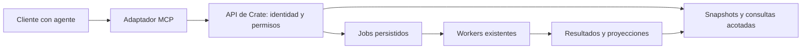

# Crate: mantenimiento mediante MCP

> **Estado (2026-11-18):** Propuesta exploratoria. Se concretó en [2026-10-15-crate-mcp-feature-plan.md](2026-10-15-crate-mcp-feature-plan.md) y está implementada en app/crate/mcp ([docs/technical/crate-mcp.md](../technical/crate-mcp.md)).

15 de octubre de 2026. Propuesta exploratoria para discusión, pendiente de aprobación. Alcance indicado por Diego: biblioteca y operaciones, con un catálogo acotado. Revisión estática del repositorio y documentación oficial del protocolo; sin acceso a producción ni implementación.

**La oportunidad es hacer delegable el mantenimiento de una instancia de Crate.** Un agente externo puede relacionar incidencias de biblioteca, estado de las colas y señales operativas; proponer una intervención; ejecutarla dentro de los permisos concedidos; y verificar su efecto. Crate mantiene las reglas, las autorizaciones y la ejecución determinista. El modelo y la conversación permanecen en el cliente del usuario.

Esto permite empezar con una experiencia útil sin incorporar un modelo, un chat ni un nuevo scheduler dentro de Crate. El protocolo aporta una interfaz común; el valor del producto está en los diagnósticos y acciones que exponemos.

**Tres encargos que deberían funcionar de principio a fin:**

1. «Revisa estos artistas y corrige las inconsistencias permitidas en la base de datos». Consultar incidencias, preparar cambios sobre IDs concretos, ejecutar los autorizados y repetir la comprobación. Informar por separado de lo corregido, lo omitido y lo que necesita intervención.
2. «El análisis lleva horas sin avanzar; averigua por qué». Relacionar tareas, heartbeat, capacidad, ventanas de ejecución, resource governor y errores recientes. Distinguir una espera normal de un fallo. Reintentar únicamente una operación admitida cuando la causa lo permita.
3. «Resume qué necesita atención en mi instancia». Entregar un informe breve con evidencias, antigüedad de los datos y siguientes acciones disponibles. Un agente programado externamente podría repetir este flujo en el futuro; MCP por sí mismo no programa ni ejecuta agentes.

El resultado interesante es cerrar el ciclo `observar → proponer → ejecutar → verificar`. Encolar una tarea no basta para declarar resuelto un problema.

**Crate ya dispone de una base considerable.**

| Base actual | Qué podemos aprovechar | Ajuste necesario para agentes |
| --- | --- | --- |
| Ops, health y task snapshots; métricas y logs | Diagnósticos con fuentes compartidas con Admin | Frescura y procedencia explícitas; salidas pequeñas; separar lectura de control |
| Catálogo de reparaciones y preview | Riesgo, alcance, acciones y versión del plan | Selección exacta vinculada a la ejecución y precondiciones verificadas en el worker |
| Jobs persistidos, Dramatiq, governor y deduplicación activa | Ejecución asíncrona, progreso, control de carga | Idempotencia de la solicitud, identidad consistente y semántica clara de retry/cancel |
| Capabilities y audit log | Vocabulario de permisos y registro de acciones | Credenciales específicas para agentes y trazabilidad completa |

Referencias locales: [ops snapshot](../../app/crate/api/admin_ops.py), [catálogo](../../app/crate/repair_catalog.py), [preview y ejecución](../../app/crate/api/management.py), [creación de tareas](../../app/crate/db/repositories/tasks_creation.py), [permisos](../../app/crate/api/permissions.py).

**Catálogo inicial propuesto: once herramientas.** Los nombres son contratos candidatos, no capacidades MCP ya implementadas. Cada herramienta combina parámetros tipados, límites del servidor y respuestas estructuradas. Las operaciones de escritura se incorporan después de reforzar los contratos compartidos.

| Herramienta | Encargo | Límite inicial |
| --- | --- | --- |
| `get_instance_status` | Estado operativo, colas, almacenamiento y frescura de las proyecciones | Datos disponibles en snapshots; lo desconocido se devuelve como desconocido |
| `list_library_issues` | Incidencias filtradas por entidad, check y riesgo | Paginación y cantidades acotadas |
| `inspect_artist` | Contexto de un artista y sus incidencias | ID estable; incluye resolución de una búsqueda ambigua antes de actuar |
| `list_jobs` | Tareas activas o fallidas y motivo de espera disponible | Filtros, límites y parámetros saneados |
| `get_job` | Estado, progreso, resultado y diagnóstico de una tarea | Resultado operativo distinguido del estado de la cola |
| `read_diagnostics` | Métricas y fragmentos de logs relevantes | Componentes/métricas enumerados, ventana temporal y tamaño máximos |
| `preview_repairs` | Preparar cambios exactos sobre incidencias seleccionadas | Allowlist de checks; versión, objetivos, precondiciones y caducidad |
| `run_health_check` | Comprobar entidades seleccionadas | Job deduplicado; alcance explícito y presupuesto de trabajo |
| `apply_repairs` | Ejecutar el plan autorizado | Plan vigente e inmutable; allowlist pequeña; identidad e idempotencia |
| `retry_job` | Reintentar una operación recuperable | Tipos y estados admitidos, permisos originales, límite de intentos |
| `cancel_job` | Solicitar la cancelación de una tarea | Solo tareas autorizadas y handlers con cancelación comprobada |

`inspect_artist` debe ofrecer candidatos cuando un nombre sea ambiguo; las mutaciones siempre usan IDs. Un contrato de herramienta no tiene por qué corresponder a un solo endpoint. Tampoco justifica crear un endpoint genérico que acepte cualquier tipo de tarea o parámetros arbitrarios.

Los primeros comandos de biblioteca serían comprobaciones dirigidas y una reparación concreta, como la coherencia de `has_photo`, después de revisar su fixer y sus efectos. La etiqueta `safe` del catálogo ayuda a seleccionar candidatos; no sustituye esa revisión. Enrichment, reanálisis, carátulas y sincronizaciones parciales pueden ampliar el catálogo cuando exista evidencia de uso. Las deduplicaciones destructivas, reorganizaciones globales, borrados, reinicios y cambios de configuración global quedan para otra evaluación.

**Arquitectura recomendada para el piloto: adaptador Python sobre la API.**

Hay tres opciones de integración:

| Opción | Ventaja | Coste | Valoración |
| --- | --- | --- | --- |
| Adaptador MCP que llama a REST | Aprovecha contratos y guards existentes; aislable del runtime principal | Credencial interna, salto HTTP y normalización de respuestas | Recomendada para validar el producto |
| MCP integrado en FastAPI sobre servicios compartidos | Un despliegue y acceso directo a servicios de aplicación | Extraer algunos servicios; revisar auth, lifespan y bloqueo del event loop | Alternativa razonable si prima un solo servicio |
| Generar herramientas desde todo OpenAPI | Reduce trabajo inicial de mapeo | Expone una superficie extensa y semánticas demasiado amplias | Poco adecuado para este alcance |

El adaptador HTTP puede ejecutarse como proceso o contenedor independiente. Un sidecar facilita aislar dependencias y desactivarlo, pero no es requisito del contrato. El acceso al backend usa una URL fija y rutas nominadas. Mantener la lógica de negocio en Crate permite que Admin y MCP reciban las mismas mejoras. No hace falta rehacer el backend para probar la idea.

El [SDK oficial de Python](https://github.com/modelcontextprotocol/python-sdk) encaja con el stack; habría que fijar una versión y comprobar su compatibilidad al implementar. Para un endpoint remoto usaría Streamable HTTP; stdio puede servir para una integración local. Ambos transportes están definidos por [MCP](https://modelcontextprotocol.io/specification/2026-07-28/basic/transports).

**La autorización es una parte del producto que todavía falta.**

REST utiliza actualmente identidad de usuario y permisos por rol. La API key existente pertenece a OpenSubsonic. No encontramos credenciales de mantenimiento con scopes propios. Además, leer el snapshot de tareas exige `ops.tasks.manage`, el mismo permiso usado en controles de mayor impacto. [Autenticación REST](../../app/crate/api/auth.py), [tareas](../../app/crate/api/tasks.py).

Propondría credenciales revocables por integración, con acceso de lectura o a operaciones nominadas. La API debe reconocer y limitar al principal del agente, incluso si alguien intenta usar su credencial directamente contra REST. Ocultar herramientas en MCP no es un control suficiente. Los endpoints que hoy solo exigen autenticación necesitan un tratamiento explícito para estas identidades.

Para el piloto privado puede bastar una credencial preconfigurada si el cliente la admite. Una integración remota interoperable debe resolver el flujo de autorización MCP basado en OAuth y validar la audiencia del token. El tramo agente→MCP y el tramo MCP→API son distintos; un JWT de sesión de Crate no equivale automáticamente a ese contrato. [Especificación de autorización](https://modelcontextprotocol.io/specification/2026-07-28/basic/authorization).

Las operaciones de bajo impacto previamente concedidas pueden ejecutarse sin una confirmación por llamada. Una futura operación sensible necesita autorización vinculada al plan y emitida por una vía confiable; un argumento `confirm=true` enviado por el propio agente no demuestra consentimiento humano. Los hints de las herramientas describen comportamiento y no reemplazan la política del servidor. [Contrato de herramientas MCP](https://modelcontextprotocol.io/specification/2026-07-28/server/tools).

Crate tiene un precedente útil en los grants con restricciones de federación; podemos aprender de ese modelo sin reutilizar sus credenciales ni convertir un agente en un peer. [Autorización de federación](../../app/crate/federation/authorization.py).

**Tres contratos necesitan especial atención antes de habilitar escrituras.**

1. **Plan y ejecución.** Hoy `repair-issues` comprueba `plan_item_ids`, pero encola `body.issues` completo. La versión del plan es opcional y los IDs seleccionados no se trasladan al job. Para MCP, la selección debe determinar exactamente qué ejecuta el worker; hay que comprobar otra vez las precondiciones al empezar y antes de efectos que puedan haber quedado obsoletos. Una discrepancia produce `PLAN_STALE`, no un ajuste silencioso. [Implementación](../../app/crate/api/management.py).
2. **Retry e idempotencia.** El retry actual clona tipo y parámetros sin comprobar que la tarea esté fallida ni revalidar el permiso de la operación original. La deduplicación existente evita ciertos trabajos simultáneos; una repetición después de terminar puede crear otro. Se necesita una clave de idempotencia persistida, ligada al principal y a los argumentos, que devuelva el mismo resultado de aceptación dentro de una ventana documentada. Reutilizarla con otros argumentos debe fallar. [Retry](../../app/crate/api/tasks.py).
3. **Resultado y cancelación.** La API marca `cancelled`, pero la detención efectiva depende del handler. Cancelar no revierte efectos. Del mismo modo, `completed` puede incluir un resultado omitido o un trabajo que solo preparó análisis posterior. Las herramientas deben conservar estas distinciones y comprobar la condición que motivó la intervención. [Cancelación](../../app/crate/api/tasks.py).

La respuesta de una mutación devuelve inmediatamente su `job_id`, estado de aceptación y próxima consulta. Los jobs siguen ejecutándose si el cliente se desconecta. El agente consulta progreso con backoff y verifica después el resultado de dominio. No hace falta mantener una llamada MCP abierta durante un análisis completo.

La auditoría relaciona identidad, credencial, herramienta, argumentos saneados, plan, solicitud y job; también conserva denegaciones y fallos. Se puede ampliar el registro existente sin diseñar otro framework de eventos. La identidad del actor procede de la autenticación y se conserva durante todo el trabajo, nunca de un argumento libre del modelo.

**El diagnóstico debe expresar incertidumbre y coste.**

Con unas 48.000 pistas y 1,2 TB, las herramientas deben consultar superficies precalculadas, paginar y trabajar sobre selecciones. Los barridos y análisis pesados se encolan. El adaptador evita `fresh=true` por defecto y no debe provocar reconstrucciones síncronas costosas cuando falta un snapshot; ese comportamiento necesita verificarse y ajustarse en los endpoints elegidos.

Un ejemplo concreto es `/api/quality`: actualmente calcula el informe recorriendo la biblioteca de forma síncrona. Existe almacenamiento para un snapshot de calidad, pero la revisión de referencias no localizó un productor conectado a esa ruta. Ofrecer calidad como herramienta barata requiere primero completar ese flujo asíncrono. [Ruta actual](../../app/crate/api/analytics.py).

Cada resultado de diagnóstico debería distinguir `observed_at`, `stale`, fuente y comprobaciones no disponibles. Un worker que produjo logs en las últimas 24 horas no está necesariamente vivo. Un job pendiente puede esperar por capacidad o por una ventana de descargas. Algunos fallbacks del snapshot de tareas incluyen valores por defecto para servicios que no equivalen a probes reales. Presentar esos datos como certezas produciría decisiones incorrectas. [Caché](../../app/crate/db/ops_snapshot.py), [fallback](../../app/crate/db/admin_tasks_surface.py).

Las respuestas limitan logs y campos sensibles; texto de metadatos y errores se trata como datos, no como instrucciones. Presupuestos por credencial, concurrencia e intervalos de consulta evitan bucles de reintentos y trabajo repetido. Los mismos workers y governor siguen regulando la carga. Si API o base de datos están caídas, este MCP tiene capacidad de recuperación limitada: el acceso de infraestructura continúa siendo otra herramienta operativa.

**Piloto propuesto y criterio para ampliarlo.**

Primera entrega: diagnóstico de biblioteca y operaciones con las herramientas de lectura; preview acotado; credencial de mínimo privilegio; resultados pequeños y trazables. Validar que el agente explica correctamente una espera por governor, una incidencia persistida y un dato obsoleto.

Segunda entrega: comprobación dirigida, una reparación revisada y retry/cancel de una lista pequeña de tareas. Previamente, cerrar plan→ejecución, permisos, idempotencia y actor en los contratos compartidos. Repetir una solicitud no debe duplicar trabajo; un plan obsoleto no debe ejecutarse; una credencial de lectura no puede mutar por MCP ni por REST.

La demostración de valor sería: localizar una incidencia real, proponer un cambio exacto, ejecutarlo con los permisos adecuados y mostrar evidencia de que quedó resuelta. Medir intervenciones manuales necesarias, acciones duplicadas, resultados mal interpretados, carga añadida y tiempo hasta el diagnóstico. Una vez demostrado ese ciclo, priorizar nuevas herramientas a partir de encargos reales.

Una futura vista en Admin podría mostrar integraciones autorizadas y actividad de los agentes con enlaces a planes y tareas. Esto haría visible y revocable la delegación sin incorporar un chat al producto. Es una evolución posible, no un requisito del piloto.
