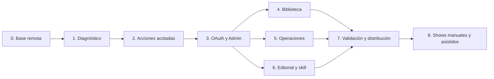

# Crate MCP — Feature Implementation Plan

> **For agents:** REQUIRED SUB-SKILL: Use viterbit:executing-plans to implement this plan task-by-task.
> **Estado: plan aprobado por Diego el 2026-10-16. Fases 0–8 implementadas en feat/crate_mcp, PR #292. El corte publicado de fase 7, f80679ee, tiene CI verde; fase 8 incorpora revisión SPEC/QUALITY, correcciones con regresiones y el gate local final descrito abajo. Consultar el CI y la persistent review del HEAD exacto de la misma PR para su gate publicado. Despliegue y activación pendientes.**

**Goal:** Entregar el MCP remoto completo de Crate para diagnóstico, mantenimiento de biblioteca, operaciones y creación de playlists editoriales, con permisos, planes revisables, auditoría, gestión en Admin y una skill editorial distribuible. Incluye el alta manual/asistida de shows añadida como fase 8. El piloto es el primer incremento de la feature.

**Architecture:** Adaptador MCP dentro de crate-api, con identidad de integración y autorización explícita por herramienta. Reutiliza consultas, proyecciones y operaciones de Crate; el trabajo largo se ejecuta en los workers actuales. Las lecturas del MCP no construyen snapshots ni lanzan mantenimiento.

**Tech Stack:** Python 3.13, FastAPI/ASGI, SDK oficial Python MCP con versión fijada al validar compatibilidad, Pydantic, PostgreSQL, Dramatiq y projector existentes.

**Entrega fases 0/1 (2026-10-16):** implementadas en [PR #292](https://github.com/thecrateapp/crate/pull/292). SDK oficial 2.3.0, credenciales dedicadas, seis herramientas, migraciones 109/110, diagnóstico sin mutaciones funcionales y productor health acotado. Evidencia y reproducción en [guía MCP](../technical/crate-mcp.md#validation-record--2026-10-16). El endpoint permanece desactivado por defecto.

**Fase 2 (2026-10-16):** implementada y validada para revisión tras “siguiente fase”: comprobación dirigida, planes persistidos de un único flag, ejecución/verificación y retry/cancel acotados. Migración 111; gate adicional `CRATE_MCP_ACTIONS_ENABLED=false` por defecto. 866 casos backend verificados, PostgreSQL/Redis reales y recorrido SDK por HTTP local; [evidencia](../technical/crate-mcp.md#phase-2-validation--2026-10-16). Limitación explícita: un crash tras el cambio puede dejar verificación pendiente sin recuperación automática del actor terminal. Fase 4 en progreso; fases 5–7 pendientes.

**Fase 3 (2026-10-16):** conexión OAuth con Authlib 1.9.1/SDK MCP 2.3.0, consent y gestión/revocación de conexiones propias; Admin para credenciales, clientes, grants y actividad; aprobación humana exacta ligada a política/delegación, con reserva transaccional. Migraciones 112/113 y configuración API/workers desactivada por defecto. Gate real sobre PostgreSQL/Redis con MCP Python SDK y Authlib por TCP, sin afirmar compatibilidad de Codex CLI ni del proxy público. Revisión de conformidad y calidad aprobadas; tres carreras reproducidas y corregidas con regresiones concurrentes. [Evidencia](../technical/crate-mcp.md#phase-3-validation--2026-10-16). Entrega de fases 2/3 en la PR #292; activación en producción pendiente.

**Fase 4 (2026-10-16, completada y validada localmente):** catálogo de 17 checks con 11 variantes automáticas condicionadas y seis manuales; motor común de planes/jobs con aprobación obligatoria por riesgo/alcance global; selección canónica y preparación asíncrona compartida con Admin; metadata/enrichment, generaciones DSP, sync de álbumes indexados, calidad desde snapshot y exportación/rehydrate mediante presets con artifacts autorizados. Migración 114, revisión completa por dominio y resultados separados de aceptación/verificación. Las regresiones de identidad de sync, tamaños tras editar tags y reconciliación tras timeout/zombie están corregidas. El contrato compacto de resultados y su paginación preservan el diff completo y la evidencia privada; los casos de bio/setlists extensos, replay, ownership y cursores obsoletos están probados por SDK. Conformidad y calidad/seguridad aprobadas sin P1/P2 pendientes; validación acotada y medición de carga sintética con PostgreSQL/Redis reales documentadas. Fases 5–8 pendientes. [Guía de fase 4](../technical/crate-mcp.md#phase-4-library-maintenance--2026-10-16); el [primer bloque](../technical/crate-mcp.md#phase-4-foundation-checkpoint--2026-10-16) se conserva como evidencia histórica.

**Fase 5 (2026-10-16):** control catalogado de jobs propios y de instancia con permisos originales; cancelación cooperativa y evidencia parcial; auditoría/series acotadas; schedules y política de runtime con CAS y adopción real en Dramatiq; operaciones compartidas con Admin. Migración 115, 40 herramientas y 24 grants explícitos, con un slot de control reservado y cerrado a cancelaciones. Conformidad y calidad revisadas; regresiones focalizadas de PostgreSQL/SDK/Admin y rollback. [Guía de fase 5](../technical/crate-mcp.md#phase-5-instance-operations--2026-10-16). Siguiente fase: 6, playlists editoriales y skill. Relevo portable: [Linux](2026-10-16-crate-mcp-linux-handoff.md).

**Fase 6 (2026-10-16, corte Linux validado localmente):** migración 116; cuatro grants editoriales; nueve herramientas MCP de lectura, preparación, revisión y publicación; planes privados completos en el motor común, selección inicial smart congelada y política de refresh separada; aplicación atómica con CAS, locks y exclusiones; refinamiento Admin ligado a propuesta/actor/revisión; `/generate` y scheduler con admisión deduplicada; skill distribuible. La selección focalizada de fase 6 pasó 37 casos PostgreSQL; un cliente SDK MCP sobre ASGI cubrió create/edit, aprobación, replay y conflicto, sin tocar producción. Dos casos de PlaylistEditor, typecheck y ESLint dirigidos, Ruff y validador de skill pasaron. La evaluación independiente de la skill resolvió seis fixtures (temática, smart, locks, escasez acotada, concurrencia y solo preparar); segundas revisiones SPEC/QUALITY no hallaron P1/P2 pendientes. La carga de portadas queda en Admin porque MCP aún no tiene staging privado de assets; el enlace Listen solo se ofrece para playlists activas con origen configurado. [Guía de fase 6](../technical/crate-mcp.md#phase-6-editorial-playlists--2026-10-16). No se han ejecutado suites completas ni se han activado flags.

**Fecha:** 2026-10-15. **Rama:** feat/crate_mcp. **Base:** origin/main, 2451aa7537d15f7790edca565fb64367982e7b2a.
**Worktree:** /Users/diego/.codex/worktrees/crate-mcp/musicdock.

---

**Decisiones confirmadas y propuestas para revisión**

Diego ha confirmado biblioteca y operaciones, catálogo acotado, diagnóstico antes de acciones, conexión desde agentes remotos, rama feat/crate_mcp desde main y revisión del plan antes de implementar. Ha precisado que el plan debe cubrir la feature completa, incluyendo valorar una skill de playlists editoriales basada en Admin. Este plan incorpora esa skill como propuesta para revisión.

Propongo un ajuste respecto al approach inicial: alojar el adaptador HTTP dentro de crate-api. El sidecar sobre REST obligaría a gestionar autenticación en dos tramos o a reenviar credenciales. Dentro del proceso podemos compartir operaciones de aplicación y mantener un solo principal por llamada. El coste es compartir dependencias y recursos con la API: por eso compatibilidad, lifecycle, concurrencia y comportamiento desactivado son criterios de la fase 0.

Para el **piloto privado**, propongo Bearer opaco individual por integración, provisionado por el operador. Esto solo cubre clientes remotos que permiten configurar Authorization; **no equivale al flujo OAuth interoperable de MCP**. La fase 0 debe demostrar compatibilidad con el cliente real elegido. Si ese cliente exige OAuth, adelantar 3.1 y el consent mínimo de 3.2; estas piezas dependen de 0, no de las acciones de fase 2; no sustituirlo por un token admin. OAuth con discovery, consent y revocación forma parte de la feature completa.

También propongo acotar la primera escritura a la coherencia del flag has_photo de **un artista**. La etiqueta safe del catálogo no basta: el fixer actual requiere las correcciones descritas en la fase 2.

**Resultado visible y puntos de revisión**

| Fase | Entrega | Condición de salida |
| --- | --- | --- |
| 0. Conexión e identidad | Endpoint remoto protegido, desactivado por defecto | Cliente real conecta; revocación y aislamiento funcionan; API mantiene sus contratos |
| 1. Diagnóstico | Seis herramientas de lectura de biblioteca y operaciones | Evidencia correcta, frescura y cobertura explícitas; ninguna mutación de biblioteca o cola |
| 2A. Comprobar y preparar | Health check dirigido y preview persistido | Trabajo acotado, identidad estable y plan exacto |
| 2B. Reparar | Aplicar un plan de foto válido | Cambio único, idempotente, auditado y comprobado después |
| 2C. Control operativo limitado | Retry de comprobaciones fallidas y cancelación de pendientes | Permisos, ownership y carreras cubiertos; sin control genérico de workers |
| 3. Acceso remoto y Admin completos | OAuth, integraciones, grants, aprobaciones y actividad | Dos clientes interoperan; consent, revocación y aprobación exacta funcionan |
| 4. Mantenimiento de biblioteca completo | Reparaciones catalogadas, metadata, enrichment, análisis, sync y portabilidad | Cada acción cumple su contrato de impacto, plan, worker y verificación |
| 5. Operaciones completas | Jobs catalogados, schedules, límites y política de ejecución | Acciones sobre tareas propias y de instancia según grants; carreras y efectos comprobados |
| 6. Editorial y skill | Planificar, revisar, crear/editar y publicar playlists estáticas/smart | Selección exacta, reglas y overrides preservados; skill validada con encargos reales |
| 7. Cierre de producto | Evaluaciones, documentación, distribución y rollout | Catálogo v1 completo, pruebas de integración, compatibilidad y recuperación verificadas |
| 8. Shows manuales y asistidos | Alta desde Admin y MCP, visión y OCR local gratuito | Todas las fechas revisables, dedupe durable y uso sin LLM |

Se revisan los resultados de fase 1 antes de habilitar herramientas de acción. Cada operación permanece desactivada hasta pasar su validación. Las fases 4, 5 y 6 pueden avanzar en paralelo tras los contratos comunes de 2 y 3; la editorial no necesita esperar a completar todas las reparaciones. El orden refleja dependencias, no exige un único PR por fase.

El módulo OAuth de 3.1 puede adelantarse tras 0 si el primer cliente lo exige; el gráfico representa el resto de dependencias de producto.

La feature v1 cubre los dominios y herramientas descritos abajo; no consiste en exportar todo OpenAPI. Quedan fuera SQL/shell/HTTP arbitrarios, Docker socket, deploy/restart del host, wipe/rebuild global, administración de usuarios por agentes, adquisiciones automáticas y un scheduler nuevo. Las automatizaciones pueden usar MCP desde clientes externos. Los cambios destructivos del catálogo de reparación sí se contemplan en fase 4, con plan exacto, aprobación humana independiente y readiness por operación.

**Contrato propuesto del piloto**

Endpoint canónico configurable: https://api.<dominio>/mcp. Routing directo a crate-api, sin readplane ni caché de proxy. Streamable HTTP, respuestas estructuradas, autenticación en cada petición y contexto de principal aislado por llamada. Una conexión o identificador de sesión no concede permisos. El SDK gestiona el protocolo; el montaje debe evitar redirects ambiguos /mcp ↔ /mcp/ y coexistir con las rutas existentes.

| Herramienta | Entrada principal | Permiso de integración | Fase |
| --- | --- | --- | --- |
| get_instance_status | Sin refresh | ops.status.read | 1 |
| list_library_issues | Check/severidad/artista opcionales, limit, cursor | library.health.read | 1 |
| inspect_artist | UID o búsqueda de nombre; nunca resolver silenciosamente una ambigüedad | library.health.read | 1 |
| list_jobs | Estados/tipos permitidos, limit, cursor | ops.jobs.read | 1 |
| get_job | job_id | ops.jobs.read | 1 |
| read_diagnostics | Fuente enumerada, filtros temporales/task_id, límite | ops.logs.read o ops.status.read según fuente | 1 |
| run_health_check | Un artist_uid; solo has_photo_desync; idempotency_key | library.health.run | 2A |
| preview_repairs | Un issue_id del check permitido | library.repair.photo_flag | 2A |
| apply_repairs | plan_id, plan_version, idempotency_key | library.repair.photo_flag | 2B |
| retry_job | job_id, idempotency_key | ops.jobs.retry y permiso de la operación original | 2C |
| cancel_job | job_id | ops.jobs.cancel_pending | 2C |

Nombres y permisos son nuevos y propuestos. Las credenciales de diagnóstico solo reciben los cuatro permisos de lectura; no heredan roles admin/ops. La biblioteca observada es la local, no el catálogo federado. Las lecturas operativas pueden abarcar tareas de la instancia; las acciones solo alcanzan tareas propias de la integración y del catálogo habilitado.

El catálogo estático de checks se incluye de forma acotada en inspect_artist y en descripciones de las herramientas; no dependemos de soporte de Resources/Prompts del cliente para completar el piloto. El resultado distingue auto_fixable, risk y can_execute_for_this_principal.

Respuesta de diagnóstico:

- schema_version, availability (available/stale/unavailable), source, observed_at y razón de datos incompletos.
- Metadata del snapshot cuando aplica: built_at, version, source_seq y estado de invalidación.
- data, returned_count, truncated y next_cursor; total solo cuando se conoce.
- Fecha del último check separada de la fecha de construcción del snapshot.
- Errores tipados: FORBIDDEN, INVALID_ARGUMENT, SNAPSHOT_UNAVAILABLE, CURSOR_STALE, RATE_LIMITED; más PLAN_STALE, IDEMPOTENCY_CONFLICT y STATE_CONFLICT en acciones.

Límites iniciales propuestos, sujetos a la medición del piloto: páginas de 20/máximo 100 elementos; logs máximo 100 entradas, ventana máxima 24 h y texto máximo 2 KiB por entrada; respuesta máxima 64 KiB UTF-8; máximo dos operaciones concurrentes y 60 lecturas/minuto por integración. Un job de mantenimiento activo por integración, reservado atómicamente al aceptar el comando. La política también pone un límite global compatible con la capacidad del proceso API.

Frescura inicial propuesta y configurable por fuente: ops fresh hasta 60 s y stale hasta 300 s; heartbeat fresh hasta 60 s, después evidencia antigua y nunca prueba de proceso vivo; checks health fresh hasta 24 h, históricos hasta 7 días y después fuera de evaluación vigente. Estos umbrales describen edad, no certifican salud. Una acción exige observación dirigida de como máximo 15 min y revalidación en el worker. Probar los bordes con reloj fijo; built_at no sustituye observed_at.

No hay reintentos o paginación ocultos. Se devuelven códigos y retry_after cuando proceda. Metadata, logs y errores son datos no confiables: se proyectan campos permitidos y se eliminan secretos, rutas innecesarias y payloads libres. Las lecturas pueden registrar auditoría/acceso; no alteran biblioteca, issues, jobs, schedules ni snapshots.

**Fase 0 — conexión remota e identidad**

**Tarea 0.1. Fijar contrato y compatibilidad del transporte.**

Archivos existentes a integrar: [requirements-api.txt](/Users/diego/.codex/worktrees/crate-mcp/musicdock/app/requirements-api.txt), [create_app y lifespan](/Users/diego/.codex/worktrees/crate-mcp/musicdock/app/crate/api/__init__.py), [config](/Users/diego/.codex/worktrees/crate-mcp/musicdock/app/crate/config.py), [Compose dev](/Users/diego/.codex/worktrees/crate-mcp/musicdock/docker-compose.dev.yaml), [Compose producción](/Users/diego/.codex/worktrees/crate-mcp/musicdock/docker-compose.yaml) y [Compose home](/Users/diego/.codex/worktrees/crate-mcp/musicdock/docker-compose.home.yaml).

Crear propuestos: /Users/diego/.codex/worktrees/crate-mcp/musicdock/app/crate/mcp/server.py, /Users/diego/.codex/worktrees/crate-mcp/musicdock/app/crate/mcp/schemas.py y /Users/diego/.codex/worktrees/crate-mcp/musicdock/app/tests/test_mcp_transport.py.

Pasos: definir inputs/outputs y tabla tool→permiso; escribir pruebas del boundary ASGI; fijar versión del SDK compatible con las dependencias resueltas; montar /mcp detrás de CRATE_MCP_ENABLED=false por defecto; integrar explícitamente su lifecycle en el lifespan del host; validar host/origin y HTTPS en el despliegue seleccionado.

La decisión de habilitar el endpoint es configuración de despliegue. El catálogo de escritura tiene un control independiente, desactivado por defecto. Importar/arrancar la API con ambos desactivados mantiene el comportamiento actual. Trabajo síncrono de DB/Redis se ejecuta fuera del event loop, con concurrencia limitada; no llamar handlers REST desde herramientas.

Salida: prueba HTTP real de descubrimiento y llamada con el SDK cliente y con al menos un host agente que permita Bearer configurado; desconexión y shutdown limpios; error de protocolo/auth sin stack trace. Registrar cliente y versión. No afirmar compatibilidad con clientes no probados.

**Tarea 0.2. Identidad de integración y credenciales.**

Crear propuestos: /Users/diego/.codex/worktrees/crate-mcp/musicdock/app/crate/agent_access.py, /Users/diego/.codex/worktrees/crate-mcp/musicdock/app/crate/mcp/auth.py, /Users/diego/.codex/worktrees/crate-mcp/musicdock/app/crate/db/repositories/agent_credentials.py, /Users/diego/.codex/worktrees/crate-mcp/musicdock/app/crate/db/schema_sections/agent_access_v109.py, /Users/diego/.codex/worktrees/crate-mcp/musicdock/app/crate/db/migrations/versions/109_agent_access.py y /Users/diego/.codex/worktrees/crate-mcp/musicdock/app/crate/agent_credentials_cli.py.

109 es el siguiente ID en esta base; volver a comprobar el head al implementar. No modificar migraciones publicadas. Seguir el patrón de bootstrap, downgrade y pruebas de schema del repositorio.

Modelo mínimo: principal estable por integración (ID, nombre, enabled, grants); credenciales revocables (ID, principal, digest, created/expires/revoked). Secretos aleatorios de alta entropía, visibles una vez, nunca almacenados en claro. CLI operada por el propietario para crear, listar sin secretos, rotar y revocar. Nada de provisioning por MCP.

El principal de integración es distinto de request.state.user. /mcp solo acepta su Bearer dedicado: no cookie, query token, usuario humano ni Remote-User como fallback. Fuera de /mcp, una credencial MCP no autentica rutas humanas, media, Subsonic o federación; rechazar también combinaciones ambiguas de credenciales. El agente no puede proporcionar actor_id ni modificar grants.

Validar credencial, expiración, revocación y permisos en cada llamada; no cachear autorización en el piloto. Auditoría saneada con principal_id, credential_id, tool y trace_id, sin convertirlos en user_id ficticios. Una credencial revocada pierde acceso en su siguiente llamada. Las acciones pendientes volverán a validar autorización al ejecutarse.

Pruebas propuestas: /Users/diego/.codex/worktrees/crate-mcp/musicdock/app/tests/test_agent_credentials.py, /Users/diego/.codex/worktrees/crate-mcp/musicdock/app/tests/test_mcp_auth.py y /Users/diego/.codex/worktrees/crate-mcp/musicdock/app/tests/test_agent_access_migration.py. Matriz: anónimo, inválido, expirado, revocado, scope insuficiente, contexto mezclado entre dos clientes, token en otra ruta, cookies/forward-auth no aceptados. Mantener verdes [auth](/Users/diego/.codex/worktrees/crate-mcp/musicdock/app/tests/test_auth.py), [permissions](/Users/diego/.codex/worktrees/crate-mcp/musicdock/app/tests/test_permissions.py) y [schema](/Users/diego/.codex/worktrees/crate-mcp/musicdock/app/tests/test_crate_schema_definition.py).

**Fase 1 — diagnóstico de biblioteca y operaciones**

**Tarea 1.1. Lecturas puras, frescura y cobertura.**

Crear propuestos: /Users/diego/.codex/worktrees/crate-mcp/musicdock/app/crate/agent_diagnostics.py, /Users/diego/.codex/worktrees/crate-mcp/musicdock/app/crate/db/queries/agent_library.py y /Users/diego/.codex/worktrees/crate-mcp/musicdock/app/crate/db/queries/agent_operations.py.

Reutilizar [snapshot reads](/Users/diego/.codex/worktrees/crate-mcp/musicdock/app/crate/db/ui_snapshot_reads.py), [ops](/Users/diego/.codex/worktrees/crate-mcp/musicdock/app/crate/db/ops_snapshot.py), [health surface](/Users/diego/.codex/worktrees/crate-mcp/musicdock/app/crate/db/admin_health_surface.py), [runtime state](/Users/diego/.codex/worktrees/crate-mcp/musicdock/app/crate/db/ops_runtime.py) y [worker logs](/Users/diego/.codex/worktrees/crate-mcp/musicdock/app/crate/db/worker_logs.py).

Agregados desde snapshots; detalle de artista/job y logs mediante lecturas persistidas indexadas y acotadas. No agregar library_tracks en HTTP. Resolver IDs en lote; sin N+1. No invocar get_cached_* que reconstruya ante un miss, quality_report, get_schedules con migración implícita, probes ni filesystem.

Añadir un lector explícito que preserve metadata y permita observar snapshots envejecidos sin cambiar el comportamiento del lector actual. Un snapshot invalidado se marca unavailable para conclusiones vigentes; si se incluye como evidencia histórica, debe estar inequívocamente invalidated y no mezclarse con datos actuales.

Ops ya tiene warming en projector. Para health, reutilizar su builder solo desde el productor background: clave canónica y warm periódico coalescido, no una key por filtro del agente. Proponer frecuencia inicial 60 s, medir coste; un fallo conserva el último dato y su antigüedad. No es necesario construir nuevos snapshots de tareas/logs: consultas acotadas sobre sus datos persistidos bastan.

La muestra health se materializa con un límite fijo y cobertura explícita. Cursor ligado a versión/filtros/offset, con CURSOR_STALE si cambia la versión. Fin de cursor no implica inventario completo si truncated=true. El detalle dirigido por artista puede usar consulta persistida limitada para evitar perder un artista fuera de la muestra.

Preservar observed_at de cada fuente. No interpretar postgres=true o watcher=true constantes como probes. No interpretar presencia en logs como liveness. Una cola pendiente puede esperar por governor/ventana; devolver la evidencia disponible y unknown donde no haya causa conocida. Un snapshot recién construido no rejuvenece un heartbeat antiguo.

Pruebas propuestas: /Users/diego/.codex/worktrees/crate-mcp/musicdock/app/tests/test_agent_diagnostics.py y /Users/diego/.codex/worktrees/crate-mcp/musicdock/app/tests/test_agent_diagnostic_reads.py. Extender [ops](/Users/diego/.codex/worktrees/crate-mcp/musicdock/app/tests/test_ops_snapshot.py), [health persistence](/Users/diego/.codex/worktrees/crate-mcp/musicdock/app/tests/test_health_issue_persistence.py), [DB](/Users/diego/.codex/worktrees/crate-mcp/musicdock/app/tests/test_db.py) y [projector](/Users/diego/.codex/worktrees/crate-mcp/musicdock/app/tests/test_projector.py).

Casos: fresh/stale/invalidated/missing; cero real frente a dato desconocido; muestra truncada; cursor obsoleto; artista ambiguo; redacción y límites Unicode; falla parcial. Tests deben fallar si la lectura llama builders, upsert, create_task, dispatch, filesystem o red externa. Con pg_db, verificar consultas acotadas y ausencia de cambios funcionales.

**Tarea 1.2. Publicar las seis herramientas y validar una sesión real.**

Crear propuestos: /Users/diego/.codex/worktrees/crate-mcp/musicdock/app/crate/mcp/tools.py, /Users/diego/.codex/worktrees/crate-mcp/musicdock/app/tests/test_mcp_diagnostics.py y /Users/diego/.codex/worktrees/crate-mcp/musicdock/docs/technical/crate-mcp.md.

Adaptadores pequeños: validar → autorizar → llamar operación de aplicación → serializar. Esquemas cerrados, enums, límites y campos desconocidos rechazados. Filtrar descubrimiento por permisos cuando el SDK lo permita, y comprobar permisos igualmente en tools/call. Cada resultado declara qué se sabe, qué falta y qué acción está disponible sin ejecutarla.

Validación determinista con reloj fijo:

| Escenario | Resultado exigido |
| --- | --- |
| Tarea fallida con error y logs relacionados | Diagnóstico con IDs y evidencias, sin retry automático |
| Worker antiguo, health ausente y flags optimistas | stale/unknown/unavailable; nunca declarar la instancia sana |
| Biblioteca permitida, ops denegado, payload grande y timeout parcial | Respetar permisos, acotar salida y devolver parcial sin escalada ni bucles |
| Artista con incidencia conocida | Resolver identidad, explicar check/riesgo y antigüedad; cero reparaciones |

Además de tests de contrato, ejecutar estos encargos con el cliente agente real sobre fixtures/dev y registrar tool calls/resultados. El juicio lingüístico del modelo se evalúa aparte de las garantías deterministas del servidor.

**Gate fase 1:** seis herramientas funcionales; snapshot cold no inicia trabajo; todas las mutaciones rechazadas con la credencial de lectura; ninguna regresión de auth/API; una sesión remota completa y evidencia guardada. Comparar carga API/DB antes/después con igual dataset y patrón de llamadas; fijar baseline y criterio de regresión antes de activar el piloto. El coste de lectura queda limitado con independencia de los 48K tracks.

**Fase 2A — comprobación dirigida y plan**

**Tarea 2.1. Comandos asíncronos e idempotencia durable.**

Crear propuestos: /Users/diego/.codex/worktrees/crate-mcp/musicdock/app/crate/agent_maintenance.py, /Users/diego/.codex/worktrees/crate-mcp/musicdock/app/crate/db/repositories/agent_requests.py y /Users/diego/.codex/worktrees/crate-mcp/musicdock/app/tests/test_agent_request_idempotency.py. Nueva migración aditiva, con ID siguiente al de fase 0, para request records y planes; reservarlo solo al implementar.

Reutilizar [creación de tareas](/Users/diego/.codex/worktrees/crate-mcp/musicdock/app/crate/db/repositories/tasks_creation.py) con session= y dispatch after commit. Transacción única para aceptación, request record, task y auditoría; un rollback no despacha nada. Scope de idempotencia: principal + operación + key; payload canónico con hash. Misma key/mismo payload devuelve el mismo job incluso completado; distinto payload devuelve conflicto. Retener el mapping compacto key/hash/job/estado mientras exista el principal. Se pueden purgar payloads según retención, pero un replay devuelve RESULT_EXPIRED y nunca ejecuta otra vez por haber limpiado el historial. Probar replay después de purgar el resultado.

Dedup activo es adicional a idempotencia: principal + operación + targets + parámetros/versiones efectivos. Devolver un ID existente solo con permiso para observarlo; conflictos con trabajo de otro actor devuelven TARGET_BUSY sin filtrar su ID. Reserva de cupo y creación de job en una transacción. Revalidar enabled/grants al comenzar el worker; revocación no deshace efectos ya producidos. Probar dos principales concurrentes sobre el mismo target.

run_health_check admite solo has_photo_desync de un artista identificado por UID. Hacer ese check realmente scoped en [health_check](/Users/diego/.codex/worktrees/crate-mcp/musicdock/app/crate/health_check.py) y [worker management](/Users/diego/.codex/worktrees/crate-mcp/musicdock/app/crate/worker_handlers/management.py); no reutilizar un recheck que inspeccione toda la biblioteca. El worker lee el filesystem y persiste la observación vinculada al run/UID. El preview posterior construye y persiste el plan exclusivamente a partir de esa evidencia en DB.

Tests: misma key después de completar; dos solicitudes concurrentes; payload distinto; crash tras commit y antes de respuesta; rollback sin dispatch; redelivery; revocación antes de ejecución; scope a un artista. Extender [dedup](/Users/diego/.codex/worktrees/crate-mcp/musicdock/app/tests/test_task_dedup.py), [health](/Users/diego/.codex/worktrees/crate-mcp/musicdock/app/tests/test_health_check.py) y [handlers](/Users/diego/.codex/worktrees/crate-mcp/musicdock/app/tests/test_management_handlers.py).

**Tarea 2.2. Preparar un plan exacto y persistido.**

preview_repairs acepta un issue del check permitido y usa la observación persistida de un health check dirigido reciente, ligada a run_id y artist_uid. Si falta o ha vencido, devuelve EVIDENCE_STALE y exige run_health_check; no escanea ni crea un job implícito. Persiste el plan y devuelve plan_id y before/after. El worker vuelve a observar el disco al aplicar.

Plan mínimo: principal, artist_uid, issue_id, check_type, observación del filesystem, before/after, precondiciones, versión/hash, created_at, expires_at y estado. Caducidad inicial propuesta 15 min. Un plan contiene un único cambio; no hace falta selección libre de múltiples ítems para el piloto.

Se muestra exactamente “actualizar has_photo de X a Y”; no descargar/modificar imágenes. El grant de esta acción autoriza su aplicación dentro del alcance revisado. No incluir confirm=true como mecanismo de aprobación. El plan es inmutable y se vuelve a comprobar al ejecutar.

Archivos: [repair](/Users/diego/.codex/worktrees/crate-mcp/musicdock/app/crate/repair.py), [artist repair jobs](/Users/diego/.codex/worktrees/crate-mcp/musicdock/app/crate/db/jobs/repair_artist_jobs.py), repositorio nuevo /Users/diego/.codex/worktrees/crate-mcp/musicdock/app/crate/db/repositories/agent_repair_plans.py y test nuevo /Users/diego/.codex/worktrees/crate-mcp/musicdock/app/tests/test_agent_repair_plans.py.

**Gate fase 2A:** chequeo y preview afectan a un único artista, no mutan has_photo ni lanzan scan/enrichment, el plan es trazable y una identidad diferente no puede aplicarlo.

**Fase 2B — primera reparación verificable**

**Tarea 2.3. Aplicar has_photo_desync por identidad y precondición.**

El fixer actual usa nombre y fs_has_photo del issue antiguo, no comprueba fila afectada y puede declarar applied aunque el artista ya no exista. Corregir la operación compartida para usar UID, observar de nuevo la foto, actualizar por identidad con precondición y devolver el resultado real.

El worker comprueba autorización, vigencia, identidad y estado esperado antes del cambio. Cambio de foto/valor/identidad relevante → PLAN_STALE o conflicto; artista inexistente → resultado explícito. Actualización DB, resultado del plan, auditoría y eventos en la misma transacción. Dispatch/invalidación sigue los mecanismos existentes.

Las entregas repetidas no reaplican un plan consumido: devuelven resultado persistido o verifican de manera explícita un estado ya alcanzado. Registrar applied/already_satisfied/conflict/failed y verificación por artista. Persistir el resultado aunque se corte la conexión del cliente.

La observación filesystem y la transacción DB no son atómicas entre sí: reobservar inmediatamente antes del cambio y verificar después; si el archivo cambia durante ese intervalo, conservar el resultado y señalar verificación pendiente/conflictiva en lugar de afirmar una coherencia permanente.

Revalidar solo el artista/check afectados. No resolver automáticamente una incidencia por el mero éxito del enqueue. get_job distingue aceptación, ejecución, verificación y proyección pendiente.

No exponer el /repair-issues genérico al agente. Extraer la operación corregida para reutilizarla también en el camino Admin de este check. El contrato general de selección múltiple de /repair-issues sigue fuera del piloto; antes de ampliar checks/batches habrá que corregir allí plan_item_ids y plan_version. Esta limitación queda registrada, no “solucionada” por un wrapper.

Pruebas propuestas: /Users/diego/.codex/worktrees/crate-mcp/musicdock/app/tests/test_agent_photo_repair.py. Extender [repair](/Users/diego/.codex/worktrees/crate-mcp/musicdock/app/tests/test_repair.py), [handlers](/Users/diego/.codex/worktrees/crate-mcp/musicdock/app/tests/test_management_handlers.py) y [health](/Users/diego/.codex/worktrees/crate-mcp/musicdock/app/tests/test_health_check.py). Casos: dry-run puro; artista renombrado/borrado; UPDATE sin fila; foto cambia tras preview; plan expirado; petición concurrente/redelivery; fallo de auditoría; único artista modificado; cero escrituras de imagen y cero revalidación global.

**Gate fase 2B:** recorrido remoto diagnosticar→comprobar→preview→apply→verificar exitoso con fixture real; el doble envío devuelve mismo job/resultado; un plan obsoleto no modifica la biblioteca.

**Fase 2C — control operativo acotado**

**Tarea 2.4. Retry y cancelación compatibles con carreras.**

retry_job solo admite health_check dirigido creado por esa misma integración, en failed, con el permiso original vigente y parámetros recuperados del servidor. Actor actual, retry_of, idempotencia y presupuesto limitado; no clonar repair ni tipos arbitrarios. Si la causa sigue siendo permanente, devolver no_retriable.

cancel_job solo admite health_check y repair propios del piloto que sigan pending. Transición condicional atómica pending→cancelled, compatible con el claim del actor; si ya comenzó, STATE_CONFLICT. Una repetición devuelve el resultado existente. No sobrescribir terminales ni prometer rollback o interrupción de running/delegated.

Reutilizar primitivas compartidas en [task updates](/Users/diego/.codex/worktrees/crate-mcp/musicdock/app/crate/db/repositories/tasks_updates.py), [actors](/Users/diego/.codex/worktrees/crate-mcp/musicdock/app/crate/actors.py) y [task API](/Users/diego/.codex/worktrees/crate-mcp/musicdock/app/crate/api/tasks.py). No envolver el retry/cancel genérico actual como autorización del agente. Los nuevos límites pertenecen a las operaciones de aplicación; el adapter MCP no contiene reglas de negocio duplicadas.

Pruebas: /Users/diego/.codex/worktrees/crate-mcp/musicdock/app/tests/test_agent_job_controls.py, [tasks API](/Users/diego/.codex/worktrees/crate-mcp/musicdock/app/tests/test_tasks_api.py) y [runtime](/Users/diego/.codex/worktrees/crate-mcp/musicdock/app/tests/test_task_runtime_contract.py). Ownership cruzado, tipo no permitido, tarea running/completed, retry sin permiso original, carrera cancel/claim y dos cancels concurrentes.

**Gate fase 2C:** ninguna acción puede alcanzar una tarea ajena o no catalogada; reintentar un check no duplica intención; cancelar pendiente y arrancar tarea tienen un único ganador.

**Fase 3 — acceso remoto y gestión completos**

**Tarea 3.1. OAuth interoperable con identidad de Crate.**

El producto terminado incluye autorización OAuth, no exige configurar headers manualmente. Arquitectura propuesta: MCP actúa como resource server usando el verificador del SDK; un módulo de authorization server en la misma aplicación reutiliza login/sesión de Crate para identificación y consent. Propuesta de implementación: Authlib core para grants/tokens, sujeto al gate de compatibilidad y al adaptador ASGI. Su función y límites están documentados en [Authlib Authorization Server](https://docs.authlib.org/en/stable/oauth2/authorization-server/); el papel de verificación del SDK se describe en [MCP SDK Authorization](https://py.sdk.modelcontextprotocol.io/run/authorization/). Su integración FastAPI como servidor requiere adaptación y pruebas: no confundir sus helpers de cliente OAuth con un authorization server listo.

Entregables: protected-resource metadata y authorization-server metadata; authorization code con PKCE S256 obligatorio; consent por cliente y scopes; validación de issuer/audience/resource; expiración, refresh con rotación y detección de reutilización, revocación; redirect URIs exactas. Registro inicial de clientes administrado y soporte de Client ID Metadata Documents según la versión MCP seleccionada. DCR solo como compatibilidad si lo requiere un cliente objetivo, con alcance revisado. Las URLs de metadata remota se validan para evitar acceso a destinos internos.

Persistir clientes, autorizaciones, códigos de un solo uso, digests de tokens/refresh y relación con principal/usuario que delega. No reutilizar los JWT de sesión como access tokens MCP. La sesión humana solo participa en login/consent: las llamadas MCP siguen sin aceptar cookies o Remote-User. El usuario ve los permisos que concede y puede revocarlos. Permisos efectivos = scopes emitidos ∩ concesión OAuth vigente ∩ grants de integración ∩ capacidades vigentes del actor delegante ∩ restricciones del target.

OAuth client identifica software; no identifica al actor. Cada conexión delegada conserva un principal estable ligado al usuario + cliente + instancia; dos usuarios del mismo cliente nunca comparten principal. Una integración de servicio tiene su concesión administrada independiente, sin heredar el rol del creador. Guardar authorization_id/grant_id, actor delegante y scopes aceptados en plan/request/job, desde autenticación. Ownership, cuotas e idempotencia siguen esa conexión. Antes de devolver un replay, autorizar de nuevo el acceso al resultado. Antes de ejecutar y de escribir, validar la concesión y capacidades actuales completas. La expiración normal del access token no cancela un job ya aceptado; revocar el grant/deshabilitar al actor sí impide nuevos efectos autorizados por él. Probar dos usuarios del mismo cliente y downgrade/revocación entre enqueue y ejecución.

Crear propuestos: /Users/diego/.codex/worktrees/crate-mcp/musicdock/app/crate/mcp/oauth.py, /Users/diego/.codex/worktrees/crate-mcp/musicdock/app/crate/api/mcp_oauth.py, /Users/diego/.codex/worktrees/crate-mcp/musicdock/app/crate/db/repositories/mcp_oauth.py y su migración aditiva. Reutilizar login desde [auth](/Users/diego/.codex/worktrees/crate-mcp/musicdock/app/crate/api/auth.py), sin confundir [native_oauth](/Users/diego/.codex/worktrees/crate-mcp/musicdock/app/crate/api/native_oauth.py) con un authorization server. Pruebas propuestas: /Users/diego/.codex/worktrees/crate-mcp/musicdock/app/tests/test_mcp_oauth.py y /Users/diego/.codex/worktrees/crate-mcp/musicdock/app/tests/test_mcp_oauth_integration.py.

**Gate:** dos clientes MCP remotos identificados por nombre/versión completan discovery, consent, lectura y revocación; token de otro recurso falla; PKCE plain, código reutilizado, refresh reutilizado y redirects no registrados se rechazan. Mantener el Bearer privado como modo explícito de integración administrada, sin presentarlo como OAuth.

**Tarea 3.2. Integraciones, permisos y actividad en Admin.**

Pantalla de integraciones con alta/desactivación, scopes por dominio, límites, rotación/revocación y última actividad; separación entre integraciones humanas delegadas y credenciales de servicio. Mostrar el catálogo habilitado, recursos permitidos y por qué una acción está denegada. Tokens solo una vez al provisionar; nunca en listados, eventos o logs.

Actividad enlazada a principal, usuario delegante, cliente, herramienta, target, plan y job; before/after saneado y resultado. Usar auditoría existente extendida con actor máquina y session= para participar en la transacción. No simular un user_id del agente ni registrar argumentos completos por defecto. Las lecturas requieren permisos propios; audit no da acceso implícito a logs o secretos.

Crear propuestos: /Users/diego/.codex/worktrees/crate-mcp/musicdock/app/crate/api/agent_integrations.py, /Users/diego/.codex/worktrees/crate-mcp/musicdock/app/ui/src/pages/AgentIntegrations.tsx y /Users/diego/.codex/worktrees/crate-mcp/musicdock/app/ui/src/pages/AgentIntegrations.test.tsx. Integrar en [App](/Users/diego/.codex/worktrees/crate-mcp/musicdock/app/ui/src/App.tsx), [Sidebar](/Users/diego/.codex/worktrees/crate-mcp/musicdock/app/ui/src/components/layout/Sidebar.tsx), [CommandPalette](/Users/diego/.codex/worktrees/crate-mcp/musicdock/app/ui/src/components/layout/CommandPalette.tsx) y [permissions](/Users/diego/.codex/worktrees/crate-mcp/musicdock/app/crate/api/permissions.py). Añadir capability de administración de integraciones y lecturas específicas manteniendo los roles actuales. Seguir AGENTS de Admin: cookies, CapabilityRoute, useApi, sonner y tokens visuales.

**Tarea 3.3. Plan común y aprobación cuando la política la requiere.**

Generalizar el plan de fase 2: operación catalogada, targets exactos, versión de fuentes, cambios, impacto/coste, riesgo, expiración y política aplicada. Estados propuestos: preparing → ready → awaiting_approval/authorized → queued → running → applied/partial/conflict/failed. La verificación se registra aparte; no convertir una espera de proyección en un fracaso del cambio.

Lecturas y acciones pequeñas previamente concedidas se ejecutan dentro de la política. Operaciones destructivas, cambios globales o publicación fuera del permiso delegado requieren una aprobación emitida por una sesión humana autorizada en Admin. La aprobación liga principal, autorización, plan/version/hash, targets y revisión de política. Aprobar no concede scopes ausentes: ejecución exige tanto permiso vigente como la aprobación requerida. No existe tool que permita al agente aprobarse a sí mismo. Un cambio de alcance o expiración invalida esa aprobación.

Admin muestra diff completo paginado, cantidades, efectos secundarios, reversibilidad real y enlaces a evidencia. Aprobar una página de muestra no aprueba implícitamente targets que el servidor no incluyó en el plan. La orden aceptada consume/reserva la autorización una sola vez en la misma transacción que el job.

Crear propuestos: /Users/diego/.codex/worktrees/crate-mcp/musicdock/app/crate/agent_plans.py, /Users/diego/.codex/worktrees/crate-mcp/musicdock/app/crate/db/repositories/agent_plans.py, /Users/diego/.codex/worktrees/crate-mcp/musicdock/app/crate/api/agent_plans.py y /Users/diego/.codex/worktrees/crate-mcp/musicdock/app/ui/src/pages/AgentPlanReview.tsx. Migrar/reutilizar la representación de planes del piloto en vez de mantener dos motores. Tests de actor sin permisos, plan alterado, selección vacía, aprobación expirada, doble submit y revisión de política concurrente; UI de diff/approve/reject sin permitir que la app agente use cookies de Admin.

**Fase 4 — mantenimiento de biblioteca completo**

El catálogo final es explícito. Los siguientes nombres son propuestos para herramientas nuevas; todas las escrituras usan la infraestructura común de planes/jobs. apply_repairs se mantiene como operación de dominio y no se convierte en enqueue_task arbitrario.

| Grupo | Herramientas finales adicionales | Resultado y alcance |
| --- | --- | --- |
| Descubrimiento | get_operation_catalog, get_plan | Operaciones/checks disponibles, límites, riesgos, scopes y estado del plan |
| Health y calidad | run_health_check ampliado, get_library_quality, run_quality_check | Checks seleccionados y scope explícito; calidad calculada en worker y leída de snapshot |
| Reparación | preview_repairs y apply_repairs ampliados | Selección exacta de checks/items del catálogo; permisos y aprobación por riesgo |
| Metadata | preview_metadata_update, apply_metadata_update | Patch validado de artista/álbum/track, procedencia, field locks y cambios reales |
| Enrichment | plan_enrichment, run_enrichment | Facetas/proveedores enumerados, scope, límites y política de sobrescritura |
| Análisis | get_analysis_status, plan_analysis, run_analysis | Targets/tipo soportado, coste y estado final del pipeline DSP |
| Sincronización | plan_library_sync, run_library_sync | UID de álbum/artista o alcance global revisado; resolución de paths en servidor |
| Portabilidad | plan_metadata_export, run_metadata_export, plan_metadata_rehydrate, run_metadata_rehydrate | Destinos configurados, metadata/sidecars, conflictos y artifacts de resultado |

**Tarea 4.1. Contrato exacto de reparación para todo el catálogo.** Clasificar y cubrir los 17 checks actuales: duplicate_folders, canonical_mismatch, artist_layout_fix, fk_orphan_albums, fk_orphan_tracks, stale_artists, stale_albums, stale_tracks, zombie_artists, has_photo_desync, duplicate_albums, duplicate_tracks, shadow_quality_tracks, unindexed_files, tag_mismatch, folder_naming y missing_cover.

Cada check declara targets, si admite batch/global, precondiciones, efectos DB/filesystem, plan reproducible, retry/cancel y postcondición verificable. Un check scan_only/manual se presenta como diagnóstico/manual; no inventar ejecución. Los automáticos habilitados en v1 deben cumplir el contrato, incluidos los de riesgo alto con aprobación apropiada.

Corregir el contrato compartido de [repair-issues](/Users/diego/.codex/worktrees/crate-mcp/musicdock/app/crate/api/management.py): selección exacta, versión obligatoria para ejecución basada en plan y transmisión al worker. API y MCP ejecutan la misma operación. Selección vacía significa ninguna acción, nunca “todas”. No confiar en issues/acciones enviados libres por el cliente.

Reutilizar [repair catalog](/Users/diego/.codex/worktrees/crate-mcp/musicdock/app/crate/repair_catalog.py), [repair](/Users/diego/.codex/worktrees/crate-mcp/musicdock/app/crate/repair.py), [management handlers](/Users/diego/.codex/worktrees/crate-mcp/musicdock/app/crate/worker_handlers/management.py) y módulos concretos de /Users/diego/.codex/worktrees/crate-mcp/musicdock/app/crate/db/jobs/. Para filesystem: worker autorizado, paths resueltos dentro de biblioteca, precondiciones por archivo y cuarentena cuando exista soporte; no prometer rollback para efectos irreversibles. El riesgo visible incluye pérdida potencial de datos. Pruebas parametrizadas por check y fixtures de archivos; plan→apply, segundo delivery, selección parcial, fallo parcial y cambios concurrentes.

**Tarea 4.2. Metadata, enrichment, análisis y sync.** Extraer operaciones compartidas pequeñas desde [tags](/Users/diego/.codex/worktrees/crate-mcp/musicdock/app/crate/api/tags.py), [management](/Users/diego/.codex/worktrees/crate-mcp/musicdock/app/crate/api/management.py), [enrichment workers](/Users/diego/.codex/worktrees/crate-mcp/musicdock/app/crate/worker_handlers/enrichment.py) y [library workers](/Users/diego/.codex/worktrees/crate-mcp/musicdock/app/crate/worker_handlers/library.py). UID como entrada; esquemas de campos y facetas enumerados, límites antes de ejecutar y validación de pertenencia a la biblioteca.

Enrichment respeta field locks, procedencia y datos elegidos manualmente. Refresh no equivale a reset_enrichment, que puede borrar cachés/fotos. Declarar llamadas a proveedores, cuotas y errores recuperables; credenciales de proveedores permanecen en Crate.

Análisis separa “reset a pending” de análisis realmente terminado; get_analysis_status informa los tracks pendientes/terminados/fallidos y evidencia de la versión del análisis. Sin lanzar DSP desde HTTP. Sync de un álbum debe declarar cualquier resync adicional del artista; el plan no promete un alcance inferior al handler real. Pruebas verifican límites, efectos secundarios y postcondiciones del pipeline.

**Tarea 4.3. Calidad y portabilidad.** Completar el productor de [quality](/Users/diego/.codex/worktrees/crate-mcp/musicdock/app/crate/quality.py) hacia [quality snapshot](/Users/diego/.codex/worktrees/crate-mcp/musicdock/app/crate/db/analytics_quality_surface.py); corregir el camino síncrono de [analytics](/Users/diego/.codex/worktrees/crate-mcp/musicdock/app/crate/api/analytics.py) si se comparte. Diferenciar heurísticas de edición/bitrate de corrupción confirmada o análisis acústico. Lectura barata y refresh explícito como job.

Export/rehydrate usan presets de destino, permisos y rutas resueltas por el servidor. El preview enumera qué metadata se escribirá y cómo resolver conflictos. Audio no se incluye por defecto. El resultado devuelve artifact/referencia autorizada, no acceso libre al filesystem. Restaurar una base de datos completa o backups de infraestructura queda fuera.

Tests propuestos: /Users/diego/.codex/worktrees/crate-mcp/musicdock/app/tests/test_mcp_library_maintenance.py, /Users/diego/.codex/worktrees/crate-mcp/musicdock/app/tests/test_agent_repair_catalog_contract.py y /Users/diego/.codex/worktrees/crate-mcp/musicdock/app/tests/test_agent_metadata_portability.py; extender [quality](/Users/diego/.codex/worktrees/crate-mcp/musicdock/app/tests/test_quality.py), [repair](/Users/diego/.codex/worktrees/crate-mcp/musicdock/app/tests/test_repair.py), [health](/Users/diego/.codex/worktrees/crate-mcp/musicdock/app/tests/test_health_check.py) y [management](/Users/diego/.codex/worktrees/crate-mcp/musicdock/app/tests/test_management_handlers.py). Nuevos tipos de tarea requieren registry, pool/queue, timeouts, governor y tests de routing/runtime, no solo un handler.

**Gate fase 4:** matriz de todas las operaciones v1 con contrato y tests aprobados; ningún check automático se publica sin soporte real; escrituras en biblioteca solo en workers; cambios concurrentes producen conflicto o reconciliación documentada; todas las acciones tienen resultado verificable y evidencia de carga.

**Fase 5 — operación de instancia completa**

**Tarea 5.1. Diagnóstico y gestión de jobs catalogados.** Añadir read_audit y ampliar read_diagnostics con series enumeradas y muestras acotadas. get_job incluye origen, actor actual, retry_of, hijos/delegación, efectos parciales y estado de verificación. Readiness expresa para qué operación faltan dependencias/evidencia; no es un booleano genérico de “todo sano”.

Ampliar retry/cancel según catálogo por tipo. Default: tareas propias. Grant adicional para tareas catalogadas originadas por Admin/scheduler permite mantenimiento real de instancia; no concede control arbitrario. Una reparación parcialmente aplicada puede requerir reconciliación/nuevo plan, no clonar params.

Cancelación running/delegated exige estado cancellation_requested, checkpoints por handler, propagación a hijos cuando corresponda y resultado final persistido. No marcar detenida una tarea solo por recibir la solicitud. Probar carrera con completion y conservar efectos parciales. No habilitar completing sin semántica específica.

**Tarea 5.2. Schedules y runtime.**

Herramientas: list_schedules, run_schedule, preview_schedule_update, apply_schedule_update, get_runtime_policy, preview_runtime_update y apply_runtime_update. Nombres de schedules/pools enumerados; horarios/intervalos/slots/ventanas y revisión esperada validados. No diccionario libre de settings ni cron arbitrario.

Separar lectura pura de las migraciones/defaults actuales en [scheduler](/Users/diego/.codex/worktrees/crate-mcp/musicdock/app/crate/scheduler.py). last_enqueued_at no equivale a last_succeeded_at. run_schedule mantiene governor, ventanas, dedup y presupuesto. Guardar política y adoptarla en los workers son hechos distintos: devolver configured_revision/effective_revision o pendiente de adopción.

Compartir operaciones con [tasks API](/Users/diego/.codex/worktrees/crate-mcp/musicdock/app/crate/api/tasks.py), [admin metrics](/Users/diego/.codex/worktrees/crate-mcp/musicdock/app/crate/api/admin_metrics.py), [task registry](/Users/diego/.codex/worktrees/crate-mcp/musicdock/app/crate/task_registry.py) y [resource governor](/Users/diego/.codex/worktrees/crate-mcp/musicdock/app/crate/resource_governor.py). Sin bypass para “forzar” ejecución.

Tests propuestos: /Users/diego/.codex/worktrees/crate-mcp/musicdock/app/tests/test_mcp_operations.py y /Users/diego/.codex/worktrees/crate-mcp/musicdock/app/tests/test_agent_runtime_policy.py; ampliar [scheduler](/Users/diego/.codex/worktrees/crate-mcp/musicdock/app/tests/test_scheduler.py), [governor](/Users/diego/.codex/worktrees/crate-mcp/musicdock/app/tests/test_resource_governor.py), [tasks API](/Users/diego/.codex/worktrees/crate-mcp/musicdock/app/tests/test_tasks_api.py) y [runtime](/Users/diego/.codex/worktrees/crate-mcp/musicdock/app/tests/test_task_runtime_contract.py). Validar permiso original y de instancia, revocación, carreras, hijos, slots coherentes, zona horaria, conflictos de versión y lectura sin persistir defaults.

**Gate fase 5:** recuperar un mantenimiento fallido del scheduler con grant explícito; cancelación running con evidencia; cambiar una política y observar adopción real; ninguna acción con alcance superior al concedido.

**Fase 6 — playlists editoriales y skill**

Esta fase es parte de la feature completa. La skill aporta criterio y coordinación; las garantías de identidad, selección, permisos y escritura viven en Crate. Se puede entregar en paralelo con 4/5 cuando existan 2/3 y las lecturas editoriales.

**Tarea 6.1. Reutilizar el modelo editorial de Admin.**

Fuentes: [system playlists API](/Users/diego/.codex/worktrees/crate-mcp/musicdock/app/crate/api/system_playlists.py), [schemas](/Users/diego/.codex/worktrees/crate-mcp/musicdock/app/crate/api/schemas/curation.py), [blueprints](/Users/diego/.codex/worktrees/crate-mcp/musicdock/app/crate/playlist_blueprints.py), [refinement](/Users/diego/.codex/worktrees/crate-mcp/musicdock/app/crate/playlist_refinement.py), [tracks/overrides](/Users/diego/.codex/worktrees/crate-mcp/musicdock/app/crate/db/repositories/playlists_tracks.py) y [PlaylistEditor](/Users/diego/.codex/worktrees/crate-mcp/musicdock/app/ui/src/pages/PlaylistEditor.tsx).

Soportar system playlists estáticas y smart; blueprints; reglas reales del motor; entradas manuales locked, posiciones y exclusiones persistentes. System no es una playlist personal del agente: conservar scope/gestión por curador y atribuir la integración en auditoría.

Reglas con schema estricto compartido: campos/operators/sorts enumerados, cotas de selección, diversidad y disponibilidad. Rechazar claves/ordenaciones no soportadas; no caer silenciosamente a random. Verificar el blueprint least_played, actualmente sin sort correspondiente en el motor. Resolver referencias musicales contra Crate y devolver candidatos ambiguos/no disponibles. No inventar IDs o tracks ausentes.

**Tarea 6.2. Plan editorial exacto, separado de la playlist pública.**

La preparación crea un plan durable **sin materializar una system playlist**. is_active=false controla discovery, no privacidad: el detalle genérico puede seguir siendo accesible. El modelo de borrador vive en el almacén de planes, visible solo a sus actores autorizados.

Persistir intención/metadata, reglas, lista final completa y orden, IDs de entidad y de fila cuando aplique, locks, exclusiones, versión de la playlist, procedencia y estadísticas verificables. Preparaciones costosas se ejecutan en worker; no COUNT/SUM sobre library_tracks durante HTTP. Aplicar los mismos overrides/dedup que el motor final antes del preview. Paginación del plan permite revisar todos los tracks; no sustituir el plan por las 20 primeras pistas.

Corregir refinement compartido: acciones almacenadas por el servidor, ligadas a revisión e identidad, nunca eliminar por posiciones recibidas sin comprobar. Selección vacía aplica cero. Revalidar locks/exclusiones al aplicar. Reorder valida la permutación de filas correcta y los duplicados; distinguir playlist_track_id de library_track_uid.

Para una smart, aprobar el resultado inicial fija esa selección exacta; aplicar no vuelve a sortear. La política de regeneración futura se aprueba separadamente: reglas/versión, auto_refresh, conservación manual y efecto esperado. Corregir que auto_refresh_enabled de Create no llega hoy al schema y probar su persistencia. Un cambio de biblioteca incompatible produce conflicto, no sustitución silenciosa de tracks aprobados. La generación existente y el auto-refresh deben guardar con el mismo CAS de revisión/generation epoch: un worker iniciado antes no puede sobrescribir un plan aplicado después. Materializar la selección aprobada no dispara el generate automático de create/update; preservar esa decisión en la operación compartida. Probar generación en curso y auto-refresh concurrentes con apply/publication.

**Tarea 6.3. Herramientas de lectura, preparación y publicación.**

| Herramienta | Contrato final |
| --- | --- |
| editorial_playlists_list / editorial_playlist_get | Estado y metadata; tracks, locks/exclusiones e historial paginados |
| editorial_options | Blueprints y campos/operators/sorts realmente admitidos |
| editorial_candidates_search | Buscar biblioteca/candidatos de reglas con IDs, disponibilidad y evidencia |
| editorial_plan_prepare | Crear, editar, duplicar, refinar o regenerar mediante plan exacto; job si es costoso |
| editorial_plan_get / editorial_plan_validate | Propuesta completa y validación determinista sin publicar |
| editorial_plan_apply | Aplicar un plan de edición autorizado con CAS e idempotencia |
| editorial_publication_set | Materializar/publicar un plan nuevo o activar/desactivar una existente; revisión y scope explícitos |

Scopes separados: editorial.read, editorial.prepare, editorial.write, editorial.publish. Mantener las capacidades humanas actuales; introducir distinciones aditivas donde hagan falta sin quitar facultades existentes a curadores. Las system playlists materializadas pueden ser accesibles incluso inactivas. Por eso toda modificación de su metadata/tracks requiere editorial.write y editorial.publish, además de la política/aprobación aplicable; declarar el efecto público no sustituye autorización. La preparación del plan no requiere publish. Materializar una nueva también exige ambos permisos; activar/desactivar discovery exige publish. Probar que una credencial sin publish no modifica una system existente ni elude el control mediante editorial_plan_apply.

La creación inicial se materializa con lista/metadata aprobadas en una transacción. No crear primero una playlist activa para usar su endpoint de preview. Si hacen falta jobs de cover/generación, preparar artifacts/resultados antes de publicar; no hacer visible un estado parcial como resultado definitivo. Si el plan solo se prepara, no envía Telegram ni otras notificaciones. Publicar no autoriza mensajes sociales; cualquier efecto externo existente del worker debe quedar explícito y controlado.

Reutilizar descripción generada como opción; el agente puede redactarla sobre datos reales sin exigir otro LLM dentro de Crate. La función “AI refinement” actual es heurística; no atribuirle generación musical por modelo. Covers usan el flujo actual y solo se incluyen si el encargo los pide. Corregir contrato de respuesta /generate (job/status) y deduplicación al compartirlo.

**Tarea 6.4. Skill crate-editorial-playlists.**

Entregable propuesto: /Users/diego/.codex/worktrees/crate-mcp/musicdock/.agents/skills/crate-editorial-playlists/SKILL.md, con referencias breves a reglas/contratos cuando aporten información útil. Añadir agents/openai.yaml si se distribuye para Codex y metadata equivalente solo donde sea necesaria. No crear un framework de skills ni copiar toda la documentación API.

La skill debe:
1. Entender intención, audiencia, duración/cantidad y restricciones presentes; preguntar solo lo necesario.
2. Consultar catálogo/capabilities y candidatos reales; escoger static para secuencia exacta o smart para criterio regenerable.
3. Proponer título, descripción y secuencia con variedad/continuidad acordes al encargo, preservando elecciones manuales. No imponer cuotas musicales universales.
4. Preparar/validar el plan completo, señalar tracks ausentes y explicar impacto de futura regeneración.
5. Aplicar/publicar cuando esté autorizado por el encargo y la política del servidor; si falta autorización, presentar el resultado concreto y pedirla una vez. La skill no concede scopes ni aprueba su propio plan.
6. Verificar lista/orden/visibilidad efectivos, devolver el enlace real de Admin/Listen y conservar la propuesta si existe conflicto. No inventar un enlace público anónimo ni compartirlo por otros canales.

MCP no instala una skill automáticamente. Incluir el bundle versionado en la distribución y documentar cómo instalarlo en clientes compatibles; opcionalmente un MCP prompt reutiliza el brief como ayuda, sin ser requisito para operar las herramientas.

Evaluar la skill con un agente independiente y fixtures, sin acceso a producción: nueva editorial temática, smart por reglas, ajustar sin perder locks, biblioteca insuficiente, edición concurrente y “solo preparar”. Validar resultados y tool calls, no frases exactas. El validador de SKILL.md comprueba formato; estas evaluaciones prueban comportamiento.

Crear propuestos: /Users/diego/.codex/worktrees/crate-mcp/musicdock/app/crate/agent_editorial.py, /Users/diego/.codex/worktrees/crate-mcp/musicdock/app/crate/db/repositories/editorial_plans.py, /Users/diego/.codex/worktrees/crate-mcp/musicdock/app/tests/test_mcp_editorial.py y /Users/diego/.codex/worktrees/crate-mcp/musicdock/app/tests/test_editorial_plans.py. Extender [blueprints](/Users/diego/.codex/worktrees/crate-mcp/musicdock/app/tests/test_playlist_blueprints.py), [overrides](/Users/diego/.codex/worktrees/crate-mcp/musicdock/app/tests/test_playlist_track_overrides.py), [refinement](/Users/diego/.codex/worktrees/crate-mcp/musicdock/app/tests/test_playlist_refinement.py), [access](/Users/diego/.codex/worktrees/crate-mcp/musicdock/app/tests/test_playlist_access.py), [description](/Users/diego/.codex/worktrees/crate-mcp/musicdock/app/tests/test_playlist_description_prompt.py) y /Users/diego/.codex/worktrees/crate-mcp/musicdock/app/ui/src/pages/PlaylistEditor.test.tsx.

**Gate fase 6:** crear y editar una editorial desde un agente remoto, con selección publicada igual al plan, sin pérdida de overrides, sin creación pública durante preparación, sin duplicados por replay y con revisión concurrente detectada. La skill resuelve los seis encargos evaluados dentro de sus permisos.

**Fase 7 — cierre de la feature y distribución**

**Corte Linux 2026-10-16:** contrato 1.0.0 distribuible (49 herramientas, 28 scopes), catálogo con evidencia de readiness y versiones/fingerprints, saturación local rechazada sin cola de espera, métricas acotadas sin contenido sensible y runner de evaluación reproducible. Matriz focalizada: 40 casos de contratos/Redis/reconexión y recuperación en proceso nuevo; 14 casos de workflows con PostgreSQL real, SDK/Authlib y proveedores simulados; una medición pareada con 48K tracks. Revisión independiente SPEC/QUALITY: un P2 por métricas de cancelaciones/parciales corregido y probado RED→GREEN; comparación completa del artefacto exportado reforzada. El CI detectó una expectativa previa de discovery que confundía flag activo con worker disponible: reproducida y ampliada a cuatro combinaciones; 135 casos focalizados de discovery pasaron. Evidencia y límites en [distribución](../technical/crate-mcp-distribution.md). El presupuesto de producción y la validación de clientes/proxy reales siguen siendo gates previos al rollout; las suites completas esperan al final de fase 8. La fase 7 no declara completa la feature ni autoriza activar flags.

Entregar documentación de conexión remota/OAuth, scopes, catálogo completo y versiones, códigos de error, aprobaciones, trabajos largos, límites y semántica de cancelación. MCP tool contract versionado, cambios aditivos por defecto, deprecaciones documentadas y negociación de protocolo con el SDK. get_operation_catalog devuelve versión de contrato, operaciones disponibles por permisos/política y motivos de indisponibilidad; no anunciar como habilitado un handler sin readiness.

Integrar evaluación reproducible de servidor y workflows: diagnóstico, reparación simple y de riesgo alto, metadata/enrichment, análisis, sync/export, recuperación de tarea del scheduler, cambio de política, creación y edición editorial. PostgreSQL real para transacciones, concurrencia e idempotencia; filesystem temporal para reparaciones; proveedores simulados para límites/fallos. Probar dos integraciones, OAuth refresh/revoke, reconexión y reinicio entre aceptación y dispatch.

Medir p95/p99 y carga API/DB/worker con y sin MCP a igual dataset y concurrencia; acordar presupuesto antes del rollout, con límites automáticos que eviten saturación. Registrar tamaño/latencia por tool y métricas de denegaciones, conflictos, dedup y verificación fallida sin retener contenido sensible.

Rollout por capacidades: diagnóstico → primera acción → permisos/Admin/OAuth → dominios completos. Cerrar grants corta llamadas nuevas; workers revalidan acciones pendientes. Las operaciones en curso exponen lo aplicado y la política de cancelación real. Un fallo de MCP no debe bloquear login, streaming ni el uso normal de Admin.

**Fase 8 — creación manual y asistida de shows en Admin y MCP**

**Estado Linux 2026-10-16:** implementación de 8.1–8.7 en esta rama, con migraciones aditivas 117–119. Identidad/aliases/procedencia y archivo, planes compartidos Admin/MCP, editor manual/asistido, OCR local real, visión/OCR→texto explícitos, fuentes privadas con TTL y límites, tres herramientas MCP y lecturas/invalidation por lineup implementados. La revisión fresca SPEC/QUALITY encontró seis P2, todos reproducidos y corregidos mediante RED→GREEN: relaciones durante consolidación, ID externo heredado, destino físico repetido, preparación fallida, invalidación del editor de consolidación y referencias de proveedor estructuradas. Se añadieron regresiones para prefijos heredados y correcciones del editor. No se ha hecho merge, despliegue ni activación de flags.

**Gate final local (después de las pruebas focalizadas):**

- Backend completo según el gate del repositorio/CI, excluyendo únicamente los dos archivos históricos `test_stats_integration.py` y `test_user_stats_aggregates.py`: **6390 passed, 2 failed, 13 skipped** en 1105 s. Los dos fallos fueron ausencia del binario `make` en la imagen local; tras instalarlo en esa imagen desechable, el archivo completo `test_deploy_release_commands.py` pasó **49 casos**. Sus comandos son `make -n`; no hubo despliegue.
- Ocho omisiones pgvector se debían al chequeo de extensión durante collection, antes del bootstrap del template. No se cuentan como validación: tras inicializar la base desechable antes de collection, `test_bliss_queries.py` pasó **66 casos, sin skips**. En conjunto quedan validados los 6400 casos backend distintos del gate; permanecen cinco omisiones: dos guards históricos de rutas ausentes, harness de federación de dos nodos, smoke opt-in con modelo real y benchmark opt-in de estadísticas.
- Admin completo: **316 pruebas / 80 archivos**. Listen completo: **2834 passed, 4 skipped / 375 archivos**. Docs: integridad de 43 documentos, **8 pruebas** y build.
- Pyright completo: cero errores/avisos. Ruff check/format: 1599 archivos conformes. Admin typecheck, lint y build pasan. Persisten avisos existentes de IDs OpenAPI duplicados, APIs DOM no implementadas en jsdom y tamaño de chunks.

Las migraciones publicadas 109–116 permanecen intactas. La prueba de grants de 115 ahora compara su contrato literal de 24 grants, en lugar de derivarlo del catálogo posterior de 30 grants. El CI instala Tesseract y los idiomas eng/spa para ejecutar OCR real. El gate publicado debe comprobarse sobre el HEAD exacto, no inferirse de estos resultados locales.

La persistent review de `20b1c44b` detectó además una regresión con shows inexistentes: asistencia, retirada y recordatorios ahora devuelven `False` sin excepción ni escritura. Tres casos RED→GREEN y 67 regresiones PostgreSQL pasaron. Se eliminó también la mutación de un array capturado fuera del updater React al recuperar borradores; un caso StrictMode verifica correcciones pendientes, fuente inmutable y filas canónicas ya guardadas. El corte posterior vuelve a ejecutar CI completo y persistent review sobre su SHA exacto.

El gate frontend posterior aisló un fixture de `HeroCompositionCanvas` que combinaba recorte 21:9 y lienzo móvil 4:5: el test de apariencia competía con la normalización asíncrona inicial. Se reprodujo sin borrar las llamadas del mock, se corrigió el fixture móvil y se añadió un caso explícito de normalización; los 12 tests del archivo pasan. La revisión persistente también cuestionó `is_cancelled`: se conserva el contrato de fase 5 que devuelve el estado de parada y propaga fallos de autoridad/revocación, probado en `test_mcp_operations.py`, en vez de permitir nuevos efectos sin autoridad verificable.

**Seguimiento 2026-10-17:** el corte `08fd1ffb` obtuvo sus 20 checks CI verdes. Se corrigieron después los 18 avisos menores de React Doctor en seis archivos: búsquedas mediante Set, claves estables, inicialización diferida, notificación de cierre mediante Effect Event y subidas concurrentes acotadas a tres imágenes. Las subidas conservan el orden y esperan todos los resultados antes de desbloquear un fallo; cerrar/reabrir conserva el job aceptado. La docstring de `is_cancelled` explicita la revalidación de autoridad, la propagación de errores y la diferencia entre solicitud y acuse. Validación focalizada: **64 casos Admin** en siete archivos y **24 casos PostgreSQL sin skips** de cancelación/revocación; typecheck, ESLint dirigido, Ruff y React Doctor 0.9.18 dirigido pasan, con **0 errores/0 avisos en los seis archivos**. No se repitieron suites completas locales; el CI y la persistent review deben consultarse sobre el nuevo HEAD publicado.

**P3 de concurrencia (2026-10-17):** `9831c0f6` obtuvo sus 20 checks CI verdes. El test de resultado DSP contra reset ahora obtiene el PID de la conexión real del worker y verifica `pg_stat_activity`/`pg_blocking_pids` desde transacciones de lectura independientes: la consulta `FOR UPDATE` de `track_processing_state` debe estar esperando por la transacción de reset antes de permitir su commit. Se eliminó el criterio de éxito basado en un timeout de 100 ms; los plazos restantes solo acotan fallos del test. Pasaron **63 casos focalizados PostgreSQL sin skips** en `test_agent_analysis_sync.py`, Ruff y Pyright dirigido. Un control negativo desechable con un worker retrasado que no toma el lock hizo fallar ambas variantes (analysis/bliss) en la nueva aserción, como se esperaba. No hubo cambios de runtime ni suites completas locales; comprobar CI/persistent review del nuevo SHA.

La evidencia detallada y las limitaciones están en `docs/technical/crate-mcp.md`, la evaluación CPU en `docs/technical/crate-show-ocr-evaluation.json` y la medida batch en `docs/technical/crate-show-import-load.json`. El catálogo aditivo 1.1.0 contiene 52 herramientas/30 grants. El smoke con modelo real es opt-in y no se ha ejecutado; las pruebas deterministas usan proveedores simulados.

Ampliación solicitada por Diego el 2026-10-16 para esta misma rama/PR. Esta es la última fase funcional del plan; se conservan las fases 0–7 y su orden. La implementación se realiza en esta rama tras la fase 7. La entrega global requiere superar también el gate de esta fase.

**Resultado esperado.** En Admin, “Add show” permite introducir un concierto manualmente o importar un flyer, una captura o un enlace de Instagram/evento mediante el LLM configurado o mediante OCR local gratuito, utilizable sin ningún LLM. Un cartel de gira produce todas sus fechas como shows individuales revisables. Desde MCP, el agente cliente realiza la lectura/extracción y envía el lote estructurado; Crate valida, deduplica y persiste con las mismas reglas que Admin. Repetir una solicitud o importar el mismo concierto desde otra fuente no crea otro show.

**Hechos que condicionan el diseño.**

- El modelo actual está en `app/crate/db/schema_sections/acquisition.py`: `shows` tiene artista, fecha local obligatoria, hora opcional, recinto/localización, enlaces, imagen, lineup, precio y estado. Attendance/reminders referencian `shows.id`. Se preservan este formato y esos IDs; no se crea un catálogo alternativo de eventos para MCP.
- `app/crate/db/repositories/shows_ticketmaster_upserts.py` hace upsert por `external_id` global. Sin ID solo busca filas sin ID externo por artista/fecha/venue y después inserta; no garantiza exclusión concurrente ni dedupe manual↔proveedor. Un sync puede sobrescribir todos los campos de una fila existente.
- `app/crate/db/queries/shows_shared.py` deduplica respuestas, no filas persistidas. El filtrado por artista no cubre todo el lineup. Ticketmaster puede reescribir el artista principal al procesar el mismo event ID para varios artistas.
- Admin todavía no tiene un alta manual completa: `Upcoming.tsx` solo ofrece sincronización y `Shows.tsx` consume lecturas. Ya existe la capacidad humana `curation.shows.write`.
- `app/crate/llm/provider.py` ya ofrece `ask_structured` y `ask_image_structured`; se reutilizan. Tener API key/conectividad en `llm_status` no demuestra soporte de visión ni acceso al contenido de una URL. No existe un importador de Instagram.

**Decisión de arquitectura.** Se recomienda ampliar aditivamente `shows` con identidad/procedencia y un servicio compartido de preparar/aplicar importaciones. Un formulario que llamase al upsert actual sería más pequeño, pero dejaría las carreras y el cruce manual↔Ticketmaster sin resolver. Un subsistema independiente de eventos obligaría a duplicar lecturas, asistencia y recordatorios. La extracción con LLM u OCR es una ayuda para producir candidatos; las decisiones de identidad y escritura se validan de forma determinista en Crate.

**Tarea 8.1. Contrato canónico y procedencia de shows.**

Crear un esquema cerrado de candidato/borrador y resultado por item, compatible con las respuestas actuales de shows. Un registro representa una función/fecha/recinto, con artista principal y lineup completo; no se crea una fila por cada banda del cartel. Resolver artistas existentes por UID o coincidencia inequívoca en batch. Conservar nombres de artistas externos válidos sin crear entidades de biblioteca automáticamente.

Campos: artista/lineup, fecha local `YYYY-MM-DD`, hora opcional validada, timezone IANA cuando esté disponible, recinto, ciudad/región/país, dirección/coordenadas válidas si se conocen, enlace del evento/tickets, imagen, precio y estado enumerado con adaptadores de las fuentes actuales. Distinguir hora de puertas de hora del concierto. Una fecha sin año inequívoco permanece como borrador; no publicar una fecha inventada ni usar `00:00` para una hora desconocida. No asignar `Europe/Madrid` automáticamente a toda España: Canarias y cambios de horario deben quedar bien representados. No fabricar coordenadas con el LLM.

Guardar procedencia por fuente y campo, actor humano/integración, evidencia de origen y versión del extractor/modelo cuando proceda; las correcciones manuales quedan protegidas ante syncs posteriores. Datos ausentes de un proveedor no borran los elegidos manualmente. Definir estados y regla de actualización para cambios de fecha/recinto/cancelación conservando el show canónico. Archivo/retención preserva identidad e idempotencia; el cleanup actual de shows de más de 30 días no debe borrar sin criterio esta evidencia ni recrear el mismo evento después.

Crear propuestos: `app/crate/api/schemas/show_imports.py`, `app/crate/show_imports.py`, `app/crate/db/repositories/show_imports.py` y `app/crate/db/repositories/show_identities.py`. Extender el esquema mediante la migración que corresponda al implementar esta fase, bootstrap/ORM y sus pruebas; no fijar ahora un número ni reescribir migraciones publicadas.

**Tarea 8.2. Dedupe e idempotencia transaccionales compartidos.**

Identidad estable de evento y aliases únicos `(provider, provider_event_id)` para que Ticketmaster, Setlist.fm, entradas manuales y MCP puedan apuntar al mismo show. La URL o el hash del flyer identifican una fuente/importación, no un concierto: un flyer puede contener una gira y el mismo show puede aparecer en capturas distintas. No incluir todo el lineup en una clave rígida: un cambio de telonero no crea otra función.

Normalizar artista/recinto/localización/fecha y sesión con reglas conservadoras. Coincidencia fuerte e inequívoca → conservar el ID y añadir procedencia; probable/ambigua → conflicto revisable, sin insertar ni fusionar silenciosamente. No deduplicar solo por artista+fecha ni por recinto+fecha. Dos funciones con horas conocidas diferentes permanecen separadas. Hora desconocida con varias funciones posibles requiere resolución explícita. Los matches aproximados ayudan a revisar; el LLM no decide un merge ni impone unicidad.

Ledger durable por actor/integración + `idempotency_key` + hash del payload: misma clave/mismo contenido devuelve los mismos IDs/resultados, incluso tras reinicio; misma clave/contenido diferente devuelve conflicto. Con otra clave o fuente, la identidad semántica sigue evitando duplicados. Todos los escritores, incluidos syncs de proveedores, usan el mismo servicio de identidad, índices únicos y bloqueo/recheck transaccional al aplicar. Preparar no reserva una verdad que pueda ignorar inserciones concurrentes.

Backfill conservador de aliases y claves sin merges fuzzy globales. Si hay duplicados ya existentes, preparar una consolidación explícita que transfiera attendance/reminders con sus restricciones únicas y conserve el ID canónico; no borrar relaciones como efecto lateral del despliegue. Probar los dos órdenes manual→Ticketmaster y Ticketmaster→manual, dos integraciones simultáneas y alta manual simultánea con sync.

Para un lote seleccionado válido y acotado, preferir una transacción única. La extracción/revisión puede contener candidatos inválidos o ambiguos, pero el plan aplicable contiene solo la selección explícita ya resuelta. Si se divide una gira en varios lotes, persistir resultados por item y mostrar lo creado/existente/pendiente; un reintento no repite los éxitos. Distinguir `created`, `already_exists`, `linked_source`, `conflict`, `invalid` y `failed`.

**Tarea 8.3. Interfaz Admin “Add show”, sin dependencia del LLM.**

Añadir una entrada visible desde Shows y Upcoming, protegida por `curation.shows.write`, que abra el mismo editor con dos modos: formulario manual e importación asistida. El formulario manual siempre permite crear, revisar y corregir un show aunque el LLM esté apagado, inaccesible o no soporte visión. Usar auth por cookies, `useApi`/`api`, componentes y notificaciones de Admin existentes.

Flujo manual: introducir campos → ver validaciones/coincidencias → revisar el show exacto → guardar. Flujo asistido: subir/pegar imagen o pegar URL → job de extracción → tabla editable de todos los candidatos → resolver datos dudosos/duplicados → seleccionar fechas → plan exacto → guardar selección. Mostrar fuente y campos sin evidencia, permitir cambios por fila y valores compartidos de la gira sin rellenar datos ambiguos silenciosamente. Se puede excluir una fila, pero el resumen conserva las pendientes; un tour no se reduce al primer resultado.

Mostrar progreso, errores recuperables y resultado por fila, con enlaces al show canónico. Un fallo parcial no produce un toast genérico de éxito ni vacía el borrador. Una corrección tras el preview invalida su versión y exige preparar el nuevo contenido. El refresco visible deriva de invalidación tras commit, no de reconstruir snapshots dentro de la petición.

Crear propuestos: `app/ui/src/components/shows/AddShowDialog.tsx`, `app/ui/src/components/shows/ShowImportReview.tsx` y sus tests. Modificar `app/ui/src/pages/Shows.tsx`, `app/ui/src/pages/Upcoming.tsx` y los endpoints de la familia de shows en `app/crate/api/user.py` o un router específico `app/crate/api/show_imports.py`; registrar la ruta y sus contratos OpenAPI. Mantener los lectores y permisos actuales.

**Tarea 8.4. Extracción con visión y OCR local gratuito.**

Decisión confirmada por Diego: ofrecer ambas vías, visión con el LLM configurado y OCR local gratuito que funcione sin ningún LLM ni API key. El editor permite elegir la vía disponible y reintentar con otra conservando el borrador; no cambia silenciosamente de proveedor, envía adjuntos a un servicio de pago ni hace dos extracciones de pago por defecto.

Visión: reutilizar configuración/proveedor existente y salidas Pydantic estructuradas. Exponer por separado configuración, conectividad y soporte visual del modelo seleccionado. Los curadores pueden consultar disponibilidad sin obtener administración global del LLM ni secretos. Un modelo solo de texto puede estructurar opcionalmente el texto reconocido por OCR o pegado; no es requisito para utilizar OCR.

OCR: ejecutar reconocimiento local en CPU en un worker, con preprocesado acotado y paquetes de idiomas explícitos. Evaluar Tesseract como primera opción: es un motor OCR local bajo Apache 2.0; su documentación describe la sensibilidad al preprocesado y la segmentación ([manual oficial](https://tesseract-ocr.github.io/tessdoc/), [calidad de reconocimiento](https://tesseract-ocr.github.io/tessdoc/ImproveQuality.html)). Antes de fijar versión/wrapper, comparar legibilidad, tiempo y memoria sobre fixtures representativas de flyers, incluyendo tipografía artística. Registrar binario/dependencias/idiomas/licencias en la imagen del worker y readiness independiente del LLM; ninguna instalación se hace desde una petición. Evitar añadir un servicio OCR de pago o requerir GPU.

Sin LLM, mostrar texto reconocido editable y proponer únicamente campos/fechas detectables mediante reglas deterministas conservadoras. Texto no estructurable sigue siendo útil como ayuda al formulario; no afirmar que todas las bandas o fechas se han interpretado. Conservar la evidencia junto a cada candidato y señalar campos dudosos, texto ilegible y cobertura incompleta. Los scores del OCR no son probabilidades de que el concierto sea correcto. Corregir y completar manualmente siempre es posible; datos obligatorios no resueltos bloquean guardar esa fila. No prometer precisión en carteles artísticos ni publicar una interpretación inventada.

Staging privado de imágenes fuera de `/music`, referencias opacas ligadas al actor, expiración y límites de tamaño/tipo/píxeles. OCR, extracción y llamadas externas solo en worker, con registry/pool/timeout/governor, límites de CPU/memoria/tiempo, presupuesto y resultados persistidos. Soportar uno o varios adjuntos dentro de límites explícitos; procesar todas las fechas visibles de un tour y conservar relación candidato→fuente/evidencia. Respetar cuotas/cancelación entre llamadas. Texto, imágenes y páginas son datos no confiables, no instrucciones para otras herramientas.

Para URLs públicas, recuperar contenido real con límites y protección de destinos/redirects, reutilizando el patrón de `app/crate/artist_bio_research.py` mediante un helper pequeño compartido. Instagram es un origen admisible, pero no se promete acceso universal: si no se obtiene contenido legible, conservar el enlace y pedir captura, texto o archivo desde el mismo editor. No enviar solamente una URL a un modelo y afirmar que se leyó; no requerir cookies de Instagram ni credenciales del usuario para sortear restricciones.

Definir presupuestos de adjuntos, tokens, páginas y candidatos. La escritura conserva el presupuesto de targets/bytes del motor común; comenzar con hasta 50 shows por lote aplicable, sujeto también a ese presupuesto. Si una gira supera el límite, conservar el borrador completo y proponer división explícita en lotes. Una respuesta truncada o cobertura incompleta se marca como tal y bloquea la publicación de “todas las fechas”; no tratarla como extracción completa. Ningún candidato se publica automáticamente durante la extracción.

Crear propuestos: `app/crate/show_ocr.py`, `app/crate/show_extraction.py`, `app/crate/llm/prompts/show_extraction.py` y `app/crate/worker_handlers/show_imports.py`. Extender `app/crate/llm/provider.py` solo donde falte capacidad común; registrar tarea/actor/governor y sumar pruebas de disponibilidad/capacidad/permisos en `app/crate/api/admin_metrics.py`. No crear un segundo proveedor LLM específico de shows.

**Tarea 8.5. Contrato MCP de alta estructurada.**

Herramientas propuestas: `search_shows`, `preview_shows_import` y `apply_shows_import`, reutilizando `get_plan`/`get_job`. Lectura con grant `curation.shows.read`; preparación/escritura con `curation.shows.write`, subordinado a la capacidad humana existente del mismo nombre para concesión/revisión. Enumerar scopes nuevos en catálogo, consentimiento, Admin y la migración correspondiente. El agente remoto obtiene/interpreta flyer, captura o enlaces con sus propias capacidades y envía candidatos estructurados + referencias de procedencia. Crate no vuelve a invocar su LLM ni OCR, no exige ninguno de ellos configurado y no recibe una orden arbitraria de navegar/extraer para esta vía.

`preview_shows_import` valida el lote, resuelve artistas y coincidencias, persiste un plan exacto con nuevos/existentes/conflictos, cambios de procedencia, efectos y límites. `apply_shows_import` recibe únicamente plan ID/versión/key, aplica las mismas reglas de Admin y devuelve IDs estables/resultados verificables. Un dato inventado o no validable no adquiere autoridad porque lo envíe un agente.

Extender el motor común, sin otro motor de jobs/aprobación/idempotencia. Incorporar targets de show y claves semánticas nuevas todavía sin fila; no simularlos como artistas de biblioteca ni reservar toda la biblioteca para una importación de conciertos. Cada llamada y efecto revalida concesión, ownership y política actuales. Las decisiones dudosas/merges necesitan un plan explícito; no ampliar automáticamente un plan de creación a sobrescritura o consolidación. No incluir envío de mensajes externos, publicación social ni compra de entradas.

Crear propuesto `app/crate/agent_shows.py`; extender `app/crate/mcp/schemas.py`, `app/crate/mcp/tools.py`, catálogo/grants y resolución de targets. Documentar un ejemplo de tour flyer→N candidatos del agente→preview→apply→mismos IDs en replay, además de un ejemplo con conflicto de dos sesiones.

**Tarea 8.6. Lecturas, sincronización y preservación de datos.**

Las vistas globales mantienen una fila por show; un concierto es visible por cualquiera de los artistas relevantes del lineup en las vistas por artista/seguimiento. Corregir la iteración de Ticketmaster para no sustituir el artista principal con el último artista consultado. Proteger campos manuales y mantener source aliases al completar datos de proveedores.

Attendance, reminders, tarjetas, calendario, mapas y Listen consumen el formato actual y los IDs canónicos. Las coordenadas desconocidas siguen siendo desconocidas: mostrar el show creado en Admin y explicar cuándo un filtro por radio no puede ubicarlo; no afirmar una distancia inventada ni cambiar silenciosamente filtros del usuario. Invalidar `shows`, `upcoming`, artistas afectados y snapshots de home tras commit mediante outbox/projector. Registrar provenance/actor/resultados saneados y métricas de candidatos/creados/existentes/conflictos sin guardar secretos ni el contenido íntegro de URLs/adjuntos en logs compartidos.

Modificar los repositorios/lectores bajo `app/crate/db/repositories/shows*` y `app/crate/db/queries/shows*`, `app/crate/db/queries/user.py`, `app/crate/worker_handlers/integrations.py`, `app/crate/db/repositories/shows_maintenance.py` y superficies de invalidación. No ejecutar una resincronización global ni reconstrucción inline de snapshots como efecto de añadir un show.

**Tarea 8.7. Validación y gate de la última fase.**

Primero pruebas de contrato/DB que reproduzcan las carreras y el dedupe actual insuficiente; después servicio común y migración; luego formulario manual; extracción asíncrona; integración MCP/proveedores; regresiones y carga. Cada corte incluye tests de comportamiento y revisión antes del siguiente, sin mezclar despliegue con implementación.

Crear propuestos `app/tests/test_show_identity.py`, `app/tests/test_show_import_plans.py`, `app/tests/test_show_extraction.py` y `app/tests/test_mcp_shows.py`; extender `test_shows_shared.py`, `test_shows_queries.py`, `test_integrations_handler.py`, `test_ticketmaster.py`, `test_llm_provider.py`, `test_home_upcoming.py`, permisos/OpenAPI y migraciones. Admin: Vitest/Testing Library para `AddShowDialog`/`ShowImportReview`, tests de Shows/Upcoming y regresiones de tarjetas/Listen. PostgreSQL real para concurrencia/ledger/aliases/attendance/reminders; fixtures de flyer, captura, gira, tipografía artística/ilegible y respuestas/enlaces inaccesibles para extracción. Probar OCR real sin LLM/API key ni conectividad externa, OCR→LLM de texto opcional, visión directa, dependencia/idioma ausente, timeout/cancelación y corrección manual; medir tiempo/memoria en CPU y no hacer aserciones irreales de reconocimiento perfecto. Proveedores simulados para la suite determinista y smoke opt-in con el LLM configurado, nunca producción por defecto.

**Gate fase 8:** crear un show a mano desde Admin sin LLM; importar flyer mediante OCR local sin LLM y completar sus campos dudosos; importar con visión y con OCR→LLM de texto opcional; procesar una fecha y gira conservando todas sus fechas o señalando las pendientes; revisar/corregir campos ambiguos; URL de Instagram/evento accesible y fallback honesto cuando no lo sea; crear el mismo evento desde Admin/MCP/Ticketmaster en ambos órdenes y con dos escritores concurrentes sin filas duplicadas; replay/reinicio con mismos IDs; dos sesiones distintas no fusionadas; futuras sincronizaciones preservan correcciones manuales, lineup, attendance/reminders e identidad. Ningún borrador se publica antes de confirmar. Lotes divididos/conflictivos muestran todos sus resultados sin repetir los creados. El flujo MCP funciona sin LLM servidor y el formato final sigue siendo compatible con Admin/Listen.

Entregables finales: módulos/SDK, migraciones, Admin, catálogo v1, documentación técnica, bundle de skill, alta manual/asistida de shows en Admin/MCP y evidencias de compatibilidad/evaluación. No declarar la feature completa cuando solo termina el piloto. Tampoco dejar una fase como “futuro” sin entregable: 3–8 forman parte de esta propuesta de implementación.

**Criterio global de terminado:** todos los grupos del catálogo v1 implementados y probados; OAuth remoto en dos clientes; gestión de integraciones/aprobaciones en Admin; workflows completos verificables; skill editorial distribuible y evaluada; alta manual/asistida de shows con dedupe durable; rollout y apagado comprobados. No hace falta exponer funciones excluidas expresamente, como shell, wipe o administración de infraestructura.

**Verificación y entrega de cada corte**

Aplicar tests de comportamiento antes del cambio, comprobar su fallo esperado, implementar el mínimo, ejecutar la suite del corte y revisar el diff. Un commit por cambio coherente, sin atribución de herramientas. Los tests de migración y concurrencia deben ejecutarse con PostgreSQL real mediante pg_db; un skip no satisface esos gates. Los archivos de test indicados para las fases pendientes son propuestas; los de las fases entregadas se mantienen como referencias de implementación.

**Regla de validación indicada por Diego (2026-10-16):** durante el desarrollo ejecutar únicamente suites acotadas al cambio y sus regresiones directas. Reservar las suites completas para el final del desarrollo; no volver a lanzarlas en cada ajuste o revisión.

Comandos de referencia para la ejecución futura, desde /Users/diego/.codex/worktrees/crate-mcp/musicdock/app, usando el virtualenv del checkout principal si el worktree todavía no tiene uno:

~~~sh
/Volumes/MacData/Projects/Ninja/musicdock/.venv/bin/python -m pytest tests/test_mcp_transport.py tests/test_mcp_auth.py tests/test_agent_credentials.py tests/test_agent_access_migration.py -q
/Volumes/MacData/Projects/Ninja/musicdock/.venv/bin/python -m pytest tests/test_mcp_diagnostics.py tests/test_agent_diagnostics.py tests/test_agent_diagnostic_reads.py tests/test_ops_snapshot.py tests/test_projector.py tests/test_health_issue_persistence.py -q
/Volumes/MacData/Projects/Ninja/musicdock/.venv/bin/python -m pytest tests/test_agent_request_idempotency.py tests/test_agent_repair_plans.py tests/test_agent_photo_repair.py tests/test_agent_job_controls.py tests/test_task_dedup.py tests/test_health_check.py tests/test_management_handlers.py tests/test_repair.py tests/test_tasks_api.py tests/test_task_runtime_contract.py -q
/Volumes/MacData/Projects/Ninja/musicdock/.venv/bin/python -m pytest tests/test_auth.py tests/test_permissions.py tests/test_db_access_boundaries.py tests/test_runtime_boundaries.py tests/test_crate_schema_definition.py tests/test_orm_schema_contract.py -q
~~~

Crear/actualizar un entorno aislado al añadir el SDK; los comandos anteriores identifican cómo ejecutar las suites, no autorizan modificar el entorno compartido. Ejecutar cada línea cuando existan sus archivos y corresponda al corte. Esperado: suite verde; no omitir tests fallidos o de DB por conveniencia.

Para las fases completas, añadir las suites propuestas test_mcp_oauth.py, test_mcp_oauth_integration.py, test_mcp_library_maintenance.py, test_agent_repair_catalog_contract.py, test_agent_metadata_portability.py, test_mcp_operations.py, test_agent_runtime_policy.py, test_mcp_editorial.py y test_editorial_plans.py. Ejecutarlas con el mismo patrón de pytest, junto a las regresiones de cada fase. Las migraciones nuevas necesitan sus pruebas de upgrade/bootstrap/downgrade y los guards de schema; el número definitivo se fija al implementar.

Desde /Users/diego/.codex/worktrees/crate-mcp/musicdock, verificar las pantallas nuevas y el editor afectado con npm run --workspace=app/ui test, typecheck, lint y build. Validar la skill con el validador de skill-creator y con los encargos de fase 6.4; los dos resultados son necesarios. Registrar las pruebas HTTP reales de OAuth/MCP y las evaluaciones de cliente como evidencias aparte de las suites unitarias.

Orden inicial de cambios revisables: (1) identidad y schema; (2) lecturas puras/producer health; (3) transporte+seis tools+documentación y prueba remota; (4) aceptación idempotente+check dirigido; (5) preview/aplicación exacta; (6) controles limitados de jobs. Después, cortes separados de OAuth/consent, gestión/aprobaciones en Admin, cada familia de mantenimiento, operaciones globales catalogadas, contratos editoriales y skill. Fase 0.1 empieza con el smoke de compatibilidad antes de invertir en los tres primeros cortes. Cada corte debe preservar contratos existentes y ser revisable sin mezclar dominios independientes.

Documentar conexión, permisos, límites, errores, revocación y semántica de resultados en crate-mcp.md. Guardar fixtures y trazas saneadas de la evaluación; no secretos ni logs íntegros.

El despliegue futuro sigue el flujo SHA/manifiesto de Crate. Activar primero diagnóstico con una integración; las acciones se habilitan después del gate correspondiente. Desactivar MCP o revocar credenciales cierra nuevas llamadas. Los jobs ya aceptados conservan su estado: pendientes revalidan permisos; los que hayan producido efectos no se revierten automáticamente. No hacer downgrade destructivo de tablas para apagar el piloto.

**Hechos del código que condicionan el alcance**

- Lectores cached actuales pueden construir inline; fresh=false no garantiza lectura pura.
- Health no tiene un productor equivalente al warming ops actual.
- built_at del snapshot no acredita la frescura de cada componente; hay flags true sin probe.
- El fixer has_photo_desync es DB-only, pero hoy usa nombre/observación antigua y revalida globalmente.
- Dedup activo no es idempotencia durable; retry/cancel existentes no cumplen los límites de este piloto.
- Scope de implementación: contratos nuevos y reutilización dirigida; no una refactorización global del backend.

**Referencias externas contrastadas**

El SDK permite montar su app ASGI en FastAPI y exige integrar su lifecycle en el host: [guía oficial de montaje](https://py.sdk.modelcontextprotocol.io/run/asgi/). Los transportes y la autorización HTTP se describen en [MCP transports](https://modelcontextprotocol.io/specification/2026-07-28/basic/transports) y [MCP authorization](https://modelcontextprotocol.io/specification/2026-07-28/basic/authorization). El Bearer privado solo delimita la primera entrega; OAuth y su interoperabilidad se implementan en fase 3.

**Revisiones:** alcance v1 y fases 0–3 autorizados. Este documento conserva el plan de la feature completa; no declara implementadas las fases pendientes. La fase 8 se implementa en Linux en esta misma rama; su evidencia y gate final se registran en el apartado de estado. Revisar cada entrega y su evidencia antes de ampliar capacidades o activar en producción.
