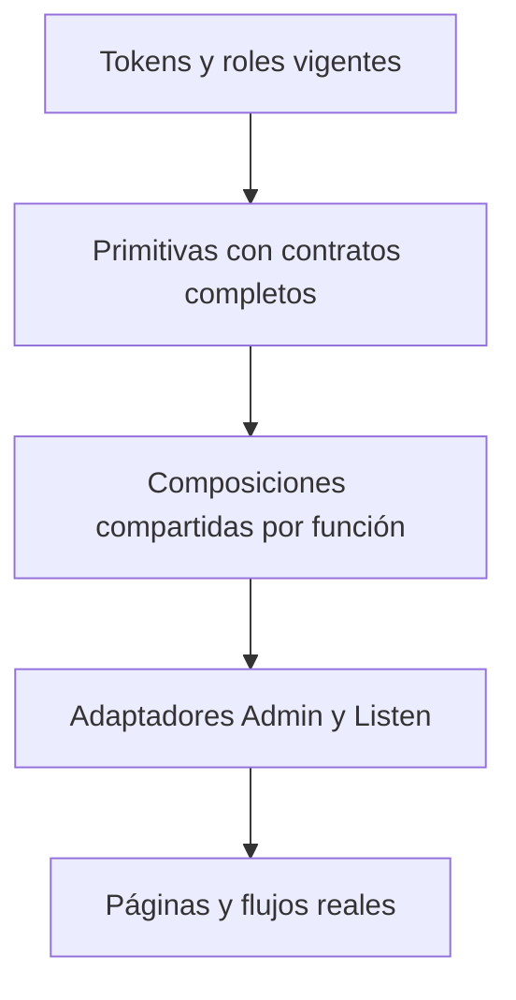

# Crate V3 — reconciliación del sistema de componentes

2026-10-19 · análisis y propuesta para Diego · 1AQ local, sin commit/push.

## Decisión de trabajo vigente

Diego pide parar las migraciones visuales y revisar el sistema completo antes de continuar.
Esta petición amplía la auditoría de filas. Se conserva todo lo publicado hasta1AP y el trabajo
local1AQ; el preview5186sigue activo. Este documento no autoriza nuevas migraciones.

La recomendación es cerrar primero el catálogo y los contratos de las familias necesarias,
comprobarlos sin ayudas del mockup y adoptarlos por grupos. No reiniciar desde cero: hay una
base compartida importante que debe completarse y utilizarse.

## Alcance y evidencia

Se revisaron los contratos del design system (§1,2,3,5,6), product design, implementation plan,
registro de decisiones, estado vigente y auditoría1AP; el código de fundamentos, familias de
filas/eventos, cabeceras, formularios, acciones, estados y superficies de ambas apps.

El [inventario AST del sistema](crate-v3-analysis/component-system-1aq.json) recorre1.069archivos
TS/TSX de producción. Registra92módulos visuales TSX en primitives/composites/domain/shadcn,
2.271sitios JSX importados de shared (414glifos y1.857otros sitios),1.077sitios con props de estilo
y727candidatos léxicos de ajuste de tipografía/geometría/superficie/estado. Incluye reexports
nativos de Admin y aliases de imports; los barrels de dominio conservan su ruta de import.

Esos727 NO son727defectos: `min-w-0`, colocación, separación entre componentes y variantes
semánticas pueden ser correctos. Los92módulos no cuentan hooks, iconos ni todas las entradas de
barrel; los usos directos no equivalen a adopción funcional ni detectan por sí solos módulos
sin uso. El registro contiene las fuentes para clasificar, no una autorización de borrado.
El [inventario de filas](crate-v3-analysis/rows-1aq.json) complementa la búsqueda de recetas inline.

Se separan cuatro disposiciones: defecto confirmado; adopción pendiente ya prevista;
ajuste legítimo; candidato que necesita comprobación. Las mediciones del mockup no certifican
un consumidor real si el mockup le añade CSS. No se afirma haber comprobado cada pantalla,
estado, locale y plataforma de los1.069archivos.

## Diagnóstico: qué nos ha llevado aquí

Los primeros checkpoints construían fundamentos y los enseñaban. Los grupos posteriores de
retirada de iconos se hicieron por pantalla, preservando intencionadamente superficies y
composiciones para fases posteriores. Esa deuda estaba registrada, pero se ha seguido
ampliando la presentación sin cerrar algunos contratos comunes. El resultado mezcla bases
nuevas, recetas anteriores y correcciones en consumidores.

Además, los ejemplos antiguos compensaban carencias de un componente con CSS exterior.
Eso produjo una falsa señal de que la base ya garantizaba el resultado. Las guardas de tokens,
los presupuestos y las pruebas funcionales no cubren automáticamente esa diferencia.

### Hallazgos confirmados y disposición

| ID                                                             | Evidencia concreta                                                                                                                                                                                                                                        | Efecto / disposición propuesta                                                                                                                                                                                                                       |
| -------------------------------------------------------------- | --------------------------------------------------------------------------------------------------------------------------------------------------------------------------------------------------------------------------------------------------------- | ---------------------------------------------------------------------------------------------------------------------------------------------------------------------------------------------------------------------------------------------------- |
| C1 · Mockup que compensa la base                               | HairlineRow no aporta inset horizontal/alineación del hijo; `.rows-preview` y `.focus-rows` de style.css añaden12px/text-left. IAB: ejemplo sin ayuda tiene padding0y texto sobre la raya                                                                 | Resuelto en la primera R1: inset/alineación compartidos, ayudas retiradas y regresiones aisladas/Listen. Admin sigue pendiente de adopción.                                                                                                    |
| C2 · Misma información, varias recetas                         | Upcoming/EventRow88px frente a NewReleases/ReleaseTimelineRow64px, diferente posición de fecha/badges/acciones; fechas show/release de Admin y Listen con cuatro presentaciones                                                                           | Familia EventRow + CalendarDate adoptada en ambas apps; conservar expansión/acciones propias. Detalle en la propuesta de filas.                                                                                                                      |
| C3 · Adopción pendiente de fundamentos existentes              | FormField compartido:20sitios Listen/0Admin; Admin tiene Field locales en Playlists y PlaylistEditor. StatNumber:2sitios Listen/0Admin; OpsStatTile y MiniMetric dibujan números/labels con recetas propias                                               | Completar contrato y mapear cada rol antes de sustituir. No toda cifra es StatNumber ni todo contenedor es InstrumentPanel. Migrar campos/métricas por grupos con consumidores reales.                                                               |
| C4 · Duplicación heredada de un nombre/papel                   | Settings.tsx define su propio `StatusDot` de8px; el compartido usa6px, tonos, nombre y control de movimiento                                                                                                                                              | Mapear ok/no-ok al StatusDot existente, preservando el significado y contexto accesible. Retirar la copia al adoptar, no crear un tercer StatusIndicator.                                                                                            |
| C5 · Acciones parecidas con fundamentos divergentes            | IconButton, ActionIconButton y PageHeaderAction: tamaños32/40/44, círculo/rounded-md, hover lift/glow, Tooltip y disabled diferentes. En Listen hay overrides como size-6/size-9 y cancelaciones de hover                                                 | Definir un IconButton/IconLink canónico para acción convencional y un ActionGroup de colocación; adaptar los existentes. Reproducción conserva sus controles especializados.                                                                         |
| C6 · Roles tipográficos no garantizados por la base            | PageHeader y SectionHeader compartidos no declaran font-display para el heading; body Listen usa Poppins. Hay labelClassName y labels manuales; esos ajustes son candidatos que requieren estilo calculado, no prueba automática de peso final incorrecto | Hacer explícitos los roles en el componente, según encabezado y tamaño; revisar cómo actúan las variantes y quitar ajustes que rehacen la receta. Confirmar estilos calculados por consumidor antes de migrar.                                       |
| C7 · Superficie heredada también en fundamentos                | Card compartido conserva backdrop-blur-xl/shadow-card; OpsPageHero/OpsPanel/tiles usan opacidades, sombras y blur locales                                                                                                                                 | Reconciliar con la superficie sólida acordada. Parte ya está registrada como A5, pendiente de adopción; no presentarla como regresión nueva ni como trabajo terminado.                                                                               |
| C8 · Ajustes locales candidatos, incluidos redundantes/inertes | SearchInput recibe h-12, rounded-xl/lg, shadow-none/backdrop-blur-none y clases locales. La receta `.crate-form-control` sin capa ya impone40/44px y ausencia de sombra/blur: esas utilities pueden ser inertes, no drift visual confirmado               | Clasificar colocación legítima frente a clases redundantes/inertes con estilo calculado. Conservar geometría/debounce/limpieza; separar query simple de búsqueda global con resultados. No crear variantes para satisfacer un override que no actúa. |
| C9 · Cobertura de pruebas insuficiente para coherencia         | Ejemplo de HairlineRow pasa con CSS exterior; guardas léxicas no cubren toda herencia/aliases/estados; preview omitió inicialmente el @source de InfoBadge y mostraba16px                                                                                 | Añadir pruebas de contratos sin CSS correctivo, comparación contra consumidores y estilos calculados. Usar imports/source discovery que no requieran recordar cada archivo nuevo. No aceptar solo “pasa el build”.                                   |
| C10 · Documentación acumulativa                                | Especificaciones originales, decisiones posteriores y stops históricos conviven; p.ej. hover de filas y política inicial de Select                                                                                                                        | Un contrato actual por familia, con decisiones superadas señaladas y enlaces desde planes/handover. Conservar historial; no obligar al siguiente implementador a deducir el estándar de decenas de apéndices.                                        |

La herencia global de mayúsculas sobre valores de pistas se detectó durante la revisión de
la ampliación anterior1AQ y se corrigió con regresión de estilo calculado. Es otro ejemplo
de por qué la responsabilidad de label/valor debe pertenecer a FormField; no es un defecto
pendiente que deba corregirse por segunda vez. Lo mismo ocurre con los badges compuestos y
su botón de retirada: regresiones verificadas, no hallazgos abiertos.

C3/C4 son adopción y duplicación heredadas ya anticipadas por el plan; no nuevas regresiones
introducidas en1AQ. C8 es una clasificación de candidatos por cascada, no un defecto visual
confirmado. El resto conserva la disposición que se explica en cada fila.

La revisión de filas detectó también texto de artista largo sin contención en la nueva release.
Ese caso queda incluido en el contrato propuesto y sus pruebas, pendiente de la migración.

## Catálogo objetivo propuesto

Primero se aprobarían estas responsabilidades. Los nombres existentes se conservan siempre
que cubran el papel; los nombres nuevos indicados son propuestas, no componentes ya creados.

| Familia                      | Pieza canónica y qué posee                                                                               | Acción propuesta                                                                                                                                                                                                                               |
| ---------------------------- | -------------------------------------------------------------------------------------------------------- | ---------------------------------------------------------------------------------------------------------------------------------------------------------------------------------------------------------------------------------------------- |
| Identidad y tokens           | Fuentes, colores, escala tipográfica, radios, strokes, espacios, z-index, motion y superficies en tokens | Conservar identidad única y pin; reconciliar roles/valores antes de tocar consumidores. No nuevos skins ni clases arbitrarias para compensar.                                                                                                  |
| Etiquetas y estado           | **MonoLabel**, **StatusDot**                                                                             | Completar y adoptar. MonoLabel posee familia/peso/case/tracking; StatusDot tamaño/tono/movimiento/nombre. Un estado de error conserva texto/contexto.                                                                                          |
| Cifras y lecturas            | **StatNumber**, **Readout**, futuro **StatStrip** ya previsto                                            | StatNumber para métrica destacada con unidad; Readout para lectura contextual; Mono para metadato compacto. StatStrip compone cifras/regras y sustituye tiles equivalentes, sin hacer todos los números grandes.                               |
| Tags, filtros y selección    | **InfoBadge**, **FilterChip**, **SegmentedControl**, **GenrePill**                                       | Conservar24/12y32–44ya propuestos/implementados en1AQ. Adapters CrateBadge/Chip/Pill y Badge no crean otras recetas. GenrePill mantiene porcentaje/procedencia/acciones.                                                                       |
| Campos de formulario         | **FormField**, Input, Textarea, Select/AdminSelect, Checkbox, Switch                                     | FormField posee label,8px,ayuda/error/association/estado; control posee40/44y foco. Eliminar Field duplicados al adoptar. Valores readonly mediante output/slot semántico, sin inventar un estilo por página.                                  |
| Búsqueda                     | **SearchInput**; **SearchBar** para resultados globales                                                  | El SearchBar compartido actual es un query control simple; el SearchBar local de Admin aporta resultados/recientes. R0 decide convergencia con SearchInput y el adaptador de shell. Reutilizar Input/capa flotante, sin tercera receta visual. |
| Rangos                       | **Slider** de formulario propuesto; seek/volume/EQ como dominio                                          | Falta un control general compartido para los ranges que ya usan ambas apps. Definir label/value/rango/teclado/foco; no reemplazar el seek con estela ni su geometría de arrastre por un slider genérico.                                       |
| Acciones                     | **Button**, **IconButton** y enlace equivalente, **ActionGroup** de composición                          | Consolidar capacidades existentes, tamaño y ayuda; normalizar acciones básicas. Título, tooltip corto y nombre accesible según contexto. AIButton sigue adaptador de Admin; play conserva su esencia.                                          |
| Imagen e identidad           | **MediaCover**, **Avatar/EntityAvatar**, **PlaylistArtwork**                                             | Conservar papeles distintos y fallbacks; variantes de tamaño/forma acotadas por familia. No confundir avatar de usuario, portada de álbum y collage de playlist.                                                                               |
| Filas simples y entidades    | **HairlineList/Row**, **EntityRow** con base interna común                                               | Completar el contrato antes de migrar; título/subtítulo/badges/acciones y estados consistentes; insets/responsive no dependen del CSS del mockup.                                                                                              |
| Eventos y fechas             | **EventRow**, **CalendarDate** propuestos                                                                | Adoptar en Incoming,NewReleases y shows de ambas apps. Header del show común con despliegue intacto. Formato civil/locale/fallback y fuente únicos.                                                                                            |
| Pistas, grids y rails        | **TrackList**, TrackRow/TrackTable especializados, **MediaGrid/MediaRail**                               | Compartir ritmo/estados y composición; conservar ring/progreso/estela/drag/virtualización y contexto de playback. La tabla conserva columnas.                                                                                                  |
| Estructura de página/sección | **PageHeader**, **SectionHeader**, **BackLink**, **FilterBar**                                           | Completar los existentes; integrar la composición aprobada de Admin, sin dejar otro header visual paralelo. Enmendar el PageHeading local pendiente del plan si esta consolidación se aprueba.                                                 |
| Contenedores                 | **Card** para objeto contenido; **InstrumentPanel** para instrumento con label/meta/status/regla         | Reconciliar sus superficies y responsabilidades. No una familia nueva de PanelCard/StatCard/MetricCard equivalentes. OpsPanel puede ser adaptador temporal según papel.                                                                        |
| Progreso e instrumentos      | **ProgressHairline**, **Meter**, **EqBands** y catálogo de instrumentos del plan                         | Mantener. Instrumentos futuros no se construyen sin sus datos reales y contrato de fase; esta pausa no autoriza24widgets ficticios.                                                                                                            |
| Estados y feedback           | **LoadingState**, **ErrorState**, **EmptyState**, skeletons, notificaciones compartidas                  | Adoptar estados reales de ruta/sección y formas reservadas compatibles con la fila/card final. No spinners/textos de error inventados por cada página.                                                                                         |
| Capas                        | **AppModal**, **ConfirmDialog**, AppPopover, Dialog/Sheet/Select/Menu/Tooltip sobre Radix                | Conservar los fundamentos1N; completar gobernanza de portal/z-index/foco/overflow con pruebas de consumidores anidados. Shadcn es capa de implementación, no otra identidad.                                                                   |
| Navegación                   | SkipLink, tabs, shell/nav, menús de entidad                                                              | Conservar. URL helpers son de cada app; shell, permisos, navegación y reproducción no se trasladan a shared por apariencia.                                                                                                                    |

No propongo un componente universal que sirva para todo ni convertir en wrappers todos los
fragmentos de JSX. Una composición específica de negocio es legítima. Se extrae un fundamento
cuando tiene un papel visual/semántico repetido y un contrato que ambos consumidores necesitan.

### Responsabilidad de cada capa

- El componente garantiza su tipografía, geometría interna, foco, estados y accesibilidad.
- El consumidor decide dónde colocarlo y aporta datos/callbacks. Un margen exterior o una
  columna del layout puede ser legítimo; rehacer su tamaño/texto/fondo/foco requiere una variante
  del contrato o una excepción explícita con motivo, dueño y criterio de retirada.
- Shared no importa contextos/API/rutas/capacidades de una app. El padre no cambia su identidad
  con selectores CSS descendientes.
- Una pieza pasa a @crate/ui cuando ambos consumidores la adoptan en ese bloque. Una pieza
  de un solo dominio/app permanece local, compuesta con los fundamentos comunes.

## Contrato mínimo antes de llamar “terminado” a un componente

Cada entrada del catálogo necesita una ficha única con:

1. Papel, usos apropiados y casos que pertenecen a otra pieza.
2. Anatomía/slots y variantes finitas; medidas, fuentes/pesos, superficie y roles de color.
3. Estados normal, activo, seleccionado, foco, disabled, loading,error/empty si aplican.
4. Teclado/ARIA, idioma y formato; semántica Link/Button/label/output correcta.
5. Responsive por contenedor, texto largo, wrap/truncado,0/1/muchos elementos y coarse pointer.
6. Props de negocio inyectadas y garantías de estabilidad al cargar/cambiar permisos.
7. Ejemplos sin CSS compensatorio, pruebas de contrato y consumidores reales de ambas apps.
8. Componentes/sitios que sustituye, compatibilidad temporal y condición concreta de retirada.

El catálogo queda con estado **definido / implementado / adoptado / validado** por separado.
Tener un archivo y una captura aprobada no implica adopción completa en las pantallas.

## Orden de trabajo recomendado tras aprobar la reconciliación

**R0 · Cerrar el mapa y las fichas.** Congelar nuevas pantallas/grupos. Clasificar los candidatos
por familia y dueño, aprobar nombres/variantes y reconciliar planes con el catálogo. La propuesta
de filas pasa a ser un capítulo de esta reconciliación, no otra iniciativa paralela. Los ajustes
finos de fecha/tamaño de esa propuesta aún se revisan en R1, no quedan aprobados por existir aquí.

**R1 · Completar fundamentos.** HairlineRow; FormField/roles tipográficos; acciones; superficies;
CalendarDate/RowLayout y Slider general si los consumidores confirman el contrato. Retirar ayudas
del mockup en la misma tarea que pasa a garantizar el componente. No cambiar todos los números
o todos los avatares con una búsqueda/reemplazo.

**R2 · Cerrar una familia en ambas apps.** Empezar por eventos/releases: Incoming y NewReleases
Admin junto a ReleaseRow y show cerrado de Listen/Admin. Mismo dato, misma presentación base,
acciones propias y desplegable intactos. Checkpoint visual antes de publicar.

**R3 · Adoptar el resto por familias.** Campos/búsquedas, etiquetas/lecturas/métricas, acciones/
headers, entidades/personas/playlists y superficies/estados. Cada bloque retira duplicados y
overrides sustituidos y tiene su stop de revisión; conservar las excepciones nativas y de dominio.

**R4 · Reconciliar páginas y retomar el plan.** Volver a las fases3.x/6.x pendientes con el catálogo
como prerequisito. La retirada de iconos deja de ser la unidad principal de desarrollo visual.
Instrumentos y backend continúan por sus contratos/datos reales cuando corresponda.

## Cómo evitar repetir el problema

- Antes de escribir una receta: buscar el componente/contrato existente y sus consumidores.
  Si no cubre el caso, decidir si falta una variante común o hay una especialización legítima.
- Pruebas primero en el componente aislado **sin CSS del mockup**; después en una página real
  de cada app y en el mockup. Comparar estilo calculado entre las tres ubicaciones.
- Matriz mínima:375/390,768y1440px, fine/coarse, texto/locale largo, imagen/dato ausente,
  0/1/muchos badges y acciones, foco/disabled/busy. Probar interacciones y datos conservados.
- Guardas de import/AST y overrides semánticos con aliases, constantes y responsive; no solo
  presupuestos de clases arbitrarias. Cada deuda permitida tiene dueño/fase/retirada.
- El mockup solo compone y coloca; no contiene estilos que arreglan el interior del componente.
  Clases locales de escena/layout quedan identificadas. Comprobar discovery de Tailwind.
- Bundle Admin532480Bgzip, Listen y rendimiento siguen siendo puertas; no elevar límites para
  introducir abstracciones pesadas. Imports por subpath y evitar nuevas dependencias.
- Mantener pruebas focalizadas seriales; suites completas una vez al cierre de fase. Sin CI
  completa ni regeneración de las33capturas canónicas durante esta reconciliación.

## Límites y siguiente decisión

Esta auditoría es profunda en estructura, contratos y familias; la clasificación léxica no
sustituye revisar visualmente todas las combinaciones de cada página. El objeto app/web258bbaee
no está disponible en los checkouts inspeccionados: se conserva el pin y no se simula una
comparación nueva con otra referencia. Backend vivo, AT, motores adicionales, zoom y plataformas
nativas permanecen en la QA correspondiente; no se afirma que todo eso esté certificado.

La propuesta para aprobar es: **catálogo por responsabilidades, fichas de contrato completas,
prueba sin compensaciones y adopción por familias antes de seguir con pantallas**. La siguiente
entrega sería el catálogo/fichas R0revisable y su plan de implementación; no otra pantalla
rediseñada. 1AQpermanece local y el preview activo.

Revisión independiente de la propuesta: recuentos contrastados con el inventario, sin bloqueo
arquitectónico. Se corrigió la clasificación inicial de C8 tras comprobar la cascada sin capa;
no se afirma que h-12 cambie la altura real de SearchInput. Se aclara el papel real de los dos
SearchBar y la deuda heredada C3/C4. La propuesta de filas tuvo un builder check independiente
sin preguntas importantes pendientes. Estas revisiones no aprueban la implementación por Diego.

## Requisito añadido por Diego: catálogo vivo y documentación del diseño

Diego pide un playbook/showcase versionado para @crate/ui: cada componente añadido o
modificado actualiza su entrada; el mismo sitio documenta el sistema de diseño de Crate.
Este requisito forma parte de R0, antes de retomar migraciones de páginas. La plataforma
recomendada es Storybook con React/Vite, con nombre de producto «Crate UI — Design System».
La elección de plataforma y su implementación se presentan como propuesta, no como instalación
ya realizada.

### Contenido y fuente de verdad

- Fundamentos: identidad, colores/tokens reales, fuentes y roles, espacios, radios, líneas,
  superficies, iconografía, movimiento y accesibilidad. Las tablas derivadas de tokens no se
  mantienen como valores copiados en otra receta.
- Componentes: propósito, import/fuente canónicos, anatomía, props, variantes, estados,
  geometría, teclado/ARIA, responsive, usos recomendados y ejemplos incorrectos. Incluir
  escenarios de texto largo, dato ausente y contenedor estrecho.
- Patrones: formularios, acciones, filas, fechas, cabeceras, paneles y capas; composiciones
  reales de los mismos componentes, con datos ficticios y comportamiento verificable.
- Adopción: estado definido/implementado/adoptado/validado por separado, consumidores de
  Admin/Listen, adaptadores/deprecados y deuda con dueño. Un archivo interno no exige una
  ficha pública propia; se vincula a la entrada de su familia. Ningún componente se declara
  validado por tener simplemente una story.

Las stories importan el componente real y sus tokens/fuentes; no reconstruyen su apariencia.
Los decorators solo aportan contexto/layout necesario, sin CSS que corrija el interior. La
ficha utiliza las mismas stories que sirven para revisar y probar estados. Metadata e historias
quedan en Git; el índice del inventario se deriva de ellas y del código para evitar otra lista
manual divergente. Los planes registran decisiones/historia y enlazan el contrato vigente.

### Regla de mantenimiento y verificaciones propuestas

Un cambio de componente incorpora en el mismo cambio la actualización de ficha/escenarios/
pruebas que le correspondan, con justificación cuando el contrato documentado no cambie.
Una guarda detecta nuevas entradas públicas sin ficha y escenarios/metadata ausentes o
obsoletos respecto al código; la revisión comprueba exactitud semántica. Tocar un timestamp no
es evidencia de revisión. Los componentes anteriores entran con cobertura pendiente explícita,
sin marcar todo el catálogo como validado al arrancar.

Desarrollo: comprobar solo componentes afectados y consumidores relacionados, con workers1.
El catálogo facilita pruebas de interacción, accesibilidad automática y estilos calculados;
no sustituye pruebas de apps, revisión visual ni QA nativa/AT. No regenerar baselines canónicas
ni disparar CI completa para cada cambio. Automatización de cobertura acotada se añade dentro
del alcance aprobado del catálogo.

### Integración y primera entrega propuestas

Configuración, stories y docs en `tools/crate-ui-showcase/`, fuera de las entradas de
producción de shared. Motivo concreto: `app/shared/ui/tsup.config.ts` recoge .ts/.tsx y solo
excluye .test.; el tsconfig compartido también incluye todos esos archivos. Instalar stories
al lado del componente sin ajustar esas reglas introduciría código/dependencias de desarrollo
en sus entradas. El showcase debe quedar separado de exports, dist y bundles de las apps.
Dependencias de desarrollo únicamente; verificar compatibilidad real con Node22, React19 y
la versión Vite instalada antes de fijar versiones. No ejecutar el scaffolder a ciegas.

El preview5186 y sus checkpoints históricos permanecen como evidencia de pantallas. El
showcase pasa a ser el catálogo por componente; enlazar desde el preview y reutilizar ejemplos
cuando se puedan trasladar sin perder historial. No dos juegos de contratos independientes.

Primera entrega: navegación del catálogo, fundamentos y fichas reales de MonoLabel, StatusDot,
StatNumber, HairlineRow y la familia de badges; índice del resto con cobertura pendiente. Se
revisa esa base antes de completar familias y adoptar nuevas pantallas.

Referencias primarias consultadas: React/Vite
https://storybook.js.org/docs/get-started/frameworks/react-vite ; documentación MDX
https://storybook.js.org/docs/writing-docs/mdx ; pruebas de accesibilidad
https://storybook.js.org/docs/writing-tests/accessibility-testing .

### 1AQ — Storybook y primera reconciliación (estado local vigente)

Storybook R0 está implementado en inglés, con identidad Crate, categorías funcionales y enlaces
estables. Catálogo: 10 fichas documentadas / 81 pendientes; mantenimiento obligatorio en el mismo
cambio, hook staged y comparación histórica en CI. Después de revisarlo, Diego autorizó comenzar
por HairlineRow: inset/alineación garantizados, texto largo contenido y ayudas del mockup retiradas.
Admin aún no adopta esa fila; el resto de R1–R4 sigue pendiente. Previews 6006/5186 activos.
[Estado y evidencia vigentes](2026-10-19-crate-v3-current-state.md),
[tooling](2026-10-19-crate-v3-storybook.md) y
[contrato Hairline](2026-10-19-crate-v3-hairline-reconciliation.md).
**Misma parada local 1AQ, sin commit/push; no se cierra la fase ni su QA.**
