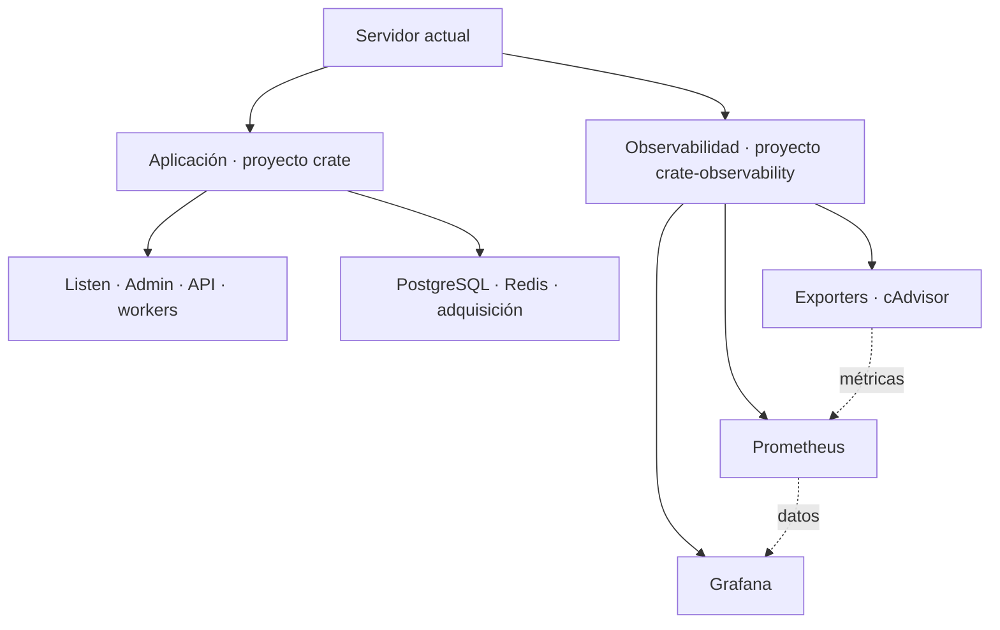

# Despliegues independientes y topología de Stack

2026-10-31. **Diseño aprobado por Diego.** Amplía el programa de
observabilidad; no modifica el alcance ya terminado de PR1A ni acredita C1.
Inspección local de código, main y documentación; sin cambios de runtime.

## Objetivo

Actualizar dashboards, Grafana, Prometheus y collectors con un ciclo propio,
conservando la aplicación en ejecución. Admin debe mostrar dónde corre cada
servicio y a qué stack pertenece, incluso si ambos stacks comparten servidor.

La instrumentación embebida en API, Listen, workers, Go o Rust continúa formando
parte de sus imágenes de aplicación. Un cambio en ese código requiere desplegar
la aplicación afectada; la separación cubre la infraestructura de observabilidad.

## Situación comprobada

- `Makefile:1232–1254` ya selecciona únicamente los ocho servicios de observabilidad
  para `up --no-deps` y `stop`. Son comandos locales; no existe un deploy remoto
  equivalente con release, staging y rollback propios.
- El overlay comparte proyecto con la instalación. El despliegue de aplicación
  selecciona solo servicios cambiados, pero su Compose omite observabilidad y usa
  `--remove-orphans` tanto en `up` como en rollback. Existe riesgo de retirar los
  contenedores de monitorización como huérfanos. No se afirma que esto haya pasado.
- Un cambio byte a byte en cualquiera de los dos Compose base marca todos los
  servicios de aplicación como cambiados, aunque sus imágenes coincidan.
- El despliegue estándar no transporta la configuración de `deploy/observability`.
  Los dashboards provisionados ya se revisan cada 30 segundos.
- Stack lee el socket Docker local y filtra el proyecto de su propio contenedor.
  Descarta los labels Compose al producir su DTO. Carece de `host_id`, stack,
  versión desplegada y métricas por servicio. Un proyecto independiente dejaría
  de aparecer con ese filtro.
- La vista pinta `running` como éxito y no expone `State.Health.Status`. Las
  acciones tienen prefijos históricos; el transporte confunde errores con un
  204 sin cuerpo. Estos límites deben resolverse al adaptar los controles.

Referencias locales: `scripts/deploy-remote.sh:26,806,896,908,1079`,
`scripts/deploy.sh:197`, `app/crate/docker_ctl.py:94,112,144,187`,
`app/crate/api/stack.py:160`, `app/crate/db/admin_stack_surface.py:8`,
`app/ui/src/pages/Stack.tsx:82`.

## Alternativas

| Opción | Ventaja | Coste o límite |
| --- | --- | --- |
| **Dos proyectos Compose en el host actual** | Ciclos y rollback separados; ownership claro | Migrar los ocho servicios de observabilidad y adaptar inventario |
| Un proyecto con comandos separados | Menor cambio inicial | Mantiene dependencia entre overlays, huérfanos y rollback |
| Observabilidad en otro servidor | Separa también recursos y dominio de fallo | Requiere conectividad privada y collectors locales; más operación |

Se recomienda la primera. Permite mover componentes a otro host posteriormente.
El host del probe externo sigue pendiente, como se decidió en C0.

## Despliegue propuesto

Mantener la identidad actual de aplicación (`crate`) y crear `crate-observability`
con Compose autónomo, sin cargar los Compose de aplicación. Reutilizar la red
externa `crate` para los exporters PostgreSQL/Redis; el resto conserva sus redes
de observabilidad privadas. La red externa ya existe, de modo que este cambio
no necesita recrear contenedores de aplicación para conectarlos.

Cada stack tendrá manifest, revisión de configuración, imágenes por digest,
artefacto de despliegue, staging, registro de versión y rollback propios, dentro
del mismo repositorio. El deploy de observabilidad no cambia `.env`, release SHA,
manifest, Sentry, migraciones o contexto de aplicación.

Separar las rutas de configuración desplegada de las rutas del checkout de app.
Usar rutas resueltas explícitamente: hoy los bind mounts dependen del primer
Compose de la lista. Los dashboards se actualizarán dentro del directorio
estable que Grafana monta, con sustitución de archivos controlada; sustituir
el directorio montado o cambiar un symlink fuera del contenedor no garantiza
que el proceso vea el nuevo contenido.

Los cambios de dashboards aprovecharán el provisioning existente. Los de imagen
o configuración que requieran reinicio seleccionarán solo los servicios
afectados de observabilidad. Las herramientas oficiales de despliegue manual y
Operator deberán coordinarse con un lock de host; sus contratos actuales no
admiten observabilidad como destino y no deben reutilizarse implícitamente.

La migración inicial detendrá solo la observabilidad antigua y arrancará el
proyecto independiente conservando datos, secretos, puerto loopback, datasource
UID y dashboards. Habrá un hueco de monitorización documentado. Nunca arrancar
dos Prometheus o dos Grafana escribiendo simultáneamente en el mismo estado.
El rollback cubrirá configuración/imágenes y, cuando una actualización migre
estado, un respaldo consistente y compatible.

## Stack en Admin

Jerarquía: **servidor → stack → servicio → instancias**. Primera entrega con
un host real, dos stacks y detalle al seleccionar un servicio. Los hosts futuros
se mostrarán al tener una fuente configurada; el probe pendiente no aparecerá
como conectado. No se construye ahora un orquestador remoto.

El modelo incluirá identificadores estables de host/stack/servicio, proyecto y
servicio Compose, identidad completa de instancia, imagen/digest, deployment SHA
y source SHA de imagen cuando estén disponibles. Estos SHA son metadatos de
inventario, no labels añadidos a todas las series de métricas. Un servicio
desconocido permanece sin clasificar, con sus acciones restringidas.

Mostrar por separado estado de contenedor, healthcheck y disponibilidad/frescura
de telemetría. CPU, memoria y tiempos tendrán fuente, fecha y estado; la falta de
una fuente es desconocida. Docker aporta inventario; Prometheus, medidas;
Grafana, enlaces al histórico del host/servicio y periodo seleccionado. El mapa
seguirá disponible como inventario cuando Prometheus falle.

Ampliar el snapshot cacheado y SSE existentes. La recogida/correlación se hace en
segundo plano con consultas acotadas, no consultando Docker o Prometheus por nodo
desde el navegador o en cada request. Reutilizar el adapter previsto en el
programa de observabilidad para incorporar métricas, sin duplicarlo.
La ampliación será aditiva: conservar payload `stack/containers` y rutas actuales
durante la transición, junto con los nuevos hosts/stacks e identidades completas.

Los controles de start/stop/restart conservarán permisos explícitos, ownership
validado en servidor por host/proyecto/servicio/instancia y confirmación real del
resultado. Ampliar lectura a dos proyectos no concede control del daemon entero.
Corregir la confusión de error/204 y evitar el fallback de listar todo el daemon
cuando falle la autodetección. La UI muestra solo las acciones permitidas.
El cambio de autorización podría rechazar nombres antes aceptados únicamente por
prefijo: inventariar usos actuales y revisar ese cambio expresamente; los
servicios conocidos de la instalación mantienen sus operaciones autorizadas.

Mantener primitivas e identidad compartidas. Mapa jerárquico legible, detalle
lateral y alternativa de lista accesible; móvil apila los grupos. Mockup en el
showcase existente con el componente real y estados observed/stale/unavailable.

## Adopción propuesta y checkpoints

1. **PR de infraestructura antes del siguiente despliegue de aplicación:**
   proyecto y artefactos propios, protección frente a huérfanos, comandos remotos,
   rollback y coordinación de herramientas. Checkpoint de contratos y ensayo Linux.
2. **PR de Stack:** inventario compatible, clasificación explícita, corrección de
   acciones y mockup del host con ambos stacks. Revisar el mockup antes de cerrar
   el comportamiento visual; incorporar medidas mediante el adapter planificado.
3. **Adopción controlada:** migrar observabilidad preservando historial; desplegar
   y revertir un cambio de observabilidad durante reproducción. Registrar IDs,
   `StartedAt` y reinicios de aplicación antes/después: deben permanecer iguales.
   Validar también que un despliegue/rollback de app conserva observabilidad.
4. **Documentación final:** actualizar GitHub/runbooks de despliegue y la página
   correspondiente del website de docs, con versiones, recovery y topología.

Tests acotados por corte: contratos Compose/deploy/ownership/rollback; snapshot
y estados de error; agrupación, frescura y controles UI; capturas de mockup en
Linux. Validación global una vez al cerrar la fase. No se modifica PR1A para
introducir este bloque; PR1B sigue reservado a QoE continuo.

## Referencias oficiales

- [Identidad de proyectos Compose](https://docs.docker.com/compose/how-tos/project-name/).
- [Conectar proyectos por redes externas](https://docs.docker.com/compose/how-tos/networking/).
- [Provisioning y actualización de dashboards Grafana](https://grafana.com/docs/grafana/latest/administration/provisioning/).
