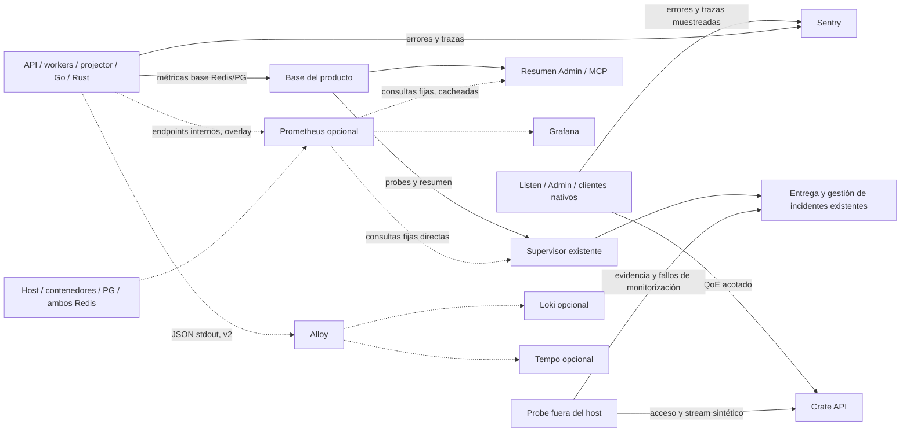

# Observabilidad de Crate: diseño

**Fecha:** 2026-10-31. **Base analizada:** `main@7460a43eb`.
**Estado:** opción 2, autohospedada y gradual, aprobada por Diego. Revisión 2 (2026-10-31): Prometheus
es opcional y las métricas internas son la base permanente del producto; la infraestructura se
adelanta en shadow; el supervisor evalúa Prometheus directamente; el programa se divide en v1 y v2.
Este documento no autoriza implementación ni despliegue.
**Plan:** [Implementación y adopción por fases](2026-10-31-observability-implementation-plan.md).

## 1. Objetivo y alcance

Poder responder con evidencia a cuatro preguntas: ¿funciona Crate?, ¿puede escuchar música el usuario?,
¿dónde se degrada el servicio? y ¿qué cambió respecto a la release anterior?

La adopción conserva Sentry y Crate Operator, corrige las mediciones existentes e introduce Prometheus y
Grafana como capa estándar **opcional** de métricas e historia. Alloy se incorpora cuando haya que
recoger logs/trazas. Loki y Tempo son extensiones posteriores sujetas a un checkpoint de utilidad y
recursos, no requisitos para la primera adopción.

**Fuente de verdad (decisión de revisión 2).** Hay dos niveles:

- **Base del producto, siempre activa:** métricas internas Redis/PostgreSQL corregidas, QoE de
  reproducción y resumen de salud en Admin/MCP. Funciona en cualquier instalación, con o sin overlay, y
  no se retira. Cubre las ventanas recientes (hasta siete días) que necesitan Admin y el supervisor.
- **Overlay opcional:** Prometheus, Grafana y exporters. Aporta historia larga, histogramas
  comparables entre releases, infraestructura (host/PG/Redis/contenedores) y paneles. Donde está activo,
  una familia de la base puede dejar de escribirse solo cuando su equivalente Prometheus tenga paridad
  verificada; donde no está, la base sigue siendo la fuente.

Incluye API, workers, projector, readplane, media-worker, Listen web/PWA, Android/iOS, Desktop, Cast,
Admin y dependencias PostgreSQL/Redis/host. Las correcciones de fiabilidad y la instrumentación barata
pertenecen al producto normal.

No cambia algoritmos de recomendación, reglas de Infinite Playback, transporte de audio ni permisos
funcionales. No introduce analítica publicitaria, session replay, captura de audio, contenidos de letras o
prompts. No sustituye el histórico de escucha por métricas técnicas.

## 2. Evidencia de partida

El análisis fue de código y configuración versionada. Una integración en el repositorio no prueba que sus
credenciales, reglas o ingesta estén activas en una instalación. Verificado en `main@7460a43eb`:

| Área | Ya existe | Problema que debe resolver la adopción |
| --- | --- | --- |
| Sentry | Proyectos por runtime, release, errores explícitos y tracing automático donde está configurado | Verificar ingesta; correlacionar operaciones; mantener información diagnóstica útil |
| Métricas Python | Buckets Redis por minuto, TTL por defecto 24 h y rollups PostgreSQL | Dimensiones genéricas mezcladas; el rollup suma al reprocesar (`metric_rollups.count + EXCLUDED.count`); pérdida no observable |
| Latencia | Percentiles recientes por ruta sobre muestras limitadas | El health score llama p95 al máximo de cinco minutos (`alerting.py`); no hay distribución histórica equivalente |
| Reproducción | Startup/stall/recovery hacia `/api/playback/qoe` | `MAX_EVENTS_PER_SESSION = 24` corta la telemetría para el resto de la sesión; entrega sin retry; faltan tasas y cobertura |
| Escuchas | Eventos durables, duración escuchada, completado y skip | No confundir intención/comportamiento musical con éxito técnico |
| Workers/projector | Espera, profundidad, duración, estado, outbox, lag y dead letters | Histórico, frescura y desglose accionable; no tratar valores estáticos como probes |
| Readplane | Logs JSON y contadores en `/readyz` | Series en memoria sin histórico común; preservar semántica al exportar |
| PostgreSQL | `pg_stat_statements`, IO timing, slow log y pool | Vista temporal de saturación, bloqueos y consultas normalizadas |
| Logs | Docker `local` con rotación y `wlog` PostgreSQL con siete días | Consultas transversales sin aumentar escrituras en la DB del producto |
| Operador | Supervisor, incidentes/entrega durables y watchdog externo opcionales | Reutilizar su ciclo de incidentes, validar activación y ampliar evidencias |
| Clientes nativos | SDKs y diagnósticos específicos; símbolos/sourcemaps según build | Android background necesita cobertura propia; Tauri elimina stacks y metadatos útiles |

Capacidad del host de producción observada el 2026-10-31: 8 vCPU (carga media ~2,5), 62 GiB de RAM con
~54 GiB disponibles (los contenedores usan ~10,6 GiB), 101 GiB libres en `/var` (data-root de Docker) y
13 GiB libres en `/` (73 %). El overlay se aloja en `/var`.

Fuentes principales: `app/crate/metrics.py`, `app/crate/alerting.py`, `app/crate/api/admin_metrics.py`,
`app/crate/api/playback_telemetry.py`, `app/listen/src/lib/playback-qoe.ts`,
`app/crate/db/repositories/management.py`, `app/readplane/internal/routes/server.go`, `deploy/operator/`,
`docker-compose.yaml` y `docker-compose.home.yaml`.

## 3. Arquitectura y responsabilidades



Responsabilidades estables:

- **Base del producto:** métricas Redis/PG corregidas, QoE y resumen de salud. Siempre disponible; es la
  fuente de Admin/MCP sin overlay y la fuente de respaldo con overlay.
- **Admin:** diagnóstico de dominio, estado reciente, cobertura, tareas, reproducción y enlaces al detalle.
  No será otra implementación de Grafana ni hará PromQL desde el navegador.
- **Prometheus (opcional):** series técnicas, histogramas, consultas y recording rules. No recibirá el
  histórico individual de escucha.
- **Grafana (opcional):** exploración histórica, paneles y comparación temporal. Sus notificaciones están
  desactivadas.
- **Sentry:** errores, releases, stacks y tracing inicial. Conservar los proyectos actuales.
- **Crate Operator:** propietario del ciclo de incidentes y su entrega donde esté instalado. **Evalúa
  directamente** una allowlist fija de consultas Prometheus cuando el overlay existe, sin pasar por la
  app ni por PostgreSQL; sin overlay, usa los probes y el resumen de la base. No añadir otro motor de
  ack/silence/recovery ni un segundo canal para la misma regla.
- **Watchdog externo:** vigilancia del supervisor y entrega; se conserva. Las pruebas funcionales de
  acceso/audio amplían la cobertura, no se atribuyen al watchdog actual.

Sin Operator se podrán consultar métricas y paneles; el estado de adopción indica explícitamente que no hay
notificaciones operativas verificadas. La capa opcional no pasa a ser dependencia de arranque o
reproducción.

## 4. Contrato de métricas

### 4.1 Tipos y catálogo

Crear un catálogo explícito que mapee nombres existentes a tipo, unidad, labels permitidos y destino (base,
Prometheus o ambos). Mantener `record`, `record_counter` y sus variantes como fachada de compatibilidad; no
registrar automáticamente nombres o labels arbitrarios.

| Tipo | Uso | Regla |
| --- | --- | --- |
| Counter | Peticiones, intentos, fallos, retries, eventos descartados | Monótono durante la vida del proceso/contenedor; usar `rate`/`increase` y admitir resets |
| Gauge | Backlog actual, actividad, bytes de caché, última observación | Definir propietario y frescura; nunca sumar muestras temporales para representar el valor actual |
| Histogram | Duración API, startup, stalls, refill y etapas de generación | Segundos como unidad estándar y buckets compartidos por familia |
| Build info | Release, versión del esquema y servicio | Una familia separada; no repetir SHA en todos los histogramas |

Empezar con histogramas clásicos por compatibilidad entre Python multiproceso y Go/Rust. No prometer
exemplars en Python multiproceso.

Labels admitidos solo cuando correspondan a la familia: `service`, `runtime`, `engine`, `operation`,
`route`, `method`, `status_class`, `outcome`, `reason`, `queue`, `task_type`, `origin`, `target`,
`provider`, `action`, `surface`, `rules_revision`. Rutas, tipos, proveedores, superficies y acciones salen
de registros cerrados. Los productores normalizan valores desconocidos a `other`; hay límites de series por
familia.

No usar como labels: usuario, track, artista, álbum, task/session/trace ID, URL, filepath, IP o texto
libre. La release del cliente se conserva como contexto acotado; cualquier desglose métrico por release
exige una allowlist pequeña de builds soportadas.

Ejemplos del contrato objetivo, no nombres ya disponibles:

```text
crate_http_requests_total{service="api",route="/api/radio/next",status_class="2xx"}
crate_http_request_duration_seconds_bucket{service="api",route="/api/radio/next",le="0.25"}
crate_playback_attempts_total{runtime="android",engine="native",outcome="started"}
crate_playback_stall_duration_seconds_bucket{runtime="web",engine="html",le="1"}
crate_radio_refills_total{runtime="android",outcome="retry",reason="network"}
crate_recommendation_early_skips_total{surface="radio",rules_revision="7"}
crate_queue_oldest_pending_seconds{queue="playback"}
crate_telemetry_dropped_total{service="api",reason="buffer_full"}
```

### 4.2 Base del producto: corregir y simplificar

La base es permanente, así que se corrige con el diseño más simple que sea idempotente:

1. Namespace Redis versionado, identidad por nombre + labels canónicos + minuto y límites de cardinalidad.
   Mantener lectura agregada por nombre para los consumidores anteriores.
2. Persistir **snapshots absolutos por minuto** en una tabla nueva con clave única por serie/minuto. El
   mismo minuto se reemplaza, no se suma; un snapshot anterior a la revisión aplicada se rechaza. Dos
   flushers concurrentes o un reintento no duplican.
3. **Sin rollups horarios mantenidos:** Admin y el supervisor calculan las ventanas de 15 min, 1 h, 24 h y
   siete días agregando las filas de minuto en la lectura, con un índice por serie y minuto. Se elimina
   la recomputación transaccional de horas y una fuente de errores.
4. Retención de minutos: ocho días con limpieza incremental por lotes. La historia más larga es
   responsabilidad del overlay opcional. Validar tamaño y coste de la agregación en lectura antes de
   activar; si no cumple el presupuesto de la ruta, añadir un agregado horario recalculado desde minutos
   (nunca acumulativo).
5. Una lectura Redis del bucket debe ser consistente. El contador/revisión de observaciones no puede
   retroceder silenciosamente; pérdida/reset de origen se declara como gap.
6. Versionar el corte histórico. Los `metric_rollups` antiguos, sobrecontados, se conservan como legacy no
   verificado y la UI muestra la fecha de inicio fiable. No se corrigen a ciegas ni se borran en el
   rollout.

El máximo actual se llamará máximo; el umbral `alert_threshold_api_p95_latency_ms` se migra con alias
deprecado. Los percentiles de ruta existentes se identifican como muestreados; los percentiles de servicio
definitivos proceden de histogramas cuando hay overlay. No promediar p95/p99 ni derivarlos de
medias/máximos.

### 4.3 Exportación y multiproceso (overlay)

La fachada añade observaciones a instrumentos estándar en memoria cuando el productor Prometheus está
habilitado; la base sigue escribiéndose. No construir counters Prometheus sumando ventanas Redis móviles ni
exportar el mismo total global desde todos los contenedores.

- Python: `prometheus_client` en modo multiproceso por contenedor; `PROMETHEUS_MULTIPROC_DIR` definido
  antes de importar la librería, en tmpfs local. Un endpoint interno por contenedor recopila todos sus
  procesos.
- El proceso supervisor de `crate api`/`crate worker` prepara el ciclo de vida una vez; un hijo de Uvicorn
  o Dramatiq no borra el directorio. Los ficheros de procesos muertos se marcan (`mark_process_dead`);
  gauges vivos requieren semántica de expiración explícita.
- El registry de exposición no vuelve a registrar los instrumentos del productor. Build-info y gauges del
  supervisor se componen en un registry separado.
- Go: endpoint interno propio; los buckets exclusivos de `OpenLatency` se convierten a acumulativos.
- Rust: endpoint de métricas independiente de la cola HTTP de empaquetado. No sumar el intento visto desde
  Python y desde Rust como uno mismo.
- Cola, outbox y snapshots globales tienen un único productor lógico, el service loop activo. La exposición
  lee su último sample y timestamp, sin consultas al catálogo por scrape.

El éxito de una operación de negocio no depende de que se registre su métrica. El exportador no consulta
las 138K pistas ni reconstruye snapshots. Métricas deshabilitadas no abren puertos, threads ni exigen
almacenamiento multiproceso al importar en CLI/tests.

## 5. Telemetría de reproducción y recomendaciones

### 5.1 QoE continuo y cobertura

Sustituir el presupuesto de 24 eventos por rate limit temporal renovable, batch y cola acotada. Valores
iniciales para validar: batch de 12, cola de hasta 500 eventos/1 MiB, caducidad 24 h y límite de 60
eventos/minuto por cliente. El límite servidor actual (120/minuto **por usuario**) rechazaría eventos
legítimos con dos o tres dispositivos activos: pasa a ser **por dispositivo/sesión de cliente**, con un
techo por usuario más alto contra abuso. Heartbeats se coalescen; una tormenta no oculta eventos
terminales.

La captura se limita a enums, duraciones, secuencias e identificadores efímeros; ningún audio/nombre de
canción/credencial. Persistencia y envío fuera del hilo de audio. El buffer se aísla por servidor y
contexto de autenticación y se vacía al cerrar sesión/cambiar de cuenta.

Identidad de batch/evento y deduplicación temporal para retries habituales: best effort con
deduplicación, no exactamente una vez. Si Redis/cliente/red impiden verificar cobertura, los ratios se
marcan parciales. Reintentos con backoff/jitter, TTL y límite; auth inválida espera autenticación nueva.

Contabilizar accepted/rejected/dropped/expired/send_failed y última entrega. Mantener compatibilidad con
payloads anteriores y declarar su cobertura limitada.

Eventos funcionales mínimos:

- Intención de reproducción y resultado `started`/`failed`/`cancelled`, con causa cerrada. Startup
  significa confirmación del motor, no sonido físico comprobado.
- Tiempo reproducido y en stall; estado final de un stall incluso si termina en error o abandono.
- Interrupción involuntaria, recuperación y agotamiento de retries. Pausa, skip, repeat y final voluntario
  no cuentan como fallos.
- Infinite activo, refill requerido/solicitado/resuelto, retry y tiempo esperando siguiente tema.
  Starvation es falta de pista reproducible cuando el motor la necesita, excluyendo fin deliberado de
  cola/repeat/pause/offline.
- Android background emite desde la capa nativa; iOS, Desktop y Cast usan adaptadores al mismo contrato.
  Cada runtime conserva una matriz de cobertura verificada en dispositivo.

### 5.2 Radio y Music Paths

Observar sin modificar ranking ni añadir consultas por pista:

- Duración por etapa (historial, candidatos, scoring, selección, serialización), número de candidatos y
  resultados.
- Motivos de fallback, agotamiento, relajación por falta de alternativas y completitud de rutas.
- Repetición entre sesiones y concentración de artistas con el contexto ya cargado.
- Distribución de penalizaciones/afinidad y cobertura de géneros/audio features, solo agregadas.
- **Señal de escucha, no solo proxy:** tasa de **skip temprano** (en los primeros 20–30 s) del tema
  entregado por radio o por un paso de path, agregada por superficie y `rules_revision`. Se calcula en
  segundo plano desde `user_play_events` existentes, sin labels de usuario/tema, con muestra mínima
  declarada. Justificación: en la 3.0.2 la métrica bruta de salto de nivel mejoraba mientras la
  experiencia percibida empeoraba; un score es un proxy y necesita contraste con comportamiento real.
- Fixtures Citizen/Concubine y puentes punk→electrónica para comparar resultados deterministas.

### 5.3 Resto de la plataforma

El catálogo y la matriz de cobertura incluyen proveedores/enrichment, federación, IA, Connect/SSE y
recuperación operativa. Incorporar primero las señales existentes:

- Proveedores: resultado, duración, timeout, rate limit y circuito/fallback por proveedor de una
  allowlist, nunca por URL.
- Federación: exportar lag, disponibilidad, autenticación y entrega, reparando su segregación de
  dimensiones. La identidad de un peer no se convierte en label.
- IA: conservar invocaciones/tokens en las tablas actuales; exportar resúmenes por acción/proveedor. No
  inferir coste monetario sin información verificable.
- Connect/SSE/offline: desconexión, reconexión, divergencia/recuperación y edad de sincronización;
  eventos agregados, nunca una muestra por frame o `currentTime`.
- Backups/restauración: fecha y resultado de la última copia verificable y del último simulacro de
  restore. Un archivo reciente no demuestra restaurabilidad.

Playback/refill y salud de pipelines son la primera prioridad. C0 ordena las familias restantes; las
pospuestas quedan visibles en la matriz.

## 6. Objetivos iniciales y presentación

Valores **propuestos**, no SLO cumplidos. C0 registra baseline; tras el shadow se confirman o ajustan con
Diego antes de notificar.

| Indicador | Definición/objetivo inicial | Condiciones |
| --- | --- | --- |
| API interactiva | p95 < 250 ms en rutas rápidas seleccionadas | Separar generación pesada, streams, SSE y descargas |
| Radio next | p95 < 500 ms inicial; 250 ms como meta de optimización | Referencia medida de 358 ms p95 en PR #301. El objetivo inicial deja aproximadamente 40 % de margen, sin declarar el objetivo como cumplido. |
| Music Paths | p95 < 2 s para 20 pasos; < 6 s para 100 | Separar tipo de ruta, modo y completitud; los fallos también cuentan |
| Arranque | > 99 % de intentos elegibles completados; p95 local < 2 s | Separar local/federado, cold/warm, motor y cancelación voluntaria |
| Stall | Tiempo en stall < 0,5 % del tiempo activo observado | Incluir stalls sin recuperación; declarar cobertura de cliente |
| Infinite | Cero starvation atribuible a falta de refill en catálogo disponible | Medir episodios/duración; separar red de coordinación |
| Recomendación | Skip temprano por superficie sin empeorar entre `rules_revision` | Muestra mínima por ventana; comparar revisiones, no valores absolutos |
| Pipelines | Edad/progreso dentro del presupuesto de cada cola | No usar un umbral universal |
| Observabilidad | Fuentes frescas y pérdidas explícitas | Ausencia, stale, parcial y cero son estados distintos |

Ventanas: 15 min, 1 h, 24 h y siete días (base); historia larga y comparación entre releases con overlay.
Tasas notificables requieren al menos 20 intentos elegibles en 15 min; con menos volumen se muestra
cobertura insuficiente. Fallos de disponibilidad y starvation prolongada no quedan suprimidos por ese
mínimo.

Paneles del overlay: Overview; Playback/Infinite; Radio/Paths; Workers/Projector; PostgreSQL/Redis/host;
Telemetry Health. Cada panel muestra unidad, ventana, muestra, frescura y fuente. Admin incorpora el
resumen QoE con las mismas definiciones y los tokens/primitivas/showcase existentes.

## 7. Despliegue, retención y coste operativo

Overlay `deploy/observability/compose.observability.yaml`, profile `observability`, compatible con
project/home. Loki y Tempo usan overlays/profiles separados. No se habilita por defecto ni entra en
`depends_on` de Crate. Prometheus scrapea directamente instrumentos/exporters: una ruta de ingesta por
señal.

| Componente | Adopción | Retención/límite inicial propuesto |
| --- | --- | --- |
| Prometheus | Overlay, primero en shadow | **90 días con tope de 10 GiB** (estimación: < 10K series a 15 s ≈ 100–150 MB/día), datos en `/var` |
| Grafana | Overlay | Dashboards/datasources provisionados desde Git; sin credenciales en JSON |
| Exporters | Host, PostgreSQL, cache Redis y durable Redis | Scrape 15 s app/colas; 30 s infraestructura; consultas PG caras fuera del intervalo rápido |
| Contenedores | cAdvisor | `housekeeping_interval` 30 s, `docker_only`, métricas deshabilitadas salvo CPU/memoria/IO/red necesarias |
| Alloy | Fase logs/trazas (v2) | Buffers limitados; pérdida observable; no bloquear Crate |
| Loki | Opcional (v2) | Siete días y volumen limitado; checkpoint de disco/IO separado |
| Tempo | Opcional (v2) | Tres días; sampling y volumen limitados; checkpoint separado |

Presupuesto de admisión para métricas+Grafana+exporters: 1 GiB RAM y 1 vCPU de límites agregados (Prometheus
con < 10K series ronda 300–500 MB). El host actual tiene margen de sobra; aun así es un presupuesto para
diseñar/probar, validado en el shadow. No añadir Loki/Tempo a ese presupuesto implícitamente.

Objetivos de sobrecoste: sin IO remoto síncrono en hot paths; sin cambios en número de consultas de
radio/paths; incremento p95 de API inferior al 5 % bajo carga comparable. Series activas: objetivo < 10K;
> 50K exige parar ampliaciones e investigar cardinalidad.

Reglas, recording rules y dashboards se validan en CI con `promtool check config|rules` y
`promtool test rules`, además de las comprobaciones de cada corte.

## 8. Acceso, logs y trazas

- Endpoints métricos en listener interno dedicado, puerto propuesto 9200; sin publicación al host/proxy
  público. Grafana solo loopback/SSH con autenticación propia.
- Exporters PG con rol mínimo; secretos Redis mediante ficheros/config no imprimibles. Cache y durable
  Redis siempre separados. Nunca montar credenciales de escritura de biblioteca.
- Node/cAdvisor con mounts/capacidades documentadas. Alloy (v2) no recibe el Docker socket completo: proxy
  de lectura con allowlist; un bind mount `:ro` del socket no es autorización de solo lectura.
- JSON stdout común: timestamp, level, service, operation, release, trace/span/request ID y códigos
  seguros. `wlog` se conserva para operaciones de dominio; no insertar cada log técnico en PostgreSQL.
- Loki indexa solo servicio/entorno/nivel; trace IDs como campos. Redacción en origen y en el colector.
- Tracing inicial con Sentry: propagación explícita, allowlist de destinos/CORS, contexto en mensajes de
  tarea y continuidad de spans. `X-Trace-ID` sigue sirviendo para soporte.
- Un propietario de autoinstrumentación por proceso; no activar dos sobre HTTP/DB.
- Muestreo inicial de trazas 10 %, ajustable. Sanitización de errores, breadcrumbs y transacciones;
  restaurar frames útiles en Tauri con redacción selectiva. No exportar parámetros SQL, prompts, letras,
  audio, tickets ni tokens.

## 9. Alertas e independencia

El ciclo de incidentes no debe depender del sistema que vigila:

- **Con overlay:** el supervisor de Crate Operator consulta Prometheus directamente con una allowlist fija
  de consultas (timeout, tamaño y frecuencia limitados) y aplica sus reglas de
  frescura/histeresis/recuperación. No pasa por la API, los workers ni PostgreSQL de Crate.
- **Sin overlay:** el supervisor usa sus probes de disponibilidad y el resumen de la base.
- **Admin/MCP:** un job opt-in en segundo plano lee las mismas consultas fijas (o la base) y persiste un
  resumen en `ops_runtime`; `get_observability_summary` expone `observed_at`, `availability`, `coverage`,
  ventana y muestra. Es solo presentación: no alimenta las alertas. No se admite PromQL/URLs arbitrarias
  desde usuarios o modelos.

La marca de observación procede de los samples de origen: una recording rule evaluada sobre datos antiguos
no los vuelve frescos. Los probes de disponibilidad existentes se mantienen para detectar la caída de la
propia API.

Adopción de cada regla: shadow → comparación con incidentes conocidos → notificación de prueba → activación
revisada. Identidad estable por instalación/subsistema/regla; no duplicar alertas de Grafana/Sentry para el
mismo síntoma.

Probe externo: instancia separada del host de Crate, credencial dedicada mínima y fichero de audio
sintético. Comprueba DNS/TLS, autenticación y entrega/primeros bytes/decodificación; no escribe escuchas ni
modifica la biblioteca. **El host del probe es una decisión de C0** y condiciona la fase de incidentes.

## 10. Adopción, programas y retirada

**Observabilidad v1** (alcance de la primera adopción):

1. Overlay de infraestructura en shadow (Prometheus, Grafana, exporters) sin tocar código de Crate, para
   que el baseline sea medido.
2. Inventario efectivo y baseline, con secretos ocultos y fuentes activas.
3. Corregir la base (integridad, dimensiones, QoE) manteniendo contratos anteriores.
4. Señales de dominio y semántica validada con fixtures/dispositivos, incluido el skip temprano.
5. Productores Prometheus de la app y paneles; revisar recursos y cobertura en shadow.
6. Alertas por grupos pequeños desde el supervisor; probe externo.
7. Documentación del alcance entregado (GitHub y website de docs).

**Observabilidad v2** (programa separado, con su propia aprobación): logs JSON/Alloy/Loki, correlación de
trazas y Tempo, adopción home/installer del overlay, retirada por familias y documentación final de v2.

**Retirada:** solo en instalaciones con overlay activo y por familia, tras 14 días de paridad sin pérdidas
inexplicadas. En instalaciones sin overlay la base nunca se retira. Se conserva el histórico legacy
etiquetado y una ventana de rollback de al menos una release.

Si cae Prometheus/Grafana/Alloy, Crate sigue funcionando y Admin usa la base o indica stale/unavailable;
no reconstruye históricos o snapshots caros. Desactivar overlay/flags no borra volúmenes ni histórico; no
hay downgrade destructivo de migraciones.

Decisiones pendientes de checkpoint: host del probe externo; dispositivos disponibles; objetivos finales
tras baseline; activación de notificaciones; conveniencia y ubicación de Loki/Tempo (v2).

## 11. Referencias verificadas

- [Catálogo y tipos Prometheus](https://prometheus.io/docs/practices/naming/).
- [Histogramas y percentiles](https://prometheus.io/docs/practices/histograms/).
- [Python multiproceso y sus limitaciones](https://prometheus.github.io/client_python/multiprocess/).
- [Retención y almacenamiento Prometheus](https://prometheus.io/docs/prometheus/latest/storage/).
- [Propagación de contexto OpenTelemetry](https://opentelemetry.io/docs/concepts/context-propagation/).
- [Alloy como colector compatible con backends propios](https://grafana.com/docs/grafana-cloud/send-data/alloy/introduction/).
- [Cardinalidad de labels en Loki](https://grafana.com/docs/loki/latest/get-started/labels/cardinality/).
- Referencias del repositorio: `docs/technical/operations.md`, `docs/technical/crate-operator.md`,
  `docs/technical/hermes-operator-release.md`, `docs/technical/storage-retention.md`,
  `docs/technical/00b-development-setup.md` y `docs/technical/evidence/radio/transition-fit.md`.

## Aclaraciones de ejecución — 2026-10-31

- El host independiente del probe queda pendiente por decisión explícita de Diego; no se presenta como desplegado ni bloquea la activación inicial en shadow. La verificación externa sigue formando parte del corte correspondiente.
- Producción usa Docker overlayfs/containerd. Diego exige adaptar y validar antes de activar, en vez de shadow parcial sin contenedores. PR0 añade un override explícito que reutiliza el proxy y presupuesto: solo `Containers/Get` en `moby`, un único header namespace, socket filtrado Unix para cAdvisor, socket host canónico bajo `/run` solo en el proxy. No se cambia Docker ni se concede modo privilegiado.
- PR0 mergeado `248636d511d7356b732b908bc07ba0b50fdb9b97`, shadow activo sin recrear la aplicación. Las evidencias C0 distinguen salud de targets, cobertura real por familia y ausencia de datos; el primer muestreo corto no sustituye el recorrido funcional ni acredita SLOs.


### Objetivos fijados tras C0

2026-10-31: Diego aprueba C0 y delega la estimación de objetivos antes de PR1A. Se fijan API interactiva p95 <250 ms, radio next p95 <500 ms (meta posterior <250 ms), Music Paths p95 <2 s/20 pasos y <6 s/100, arranque local >99 % y p95 <2 s, stall <0,5 % y cero starvation por coordinación/refill con catálogo disponible. Skip temprano:30 s. Mínimo20 intentos elegibles/15 min para tasas notificables. Son objetivos iniciales, no SLOs logrados ni activación de alertas. Presupuestos de pipelines por cola/etapa y cobertura nativa/federada se calibran en su fase. Registro versionado: docs/technical/evidence/observability/c0-acceptance.md.

## Correcciones de integridad tras revisión — 2026-11-01

El checkpoint PR1A añade cobertura durable por generación en la misma transacción que los snapshots. El intervalo de pérdida incluye el backlog más antiguo, aunque no sobreviva ninguna fila. La primera recogida activa sin baseline se declara no verificada. Familias o labels de una versión futura se aíslan sin colapsar dimensiones ni bloquear los datos válidos; los corruptos no se reintentan como compatibles.

Redis queda como buffer vivo de una a dos horas (dos por defecto y como máximo), con 24.000 buckets genéricos, 2.000 de rutas y 1.000 samples por ruta/minuto. Solo una revisión con ACK positivo permite recuperar espacio genérico; las rutas rotan minutos anteriores. Las ventanas recortadas o con pérdidas son parciales. PostgreSQL mantiene ocho días y expone cobertura, frescura y backlog; el ledger se transfiere una vez por consulta.

Slow Requests deriva su cero de la misma población clasificada de peticiones. El endpoint histórico conserva su ventana diaria, incluso con solo end, y añade procedencia. Las gráficas se aíslan del reloj de frescura de la página. El render de puntos con huecos sigue siendo conservador y conserva los totales observados en la respuesta.

La medición Redis usa volatile-lru y RDB: 500 series durante 120 minutos con ACK cada cinco minutos, 60.000 observaciones aceptadas y cero evicciones; fixture combinado cercano a 89 MiB. Son contratos Redis/memoria, no capacidad PostgreSQL ni SLO HTTP. El caso PostgreSQL de 500 series sigue pendiente. Evidencia: docs/technical/evidence/observability/pr1a-review-corrections.md.
