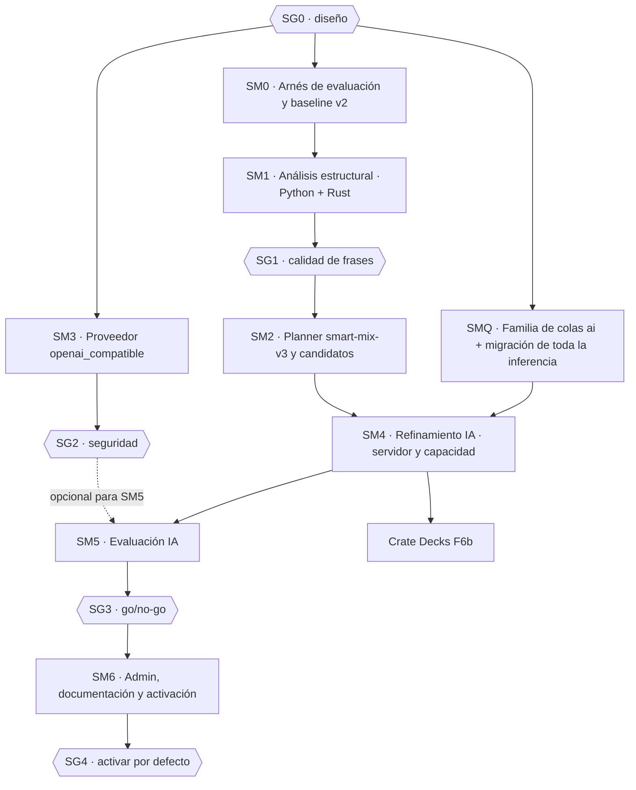

# Smart Mix 3 — Plan de implementación

> **Estado (2026-11-18):** Implementado (SM0–SM6; PR #398, #419, #420, #432). El refinamiento IA quedó apagado tras SG3 (52fefb77d).

> **Para agentes:** ejecuta las fases en orden. **No pases un gate humano (SG0–SG4, §13 del diseño) sin
> aprobación explícita de Diego.** Nada de producción sin autorización específica: los cambios se despliegan
> con el proceso normal de release de Crate y solo cuando Diego lo pida.
>
> Diseño: [2026-11-02-smart-mix-3-design.md](2026-11-02-smart-mix-3-design.md). Las decisiones se citan como
> SM3-D1…D12. Cliente que lo consume primero: Crate Decks F6b
> ([plan](2026-11-02-crate-decks-implementation-plan.md)).

**Fecha:** 2026-11-02. **Base:** `origin/main` en `a0fa13aaa` (3.1.2). La última migración es la 142: revalida
el *head* antes de numerar cada migración nueva.

---

## 0. Convenciones

- **Worktrees** desde `main`: `worktrees/sm3-<tema>`. Ramas `feat/sm3-<tema>`. Un PR por apartado `SMn.PRm`.
- **Reglas del monorepo (`AGENTS.md`):**
  - SQL solo en `app/crate/db/` (queries, repositories, jobs), sin `from crate.db import` fuera del paquete.
  - `read_scope` y `transaction_scope`.
  - `ANY(:ids)` y nada de agregados sobre `library_tracks` en requests.
  - Nada se reconstruye en un request.
- **Tareas (`app/crate/worker_handlers/AGENTS.md`):** idempotentes, con las claves de `TASK_HANDLERS` y `TASK_POOL_CONFIG` emparejadas, `max_retries=0` en trabajo de pago y `time_limit_seconds` realista.
- **IA (`docs/technical/ai-agents.md`):** reserva antes de transmitir, sin reintentos ni fallback de transporte, sin guardar prompt ni respuesta.
- **Tests:** pytest por función pública cambiada, PostgreSQL con `pg_db`, Rust con `cargo test` en `tools/crate-cli`, y frontend admin con Vitest y Testing Library.

  ```bash
  cd app && ../.venv/bin/python -m pytest tests/<fichero>.py -q
  cd tools/crate-cli && cargo test
  npm run --workspace=app/ui test -- <patrón>
  ```
- **Documentación canónica:** al cerrar cada fase, `docs/technical/smart-mix-design.md`, `-operations.md` y `ai-agents.md`. Notas de versión en `docs/releases/` cuando se publique.
- **Commits:** conventional commits sin atribución de IA; el cuerpo explica el porqué.

## Mapa de fases



| Fase | Resultado | PRs | Tamaño estimado |
|---|---|---|---|
| SM0 | Conjunto de aristas, métricas objetivas, render offline y baseline de v2 | 2 | 4–6 días |
| SM1 | Frases, curva de energía y voz opcional en Python y Rust; perfil schema 2; backfill | 4 | 10–15 días |
| SM2 | Planner v3 con menú de candidatos; la API acepta v3 | 3 | 7–10 días |
| SM3 | Proveedor `openai_compatible` (Kimi, DashScope, OpenRouter, vLLM) | 3 | 6–9 días |
| SMQ | Colas `ai` y `ai_bulk`, migración de todas las tareas de IA y paso a asíncrono de las llamadas síncronas en HTTP | 5–6 | 8–12 días |
| SM4 | Acción `smart_mix.transition.refine`, prompt, validación, cola `ai`, tabla, API `refinement` y capacidad | 4 | 10–14 días |
| SM5 | Evaluación de v3 frente a v3 + IA con varios modelos, e informe | 1 | 4–6 días |
| SM6 | Admin (binding, aviso de jurisdicción, estadísticas), SSE opcional, documentación y activación | 3 | 5–8 días |

SM3 es independiente: SM4 y SM5 funcionan con DeepSeek y Ollama sin ella. SMQ corre en paralelo a SM1–SM3 y tiene que estar terminada antes de SM4.

---

## SM0 · Arnés de evaluación y baseline

**Objetivo:** medir antes de cambiar nada. Cada fase posterior se compara con este baseline.

### SM0.PR1 · Conjunto de aristas y métricas

| Fichero | Contenido |
|---|---|
| `tools/smart-mix-eval/README.md` | Qué mide, cómo se ejecuta y que nunca se lanza contra producción sin autorización |
| `tools/smart-mix-eval/build_dataset.py` | Genera N aristas (por defecto 300) desde la biblioteca de la base de datos configurada, con el servicio de compatibles. Estratifica por género raíz y por Δ BPM (0–2 %, 2–4 %, 4–6 %) y guarda `dataset.jsonl` con los `entity_uid` y las revisiones de perfil (nunca títulos) |
| `app/crate/smart_mix/evaluation.py` | Métricas sobre plan y perfiles, sin audio: `phrase_alignment`, `bass_overlap_ms`, `harmonic_clash_ms`, `energy_step`, `vocal_clash_ms` (si hay datos) y `policy_violations`. Funciones puras, testeables y sin acceso a la base de datos |
| `tools/smart-mix-eval/run_eval.py` | Planifica el conjunto con un planner o variante, calcula las métricas y escribe `report.json` y `report.md` (medias, p50/p95 y diferencias por estrato) |

**Tests**, en `app/tests/test_smart_mix_evaluation.py`:
- `test_phrase_alignment_counts_boundaries`
- `test_bass_overlap_zero_without_handoff_overlap`
- `test_harmonic_clash_uses_camelot_compatibility`
- `test_energy_step_symmetric`
- `test_policy_violations_detects_out_of_range_plan`
- `test_metrics_are_pure` (sin acceso a la base de datos)

### SM0.PR2 · Render offline para escucha

- **Fichero:** `tools/smart-mix-eval/render_pair.py`.
  - A partir de un plan y las dos rutas de audio, genera con FFmpeg (filtros `atempo`, `volume`, `afade` y EQ de graves con `equalizer`) un WAV de 30–60 s alrededor de la transición.
  - Script de escucha a ciegas: `blind_session.py` baraja pares A/B, guarda la puntuación de 1 a 5 en `ratings.csv` y desvela al final.
- **Tests:** `tools/smart-mix-eval/tests/test_render_pair.py`, con `test_render_respects_cues_and_duration` (sobre tonos sintéticos, igual que `test_smart_mix_rust_parity.py`).
- **Baseline:** `run_eval.py --planner smart-mix-v2` sobre la biblioteca de desarrollo. Se adjunta `report.md` al PR.

---

## SM1 · Análisis estructural (SM3-D2)

### SM1.PR1 · Segmentación en Python

| Fichero | Contenido |
|---|---|
| `app/crate/smart_mix/structure.py` | `segment_phrases(beat_grid, downbeats, energy_frames, sample_rate) -> StructureDraft`. Novedad de energía y espectro por compás, con picos preferentes en múltiplos de 8 compases. Une y parte para que cada frase mida 8, 16 o 32 compases. Etiqueta el tipo con reglas sobre la energía relativa y la posición. Calcula `structure_confidence`. Curva de energía de 1 byte por compás |
| `app/crate/smart_mix/analyzer.py` | `analyze_mix_profile` llama a `segment_phrases` reutilizando los frames de energía que ya calcula |
| `app/crate/smart_mix/models.py` | `TrackMixProfileDraft` y el modelo de perfil ganan `phrases`, `energy_curve`, `vocal_presence` y `structure_confidence` |
| `app/crate/smart_mix/versions.py` | `ANALYZER_VERSION = "smart-mix-audio-v6"` y `PROFILE_SCHEMA_VERSION = 2` |

**Tests**, en `app/tests/test_smart_mix_structure.py`, con pistas sintéticas generadas como en el test de paridad (clics más bloques de energía):
- `test_segments_on_eight_bar_multiples`
- `test_detects_break_and_peak_kinds`
- `test_low_confidence_on_irregular_meter`
- `test_energy_curve_one_byte_per_bar`
- `test_caps_phrase_count`
- `test_runtime_overhead_under_ten_percent` (marcado como benchmark y saltado en CI si no hay `--benchmark`)

### SM1.PR2 · Paridad en Rust

- `tools/crate-cli/src/structure.rs` y su integración en `mix_profile.rs`, con el mismo algoritmo y las mismas constantes.
- `tools/crate-cli/tests/smart_mix_structure.rs`: casos espejo de SM1.PR1.
- `app/tests/test_smart_mix_rust_parity.py`: compara `phrases` (límites ±1 beat), `kind` y `energy_curve` (±2 por byte) entre Python y Rust.

### SM1.PR3 · Persistencia y backfill

| Fichero | Contenido |
|---|---|
| `app/crate/db/migrations/versions/<NNN>_smart_mix_structure.py` | Columnas `phrases jsonb`, `energy_curve bytea`, `vocal_presence bytea`, `structure_confidence real` en `track_mix_profiles`, todas nulas |
| `app/crate/db/schema_sections/library_catalog.py` | Las mismas columnas en el DDL de referencia |
| `app/crate/db/repositories/` (el repositorio actual de perfiles; localizar con `grep -rn "track_mix_profiles" app/crate/db/repositories`) | Escritura y lectura de los campos nuevos. La lectura de planes solo carga `phrases` y `energy_curve` cuando el planner es v3 |
| Backfill | `backfill_smart_mix_profiles` (heavy) recalcula los perfiles con `ANALYZER_VERSION` antiguo, en lotes y con la prioridad actual. Sin cambios de cola |

**Tests:**
- `test_smart_mix_analysis_storage.py`, ampliado:
  - `test_persists_structure_fields`
  - `test_v1_profile_reads_with_null_structure`
- `test_smart_mix_migration.py`, ampliado: `test_structure_migration_up_down`.
- `test_smart_mix_backfill.py`, ampliado: `test_backfill_targets_old_analyzer_version`.

### SM1.PR4 · Detector de voz opcional y vista en el admin

- **Fichero:** `app/crate/smart_mix/vocals.py`.
  - Heurística espectral barata por frase: energía en 300–3.400 Hz frente al total, más la planitud espectral.
  - Solo se activa si alcanza el umbral de §10 del diseño sobre el conjunto etiquetado (`tools/smart-mix-eval/vocals_labels.csv`, 100 frases etiquetadas a mano por Diego o con su aprobación).
  - Si no lo alcanza, la PR deja la función y los tests, y el analizador no la llama.
- **Admin:** en la ficha de pista (Smart Mix), una franja de frases con la gramática de StackMap (líneas de 1 px, MonoLabel con el tipo y la longitud) y la curva de energía como carril de 1 px. Es solo para revisar en SG1.
  - Ficheros: `app/ui/src/components/SmartMixStructure.tsx` y su test.
- **Tests:**
  - `test_smart_mix_vocals.py`: `test_precision_recall_on_labelled_set` (salta si no existe el CSV).
  - `SmartMixStructure.test.tsx`: `renders phrase boundaries and kinds`.

**Gate SG1 (Diego):**
- Revisión visual de 30 pistas variadas en el admin.
- Informe de `run_eval.py` con v2 y estructura disponible.
- Decisión sobre el detector de voz.

---

## SM2 · Planner `smart-mix-v3` (SM3-D3)

### SM2.PR1 · Generador de candidatos

| Fichero | Contenido |
|---|---|
| `app/crate/smart_mix/policy.py` | `PLANNER_POLICY_V3`: copia de v2 con su propio `identifier="smart-mix-v3"` y `rules_revision=1`. Mismos límites de seguridad; añade `phrase_lengths=(8,16,32)` y `max_candidates=8` |
| `app/crate/smart_mix/candidates.py` | `plan_transition_candidates(outgoing, incoming, context, policy) -> list[TransitionCandidate]`. Combina frases de salida (las 4 últimas válidas) × frases de entrada (las 3 primeras) × longitud × bajos × curva; filtra con la política; puntúa (alineación de frases, Δ energía, compatibilidad armónica, estabilidad); deduplica; devuelve como máximo 8. Sin estructura usa la heurística de compases de v2 |
| `app/crate/smart_mix/planner.py` | `plan_transition_v3` devuelve el mejor candidato como `TransitionPlan`, más la lista de candidatos para SM4. `plan_transition` (v2) no cambia |
| `app/crate/smart_mix/models.py` | `TransitionCandidate` (índice, frases, longitud, modo, bajos, curva, puntuación y desglose) con `to_plan()`, que pasa por el constructor de `TransitionPlan` |

**Tests**, en `app/tests/test_smart_mix_candidates.py`:
- `test_all_candidates_pass_policy`
- `test_at_most_eight_candidates`
- `test_falls_back_to_bar_heuristic_without_structure`
- `test_best_candidate_prefers_phrase_aligned`
- `test_v2_planner_unchanged` (los mismos planes que antes para un conjunto fijo)
- `test_candidates_deterministic` (misma entrada, misma salida)

### SM2.PR2 · API y caché

| Fichero | Contenido |
|---|---|
| `app/crate/api/schemas/smart_mix.py` | `plannerVersion: Literal["smart-mix-v2","smart-mix-v3"]` (por defecto v2); `structureUsed` en la respuesta; `context.setHistory` opcional |
| `app/crate/api/smart_mix.py` | Elige el planner según la versión. La clave de caché incluye el identificador del planner (ya lo hace) |
| `app/crate/smart_mix/versions.py` | `API_CONTRACT_VERSION = "2026-11"` |
| `app/crate/api/capabilities.py` y su esquema | `smart_mix.planner_versions` y `smart_mix.structure` (si el porcentaje de perfiles con estructura supera un umbral; leído de `refresh_smart_mix_coverage`, nunca calculado en el request) |
| OpenAPI | Regenerar `/openapi-app.json` y `/openapi-crate.json`; `test_smart_mix_openapi.py` |

**Tests:**
- `test_smart_mix_api.py`, ampliado:
  - `test_v2_default_unchanged`
  - `test_v3_returns_structure_used`
  - `test_v3_cache_key_differs_from_v2`
  - `test_set_history_validated`
- `test_capabilities_smart_mix_v3.py`: `test_planner_versions_listed`, `test_structure_flag_from_coverage_snapshot`.

**Rendimiento:** con un benchmark local, p95 en caché < 50 ms y sin caché < 150 ms para 32 aristas v3. Si v3 sin caché supera el presupuesto, los candidatos se precalculan en el worker de perfiles (no en el request).

### SM2.PR3 · Evaluación de v3 determinista

- `run_eval.py --planner smart-mix-v3`, con informe comparado con el baseline de SM0 y 10 pares de escucha a ciegas de v2 frente a v3.
- **Sin gate propio:** el resultado se adjunta a SG3, y si v3 empeora frente a v2 en alguna métrica, se corrige antes de SM4.

---

## SM3 · Proveedor `openai_compatible` (SM3-D7)

Independiente. Puede ir en paralelo a SM1 y SM2.

### SM3.PR1 · Modelo, configuración y migración

| Fichero | Contenido |
|---|---|
| `app/crate/ai/contracts.py` | `Provider` añade `"openai_compatible"`; `ModelManifestEntry` (id, contexto, salida máxima, `structured_output`, controles de razonamiento) |
| `app/crate/ai/configuration.py` | `_PROVIDERS` y `_KEYS`; una conexión `openai_compatible` guarda `origin`, `path_prefix`, `template` (`moonshot`, `dashscope_intl`, `openrouter` o `custom`) y el manifiesto declarado |
| `app/crate/db/migrations/versions/<NNN>_ai_openai_compatible.py` | Amplía el CHECK de proveedor (`ai_configuration_v120`) y añade `path_prefix`, `template` y `model_manifest jsonb` a `ai_provider_connections` |
| `app/crate/db/schema_sections/ai_configuration_v120.py` | El DDL de referencia, coherente con la migración |

**Tests:**
- `test_ai_openai_compatible_config.py`:
  - `test_template_origins_fixed`
  - `test_custom_origin_requires_confirmation`
  - `test_manifest_validated`
  - `test_secret_stored_encrypted`
- Migración: `up` y `down`.

### SM3.PR2 · Descubrimiento, endpoint y transporte

| Fichero | Contenido |
|---|---|
| `app/crate/ai/discovery.py` | Una conexión `openai_compatible` admite el prefijo de ruta de su plantilla. Si el origen es `custom`: HTTPS obligatorio salvo en red privada, fijado de dirección y bloqueo de metadatos y link-local como Ollama. Sin redirecciones |
| `app/crate/ai/transport.py` | Rama `openai_compatible` con `/chat/completions`, `response_format` según el manifiesto (`json_schema` con el esquema si se admite; si no, `json_object` con el esquema en el sistema), `max_tokens`, y controles de razonamiento por plantilla (`enable_thinking` en DashScope, `reasoning_effort` u otro en Moonshot). `usage` normalizado |
| `app/crate/ai/capabilities.py` | Los modelos del manifiesto declarado se validan como `validated=True` si declaran salida estructurada |

**Tests:**
- `test_ai_openai_compatible_transport.py`, con un servidor HTTP falso:
  - `test_json_schema_request_body`
  - `test_json_object_fallback_body`
  - `test_reasoning_controls_per_template`
  - `test_usage_normalised`
  - `test_no_redirect_follow`
  - `test_response_cap_2mb`
- `test_ai_discovery.py`, ampliado:
  - `test_openai_compatible_rejects_metadata_ip`
  - `test_path_prefix_only_for_openai_compatible`

### SM3.PR3 · Admin

- `AddProviderDialog.tsx`: tipo "Compatible con OpenAI", con selector de plantilla (Moonshot/Kimi, DashScope internacional/Qwen, OpenRouter, Personalizado) y editor del manifiesto de modelos.
  - Texto de ayuda: los IDs de modelo cambian y no hay alias "latest" en Moonshot.
  - Iconos Solar y MonoLabel, como el resto del admin.
- **Tests:** `AddProviderDialog.test.tsx`:
  - `shows template origins`
  - `requires manifest entry with structured output`
  - `custom origin asks confirmation`

**Gate SG2 (Diego):** revisión de seguridad (SSRF, secretos, plantillas) antes del merge de PR2.

---

## SMQ · Familia de colas `ai` para toda la inferencia (SM3-D8)

**Regla:**
- Toda llamada a un proveedor de IA va a `ai` (interactivo, ≤ 300 s) o a `ai_bulk` (lotes largos).
- Ninguna llamada a un modelo dentro de una petición HTTP.

El inventario y el destino de cada operación están en SM3-D8 del diseño. Revalida el inventario al empezar:

```bash
git grep -l -E "execute_structured|resume_action|from crate\.llm" origin/main -- app/crate | grep -v "^origin/main:app/crate/\(ai\|llm\)/"
```

### SMQ.PR1 · Colas, despliegue y test de arquitectura

| Fichero | Contenido |
|---|---|
| `app/crate/actors.py` | Comentario de colas (`actors.py:56-63`) con `ai` y `ai_bulk`. Cambia la cola de `infer_genre_taxonomy`, `rebuild_genre_taxonomy_proposals`, `enrich_genre_descriptions` y `ai_catalog_refresh` (a `ai_bulk`), y de `research_artist_bio`, `draft_i18n_translation` y `show_extract` (a `ai`, con un `time_limit_seconds` de 300 s como máximo; si alguna necesita más, a `ai_bulk` justificándolo) |
| Comando de los workers (`docker-compose*.yaml`, manifiesto de despliegue e imagen) | `crate-worker` consume `ai` (`CRATE_AI_WORKER_THREADS`, 2 por defecto) y `ai_bulk` (`CRATE_AI_BULK_WORKER_THREADS`, 1 por defecto) en pools separados. El resto de workers no consume ninguna de las dos |
| `app/crate/ai/runtime.py` / `consumers.py` | Si `reserve_invocation` rechaza por concurrencia de la conexión, la tarea se vuelve a encolar con retraso (5–30 s con jitter, hasta 10 veces) en lugar de fallar. No es un reintento de transporte: no se ha transmitido nada |
| Estado del despliegue (`make deploy-preflight` y salud de los workers) | Comprobar que hay consumidor de `ai` y `ai_bulk`; si no, el preflight falla |
| Admin (página de colas o de sistema) | Mostrar `ai` y `ai_bulk` con la longitud de la cola y la tarea más antigua |

**Tests:**
- `test_actor_config.py`, ampliado:
  - `test_ai_tasks_only_in_ai_queues`, que recorre `TASK_POOL_CONFIG` y la lista de tareas que usan `resume_action` o `execute_structured`.
  - `test_ai_interactive_time_limit_cap`.
- `test_ai_architecture.py`, nuevo:
  - `test_no_model_calls_in_api_modules`: análisis de imports y llamadas en `app/crate/api/` que falla si un router importa `crate.llm.prompts.*` generadores, `execute_structured` o el proveedor legado. La lista de excepciones arranca vacía y solo se rellena con justificación.
  - `test_model_calls_only_in_ai_handlers`.
- `test_ai_concurrency_requeue.py`:
  - `test_concurrency_refusal_requeues_with_delay`
  - `test_requeue_gives_up_after_limit`
- Despliegue: `test_preflight_requires_ai_consumers` (o el equivalente en los tests del Makefile o del script de despliegue).

### SMQ.PR2 · Propuesta de EQ por género, asíncrona

- **API:** `api/genres.py:1101` (`generate_genre_eq`) pasa a `accept_action("genres.eq.propose")` + `create_task_dedup("propose_genre_eq", dedup_key=genre)` y devuelve `202` con `task_id`.
- **Worker:** el handler llama a `generate_eq_preset` y guarda la propuesta.
- **Admin:** el editor de EQ (`GenreEqEditor.tsx`) muestra un estado pendiente y consulta la tarea, o usa el SSE de tareas si existe, hasta tener la propuesta.
- **Tests:**
  - `test_genre_eq_async.py`:
    - `test_returns_202_and_enqueues_once`
    - `test_worker_stores_proposal`
    - `test_unavailable_when_action_disabled`
  - `GenreEqEditor.test.tsx`: `shows pending then proposal`.

### SMQ.PR3 · Descripción de playlist, asíncrona

- **Cambio:** `api/system_playlists.py:766` (`admin_generate_playlist_description`), con el mismo patrón que PR2.
- **Tests:** `test_playlist_description_async.py` y el test del componente del admin.

### SMQ.PR4 · Refinamiento de Music Paths, asíncrono (UX decidida en SG0)

- **Comportamiento nuevo** en `music_paths.py:62`:
  - Al crear o regenerar, se devuelve la ruta determinista al momento y se encola `refine_music_path` (carril `ai`, dedup por `path_id` y huella del contexto).
  - Al terminar, el worker aplica `_apply_replacements` y guarda la ruta refinada como nueva revisión de la Music Path.
  - Publica el evento de invalidación que ya usan Listen y el admin, para que la vuelvan a pedir.
- **Clientes:** Listen y el admin muestran la ruta inicial y se actualizan solos. Hasta que llegue la revisión, un MonoLabel `AI · REFINANDO`.
- **Caché de 7 días:** se mantiene. Si hay acierto de caché, el refinamiento se aplica en la misma petición sin llamar al modelo, porque es una lectura.
- **Tests:**
  - `test_paths_llm_refinement.py`, adaptado:
    - `test_create_returns_deterministic_and_enqueues`
    - `test_worker_applies_refinement_as_new_revision`
    - `test_cache_hit_applies_inline_without_model_call`
    - `test_invalidation_event_published`
  - Listen: test del componente de la ruta con el estado de refinamiento.

### SMQ.PR5 · Candidatos de hero de artista (si llaman al modelo)

- **Primero, verificar** si `discover_artist_hero_candidates` (`api/artwork.py:705-719`) invoca `artwork.hero.analyze`.
  - Si lo hace, se aplica el mismo patrón asíncrono, con la tarea `analyze_artist_hero_candidates` en `ai` y el estado pendiente en el admin.
  - Si no lo hace, el PR solo añade su ruta a la lista blanca del test de arquitectura, con una nota que lo justifique.
- **Tests:** `test_artist_hero_candidates_async.py` (o la justificación).

### SMQ.PR6 · Documentación

- `docs/technical/ai-agents.md` (colas, regla de "nada de modelos en HTTP", reencolado por concurrencia).
- `smart-mix-operations.md` (dimensionado de `CRATE_AI_WORKER_THREADS`).
- Runbook de despliegue (consumidores nuevos).

---

## SM4 · Refinamiento con IA (SM3-D1, D4–D6, D8–D10)

### SM4.PR1 · Acción, prompt y validación

| Fichero | Contenido |
|---|---|
| `app/crate/ai/actions.py` | Acción `smart_mix.transition.refine`: entrada texto, permiso `smart_mix.ai` (nuevo; por defecto concedido con `library.view`), timeout de 45 s, 1.024 tokens de salida y razonamiento bajo por defecto |
| Migración `<NNN>_ai_action_smart_mix_refine.py` | Amplía los CHECK de acciones (`ai_action_bindings`, `ai_invocations`) |
| `app/crate/llm/prompts/smart_mix_transition.py` | `PROMPT_VERSION = "sm3-refine-1"`; `build_refinement_input(...)` (solo números y estructura, SM3-D6), `SYSTEM_PROMPT` y la respuesta Pydantic de §8 del diseño con `extra="forbid"` |
| `app/crate/smart_mix/refinement.py` | `apply_refinement(candidates, response, profiles, policy) -> RefinementOutcome` con las reglas de §9 del diseño; códigos de rechazo cerrados |
| Admin y documentación de acciones | Fixtures de la UI (`hooks/use-llm.tsx`) y la tabla de límites en `docs/technical/ai-agents.md` |

**Tests:**
- `test_smart_mix_refinement_prompt.py`:
  - `test_input_contains_no_titles_artists_uids_paths`, que recorre el JSON buscando cadenas de la pista de prueba.
  - `test_genre_omitted_when_binding_disallows`
  - `test_input_size_within_budget` (menos de 6 K tokens estimados en la arista más larga del conjunto)
  - `test_response_schema_forbids_extra`
- `test_smart_mix_refinement_apply.py`:
  - `test_unknown_candidate_rejected`
  - `test_shift_out_of_range_rejected`
  - `test_length_step_respects_policy`
  - `test_balanced_bass_requires_context`
  - `test_low_confidence_rejected`
  - `test_valid_refinement_builds_transition_plan`
  - `test_refined_plan_never_violates_policy`, con propiedades sobre 1.000 respuestas aleatorias.

### SM4.PR2 · Tabla, caché y tarea

| Fichero | Contenido |
|---|---|
| Migración `<NNN>_smart_mix_refined_plans.py` | Tabla de §6 del diseño, con índice `(from_entity_uid, to_entity_uid)` e índice por `last_read_at` |
| `app/crate/db/repositories/smart_mix_refinements.py` | `get_many(keys)` (`ANY(:keys)`), `save(outcome)`, `touch(keys)` (en lote y diferido) e `invalidate_for_tracks(uids)` |
| `app/crate/db/cache_store.py` | Prefijo `cache:smart-mix:refined-plan:v1:`, con lectura en el mismo `mget` en lote que los planes |
| `app/crate/worker_handlers/smart_mix_refinement.py` | `_handle_smart_mix_refine_transition`:
1. `resume_action`.
2. Recalcula los candidatos (mismos perfiles y revisiones; si cambiaron, termina como `stale`).
3. Construye la entrada y llama a `execute_structured`.
4. `apply_refinement`.
5. Guarda `ready`, `rejected` o `failed` y escribe la caché. |
| `app/crate/actors.py` | `"smart_mix_refine_transition": TaskPoolConfig("ai", 0, 60, 0)`, con prioridad máxima dentro de `ai`; la cola ya existe desde SMQ.PR1 |
| Invalidación | Al recalcular un perfil (`compute_smart_mix_profile`), `invalidate_for_tracks([uid])` |
| Limpieza | `"cleanup_smart_mix_refinements": TaskPoolConfig("maintenance", 3, 600, 0)` programada a diario: borra lo que lleve 180 días sin leer |

**Tests:**
- `test_smart_mix_refinements_repository.py` (`pg_db`):
  - `test_get_many_single_query`
  - `test_save_idempotent_by_key`
  - `test_invalidate_for_tracks`
  - `test_cleanup_respects_last_read`
- `test_smart_mix_refine_worker.py`:
  - `test_ready_on_valid_response`
  - `test_rejected_on_invalid_response`
  - `test_failed_on_transport_error_without_retry`
  - `test_stale_when_profile_revision_changed`
  - `test_budget_refusal_marks_unavailable`
  - `test_never_logs_prompt_or_response`
- `test_actor_config.py`, ampliado: `test_ai_queue_task_registered`.

### SM4.PR3 · API `refinement`

| Fichero | Contenido |
|---|---|
| `app/crate/api/schemas/smart_mix.py` | `context.aiRefinement: bool = False`; `refinement` en la respuesta (§7 del diseño) |
| `app/crate/api/smart_mix.py` | Si v3 llega con `aiRefinement` y la acción está disponible:
1. Calcula las claves.
2. Lee en lote (Redis y, si falla, la tabla con una sola consulta).
3. Para las que faltan, `create_task_dedup` con `accept_action`, con prioridad para las 2 primeras aristas del lote, que son las más próximas.
4. Devuelve `pending`.

Sin disponibilidad: `unavailable` con `reasonCode` |
| `app/crate/api/auth.py` | Alcance `vdj.smart_mix.ai` para tokens `crv_`; `aiRefinement` sin ese alcance → `unavailable` (`scope_missing`), sin 403, para no romper clientes |
| Limitación | Como máximo 64 encolados por usuario y minuto; por encima, `unavailable` (`rate_limited`) |

**Tests:**
- `test_smart_mix_api_refinement.py`:
  - `test_without_flag_no_refinement_field`
  - `test_pending_enqueues_once_dedup`
  - `test_ready_served_from_cache`
  - `test_unavailable_when_disabled`
  - `test_unavailable_when_budget_exhausted`
  - `test_access_token_needs_ai_scope`
  - `test_rate_limit_per_user`
  - `test_v2_ignores_ai_flag`
  - `test_hot_path_query_count` (en caché: 0 consultas a PostgreSQL; sin caché: 1)

### SM4.PR4 · Capacidad

- **`app/crate/api/capabilities.py` y su esquema:** `smart_mix.ai_assisted{available, provider_kind, model_label, prompt_version, typical_latency_ms, reason}`.
  - Sale de `runtime.action_availability` y del ajuste `smart_mix_ai_enabled` (nuevo, apagado por defecto).
  - `typical_latency_ms` sale de un resumen precalculado por `refresh_smart_mix_coverage`, nunca de una agregación en el request.
- **`app/crate/api/settings.py`:** `smart_mix_ai_enabled` y `smart_mix_ai_send_genre` (verdadero por defecto).
- **Tests**, en `test_capabilities_smart_mix_ai.py`:
  - `test_unavailable_when_setting_off`
  - `test_unavailable_without_binding`
  - `test_available_reports_local_or_cloud`
  - `test_no_secrets_in_capabilities`
  - `test_latency_from_snapshot`

**Desde aquí, Crate Decks F6b puede empezar.** El servidor mantiene la IA apagada por defecto hasta SG4.

---

## SM5 · Evaluación de la IA (SM3-D12)

- **`run_eval.py --planner smart-mix-v3 --refine <conexión>`** sobre el conjunto de SM0, con al menos:
  - Qwen3.8-27B en Ollama local;
  - DeepSeek (`deepseek-flash`, razonamiento bajo).
  - Kimi y Qwen en la nube, si SG2 ya está aprobado y Diego lo autoriza (coste).
- **El informe por modelo** incluye:
  - todas las métricas de §10 del diseño y la tasa de rechazo;
  - latencia p50 y p95;
  - tokens por transición y coste estimado con el precio público del día, citando la fuente;
  - diferencias frente al determinista por estrato de género y Δ BPM.
- **Escucha a ciegas:** 30 pares (v3 frente a v3 + mejor modelo) con `blind_session.py`.
- **Entregable:** `docs/plans/2026-11-XX-smart-mix-3-eval-report.md` (fuera del repo, como el resto de planes) con la recomendación de modelo y razonamiento.

**Gate SG3 (Diego):** go/no-go con los criterios de §10 del diseño.
- **Si es no-go:** se cierra la línea de IA (SM6 solo documenta) y v3 determinista sigue adelante.

---

## SM6 · Admin, documentación y activación

### SM6.PR1 · Admin

- **Binding de la acción** `smart_mix.transition.refine` en la página de modelos de IA:
  - **Aviso de jurisdicción** al elegir una conexión cloud. Lo confirma una vez el admin y queda guardado como `jurisdiction_ack_at` en el binding (migración pequeña).
  - **Interruptor** de "enviar género" (`smart_mix_ai_send_genre`).
- **Pestaña Smart Mix:**
  - refinamientos por estado;
  - tasa de rechazo;
  - latencia p50 y p95;
  - tokens al día;
  - con datos de una instantánea de `refresh_smart_mix_coverage` (nunca agregados en vivo).

  Gráficas con Nivo, con la gramática del admin.
- **Tests:**
  - `SmartMixAiPanel.test.tsx`:
    - `asks jurisdiction ack for cloud`
    - `local connection needs no ack`
    - `shows rejection rate`
  - `test_ai_binding_jurisdiction_ack.py`.

### SM6.PR2 · Evento SSE opcional

- `smart_mix.refinement_ready` en `/api/cache/events`, publicado por el worker al guardar `ready`, con las claves.
- Los clientes que lo usen dejan de hacer polling de esas aristas.
- **Tests:** `test_cache_events_refinement_ready.py`.

### SM6.PR3 · Documentación y activación

- Actualizar `docs/technical/smart-mix-design.md` (v3, estructura y refinamiento), `smart-mix-operations.md` (cola `ai`, backfill, limpieza, costes) y `ai-agents.md` (`openai_compatible` y acción nueva).
- Página en `app/docs` si Diego lo pide.

**Gate SG4 (Diego):**
- Si `smart_mix_ai_enabled` pasa a encendido por defecto en instalaciones nuevas, y con qué recomendación de modelo (local frente a cloud).
- Despliegue con el proceso normal de release, solo cuando Diego lo pida.

---

## Riesgos de ejecución

| Riesgo | Señal | Acción |
|---|---|---|
| La segmentación no alcanza calidad en SG1 | Frases visiblemente mal en el admin | Iterar SM1 antes de SM2; si un género falla, `structure_confidence` bajo y fallback a la heurística |
| La paridad Python/Rust se rompe con el algoritmo nuevo | `test_smart_mix_rust_parity.py` en rojo | No mergear SM1.PR3 sin paridad; ajustar tolerancias solo con justificación |
| v3 sin caché supera 150 ms | Benchmark de SM2.PR2 | Precalcular candidatos en el worker de perfiles |
| La familia `ai` no se despliega bien | Tareas `ai` o `ai_bulk` sin consumir | El preflight de despliegue falla sin consumidores (SMQ.PR1) |
| Los lotes de taxonomía ocupan `ai` | Refinamientos de Smart Mix tardan | Van a `ai_bulk` con su propio pool; un test impide tareas de más de 300 s en `ai` |
| El broker no respeta la prioridad de `TaskPoolConfig` | Precalentados delante de aristas próximas | Comprobarlo en SMQ.PR1; si no la respeta, solo el trabajo de prioridad alta va a `ai` y los precalentados a `ai_bulk` |
| Pasar a asíncrono rompe pantallas del admin o de Listen | Formularios que esperaban la respuesta | Una PR por operación con test de UI; Music Paths con la ruta determinista inmediata |
| Los modelos cloud cambian de ID o de precio | Fallos de binding o coste distinto | Manifiesto con IDs fijos, aviso del catálogo, coste recalculado en SM5 con fecha |
| El LLM no mejora (SG3 no-go) | Informe SM5 | Cerrar la línea de IA sin perder SM1 y SM2 |
