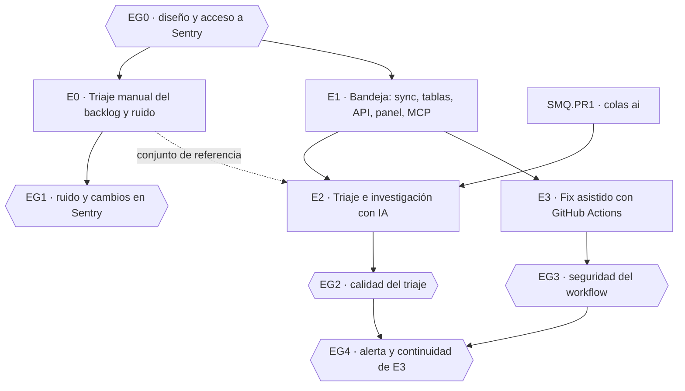

# Error Inbox — Plan de implementación

> **Estado (2026-11-18):** Implementado (PR #384, #388, #399–#402 y #453). El fix asistido acabó usando la bug API de la factory (bf962bf16).

> **Para agentes:** ejecuta las fases en orden. **No pases un gate (EG0–EG4, §12 del diseño) sin aprobación
> explícita de Diego.** Nada de producción sin autorización específica. Nada de cambios en Sentry ni en GitHub
> (estado de incidencias, ajustes de proyecto, secretos, activar workflows) sin que Diego lo pida.
>
> Diseño: [2026-11-04-error-inbox-design.md](2026-11-04-error-inbox-design.md). Las decisiones se citan como
> EI-D1…D14. Depende de SMQ.PR1 de [Smart Mix 3](2026-11-02-smart-mix-3-implementation-plan.md) para E2.

**Fecha:** 2026-11-04. **Base:** `origin/main` en `5c5bd24c0`. La última migración es la 142; revalida el
*head* antes de numerar cada migración nueva.

---

## 0. Convenciones

- **Worktrees** desde `main`: `worktrees/error-inbox-<tema>`. Ramas `feat/error-inbox-<tema>`. Un PR por apartado `En.PRm`.
- **Reglas del monorepo (`AGENTS.md`):**
  - SQL solo en `app/crate/db/` (queries, repositories, jobs), sin `from crate.db import` fuera del paquete.
  - `read_scope` para leer y `transaction_scope` para escribir.
  - Ni Sentry, ni GitHub, ni modelos dentro de una petición HTTP (EI-D3).
- **Tareas (`app/crate/worker_handlers/AGENTS.md`):**
  - idempotentes;
  - `TASK_HANDLERS`, `TASK_POOL_CONFIG` (`actors.py:70`) y `task_registry.py` emparejados;
  - `max_retries=0` en llamadas de pago o con efectos externos.
- **IA (`docs/technical/ai-agents.md`):** reserva antes de transmitir, sin reintentos de transporte y sin guardar prompt ni respuesta.
- **Tests:** pytest por cada función pública cambiada, PostgreSQL con `pg_db` y admin con Vitest y Testing Library. Las llamadas a Sentry y GitHub se prueban con `httpx.MockTransport`, nunca contra el servicio real.

  ```bash
  cd app && ../.venv/bin/python -m pytest tests/<fichero>.py -q
  npm run --workspace=app/ui test -- <patrón>
  ```
- **Commits:** conventional commits sin atribución de IA; el cuerpo explica el porqué.

## Mapa de fases



| Fase | Resultado | PRs | Tamaño estimado |
|---|---|---|---|
| E0 | Backlog triado, ruido corregido en origen, conjunto de referencia | 1–3 | 1–2 días con Diego |
| E1 | Sincronización, tablas, prioridad, API, panel Errors, tile, MCP | 4 | 7–10 días |
| E2 | Acciones `ops.error.triage` e `ops.error.investigate`, triaje automático, evaluación, alerta | 3 | 6–8 días |
| E3 | Workflow `error-autofix.yml`, despacho desde Crate, cierre por release | 3 | 4–6 días |

E1 y E0 pueden ir en paralelo. E3 solo depende de E1.

---

## E0 · Triaje manual del backlog (sin código de producto)

**Objetivo:** reducir los 92 errores abiertos, cortar el ruido en origen y dejar un conjunto etiquetado para
medir E2.

**Prerrequisito (EG0):** acceso de lectura a `ninja-development`, con una de estas opciones:
- Diego reautentica el MCP de Sentry de Claude Code con la cuenta de Crate. Hoy está en `viterbit`.
- O un token de lectura para `sentry-cli`/API en la máquina local, fuera del repo.

### E0.1 · Inventario

- Exportar las incidencias sin resolver de los ocho proyectos, con estos campos: short id, proyecto, `service`, título, culprit, nivel, substatus, eventos totales y en 24 h, usuarios, primera y última vez, y releases.
- Para cada una, leer el último evento: excepción y frames de la app, sin variables locales.

### E0.2 · Clasificación con Diego

- Cada incidencia recibe:
  - una clasificación del diseño §4.2 (`bug`, `infrastructure`, `external_dependency`, `client_environment`, `noise`);
  - una severidad;
  - si procede, el duplicado del que forma parte;
  - y una decisión: arreglar, filtrar en origen, resolver o ignorar.
- **Resultado:** `docs/technical/evidence/observability/sentry-triage-2026-11.md`.
  - Contiene una tabla por grupo y los criterios usados.
  - No incluye mensajes de evento con datos de la biblioteca: el repo es público.
- **Conjunto de referencia:** las etiquetas (short id, clasificación, severidad, duplicado) se guardan como fixture en `app/tests/fixtures/error_inbox/reference_labels.json`. E2 lo usa para la evaluación, con digests sintéticos o saneados.

### E0.3 · Ruido en origen (PR `fix(observability): …`)

Solo lo que salga de E0.2. Los candidatos típicos, que hay que verificar con los datos:
- **Desconexiones de cliente** no cubiertas por `isBenignHTTPAbort` (Go) ni por su equivalente en Python.
- **Errores de red del navegador** en Listen y admin, como `Failed to fetch` o `Load failed` en segundo plano, que no son fallos de Crate.
- **4xx capturados** como errores por `capture_handled_http_error` (`sentry.py:207`) o por `createApiErrorReporter` (`app/shared/web/sentry.ts:68`).
- **Fingerprints que parten un mismo fallo en varias incidencias:** ajuste en el helper que corresponda.
- **Variables locales:** `include_local_variables=False` en `init_sentry`, decidido en EG1. Reduce lo que llega a Sentry y no se usa en el triaje.

**Tests:** cada filtro o fingerprint nuevo lleva su test en:
- `app/tests/test_sentry_scrubbing.py` o el fichero que ya cubra `sentry.py`;
- `app/readplane/internal/observability/sentry_test.go` (tabla);
- `app/shared/web/sentry.test.ts`.

### E0.4 · Cambios en Sentry (solo con EG1)

- Resolver o ignorar en bloque, con la lista aprobada por Diego.
- Filtros de entrada de los proyectos (extensiones de navegador, navegadores antiguos), si Diego los aprueba.
- Cada bug real pasa a un PR normal, uno por causa raíz, con `Fixes <SHORT-ID>`.

---

## E1 · Bandeja

### E1.PR1 · Esquema, prioridad y cliente de Sentry

| Fichero | Contenido |
|---|---|
| `app/crate/db/schema_sections/error_inbox_v<NNN>.py` | `error_issues` y `error_issue_triage` (diseño §4), con CHECK de enums, `UNIQUE (provider, external_id)` y los índices de §4.1 |
| `app/crate/db/migrations/versions/<NNN>_error_inbox.py` | Crea las tablas; `downgrade` las borra |
| `app/crate/db/repositories/error_issues.py` | `upsert_issues(rows, *, session)` en lote con `ON CONFLICT`, `mark_status(ids, status, *, session)`, `set_digest(...)`, `purge_closed(older_than_days=30)` y `record_fix_request(...)` |
| `app/crate/db/queries/error_issues.py` | `list_issues(filters, limit, cursor)`, `get_issue(id)`, `summary()` (una sola consulta con `FILTER`), `open_ids_not_in(external_ids)` y `untriaged_open(limit)` |
| `app/crate/error_inbox/priority.py` | `crate_score(issue) -> int` y `is_critical(issue, triage) -> bool` (diseño §5) |
| `app/crate/error_inbox/sentry_client.py` | Cliente httpx síncrono, sin reintentos y con timeout de 15 s. Ver los detalles debajo |
| `app/crate/error_inbox/digest.py` | `build_digest(event) -> dict`, `digest_hash(digest) -> str` y `group_key(digest) -> str` (diseño §6) |
| `app/crate/error_inbox/config.py` | Leer y validar `error_tracking`, `base_url` con protección SSRF (reutiliza la validación de `ai/discovery.py:51-66`) y tokens con `load_secret` |

**Cliente de Sentry:**
- `list_unresolved(projects, environments, cursor)` → `GET /api/0/organizations/{org}/issues/?query=is:unresolved&statsPeriod=24h&limit=100&project=…`.
- `get_issue(id)`.
- `latest_event(id)` → `GET /api/0/organizations/{org}/issues/{id}/events/latest/`.
- `update_status(id, status, substatus=None)` → `PUT /api/0/organizations/{org}/issues/{id}/`.
- `check_scopes()`.
- Al empezar, verificar los endpoints y los nombres de estado (`ignored` frente a `archived`) contra la documentación vigente de la API de Sentry.

**Tests:**
- `test_error_inbox_priority.py` (tabla):
  - `test_fatal_escalating_streaming_is_critical`
  - `test_warning_docs_is_low`
  - `test_users_weight_is_logarithmic`
  - `test_triage_critical_overrides_score`
- `test_error_inbox_digest.py`:
  - `test_drops_frame_vars`
  - `test_keeps_only_in_app_frames_last_20`
  - `test_music_paths_are_reduced`
  - `test_query_strings_removed`
  - `test_tag_allowlist`
  - `test_size_cap_trims_breadcrumbs_first`
  - `test_hash_stable_across_event_ids`
  - `test_group_key_same_for_same_top_frame`
- `test_sentry_client.py` (MockTransport):
  - `test_lists_pages_until_cap`
  - `test_parses_stats_24h`
  - `test_update_status_payload`
  - `test_auth_error_is_typed`
  - `test_no_retry_on_5xx`
- `test_error_inbox_config.py`:
  - `test_rejects_http_base_url`
  - `test_rejects_link_local_and_metadata`
  - `test_token_never_in_settings`
- `test_error_issues_repository.py` (`pg_db`):
  - `test_upsert_is_idempotent`
  - `test_summary_counts`
  - `test_purge_closed_cascades_triage`
  - `test_open_ids_not_in`

### E1.PR2 · Sincronización y tareas

| Fichero | Contenido |
|---|---|
| `app/crate/worker_handlers/error_inbox.py` | Handlers de `sync_error_issues`, `update_error_issue_status` y `test_error_tracking_connection` |
| `app/crate/actors.py` | `sync_error_issues`: `TaskPoolConfig("maintenance", 1, 120, 0)`. `update_error_issue_status` y `test_error_tracking_connection`: `TaskPoolConfig("fast", 0, 30, 0)` |
| `app/crate/worker.py` (`_HANDLER_GROUPS`) y `app/crate/task_registry.py` | Registro de los tres tipos de tarea |
| `app/crate/scheduler.py` | `"sync_error_issues": 300` en `DEFAULT_SCHEDULES` y `ERROR_TRACKING_SCHEDULED_TASKS`, activado en `_scheduled_task_enabled` solo si `error_tracking` está configurado |

**Pasos de `sync_error_issues`:**
1. Paginar el listado con un tope de 5 páginas. Si se trunca, `log.warning` y anotarlo en `ops_runtime`.
2. Upsert en lote y cálculo de `crate_score`.
3. Último evento como mucho de 25 incidencias por pasada: las que son nuevas o cuyo `last_seen` cambió, por score. Con él se calculan el digest, `digest_hash` y `group_key`.
4. Las abiertas en local que no aparecen en el listado: `get_issue`, como mucho 50 por pasada, para actualizar su estado.
5. `purge_closed`.
6. `set_ops_runtime_state("error_inbox", {...})` con la hora, los recuentos y el último error tipado.

**`update_error_issue_status`:** llama a Sentry, actualiza la fila y escribe en `audit_log` con `actor_id`.

**Tests:**
- `test_error_inbox_sync.py` (`pg_db` + MockTransport):
  - `test_first_sync_inserts_and_scores`
  - `test_event_fetch_cap_prioritises_score`
  - `test_missing_issue_marked_resolved`
  - `test_truncation_recorded`
  - `test_sentry_down_keeps_previous_rows`
  - `test_auth_error_surfaces_in_runtime_state`
- `test_scheduler.py`, ampliado:
  - `test_error_sync_not_scheduled_without_config`
  - `test_error_sync_scheduled_with_config`
- `test_actor_config.py`, ampliado: los tres tipos nuevos tienen handler, pool y registro.
- `test_error_issue_status_task.py`:
  - `test_resolve_calls_sentry_and_audits`
  - `test_without_event_write_scope_is_refused`

### E1.PR3 · API, capacidades y MCP

| Fichero | Contenido |
|---|---|
| `app/crate/api/permissions.py` | `ops.errors.view` y `ops.errors.manage` en `ALL_CAPABILITIES` y en los roles de admin |
| `app/crate/api/error_inbox.py` | Router `/api/admin/errors`. Endpoints debajo |
| `app/crate/api/schemas/error_inbox.py` | DTOs. El token solo se acepta en la escritura; nunca se devuelve, solo `redacted()` |
| `app/crate/api/admin_metrics.py` | `_build_metrics_dashboard` añade `errors` (lo que devuelve `summary()`), con la caché de 10 s que ya existe |
| `app/crate/agent_access.py` y `agent_scope_catalog.py` | Grant `ops.errors.read` → `ops.errors.view`, en los presets `crate_operator` y `crate_agent` |
| `app/crate/mcp/tools.py` | `get_error_summary` en `OBSERVATION_TOOLS`; `list_error_issues` y `get_error_issue` en `CATALOG`. Esquemas de entrada en `mcp/schemas` |

**Endpoints de `/api/admin/errors`:**
- `GET /` (lista con filtros y cursor).
- `GET /summary`.
- `GET /{id}` (detalle con digest y triajes).
- `POST /{id}/status` (encola `update_error_issue_status` y devuelve 202).
- `GET` y `PUT /connection` (`ops.runtime.manage`).
- `POST /connection/test` (encola y devuelve 202 con `task_id`).

Ningún endpoint llama a Sentry.

**Tests:**
- `test_error_inbox_api.py`:
  - `test_list_requires_view`
  - `test_status_requires_manage_and_enqueues`
  - `test_connection_requires_runtime_manage`
  - `test_token_never_returned`
  - `test_no_outbound_http_in_handlers` (parchea httpx para que falle si se llama)
- `test_admin_metrics_dashboard.py`, ampliado: `test_dashboard_includes_error_summary`.
- `test_mcp_tools.py`, ampliado:
  - `test_error_tools_require_grant`
  - `test_error_summary_has_no_event_text`

### E1.PR4 · Admin

| Fichero | Contenido |
|---|---|
| `app/ui/src/pages/Errors.tsx` | Lista con filtros, agrupación por `group_key`, cabecera de sincronización y estados vacíos distintos: sin configurar, sin incidencias, error de conexión y filtro sin resultados |
| `app/ui/src/pages/ErrorDetail.tsx` | Detalle: métricas, excepción, frames con código, etiquetas, breadcrumbs, triajes y acciones Resolve, Ignore y Open in Sentry. Investigate y Launch fix llegan en E2 y E3 |
| `app/ui/src/components/errors/ConnectionPanel.tsx` | Configuración y "Test connection", que consulta la tarea |
| `app/ui/src/components/system-health/ErrorsTile.tsx` | Tile de System Health con `data.errors` |
| `App.tsx`, `Sidebar.tsx`, `CommandPalette.tsx` | Rutas `/errors` y `/errors/:id` con `RequireCapabilities anyOf={["ops.errors.view"]}`, entrada entre Logs y Stack y entrada en la paleta |

Reglas de UI: las del admin (`sonner`, `lucide-react`), sin emojis, MonoLabel para estado y clasificación, reglas de 1 px.

**Tests (Vitest):**
- `Errors.test.tsx`:
  - `renders critical lane first`
  - `groups by group key`
  - `shows not configured state`
  - `shows connection error state`
  - `filters by service`
- `ErrorDetail.test.tsx`:
  - `hides status actions without event write`
  - `resolve enqueues and shows pending`
- `ErrorsTile.test.tsx`: `links to errors page` y `renders unavailable when missing`.

**Documentación de E1:**
- `docs/technical/observability.md`: sección nueva "Errors". Cuenta qué hace Sentry en Crate (lo que hoy está repartido por `00b-development-setup.md`), la bandeja, la sincronización y los permisos.
- `docs/technical/crate-mcp.md`: las herramientas nuevas.

---

## E2 · Triaje e investigación con IA

**Prerrequisito:** SMQ.PR1 en `main` (colas `ai` y `ai_bulk`, consumidores y test de arquitectura). Si no lo
está, se ejecuta SMQ.PR1 tal como está en el plan de Smart Mix 3 antes de E2.PR1.

### E2.PR1 · Acciones de IA

| Fichero | Contenido |
|---|---|
| `app/crate/ai/actions.py` | `ops.error.triage` (45 s, 2.048 tokens) y `ops.error.investigate` (90 s, 4.096 tokens), con el permiso `ops.errors.manage`, el grupo `ops` y la ubicación `/errors` |
| `app/crate/db/migrations/versions/<NNN>_ai_action_error_inbox.py` | Amplía los cuatro CHECK de `ai_configuration_v120.py` (L38, 54, 75 y 84). Si `smart_mix.transition.refine` ya está en `main`, la incluye; si no, el PR de Smart Mix rebasará |
| `app/crate/llm/prompts/error_triage.py` y `error_investigate.py` | Prompts de sistema con la cláusula de dato no confiable (diseño §7.3) y los esquemas Pydantic de salida |
| `app/crate/error_inbox/triage.py` | `triage_issue(issue_id, kind, actor_id)`. Pasos debajo |
| `app/ui/src/pages/AiModels.tsx` (diálogo de binding) | Aviso de salida de datos para las acciones `ops.error.*` |

**Pasos de `triage_issue`:**
1. Cargar el digest y los candidatos de duplicado (mismo `group_key` o mismo tipo de excepción, como mucho 10).
2. `execute_structured` con `idempotency_key = issue_id:kind:digest_hash`.
3. Validar (enums, `duplicate_of` entre los candidatos, índices de frames) y guardar.

**Tests:**
- `test_ai_actions.py`, ampliado: `test_error_actions_registered_with_limits`.
- `test_ai_action_migration.py`: la migración acepta las acciones nuevas y conserva las existentes.
- `test_error_triage.py` (modelo falso):
  - `test_valid_output_saved`
  - `test_duplicate_outside_candidates_rejected`
  - `test_frame_index_out_of_range_rejected`
  - `test_invalid_output_saves_nothing`
  - `test_idempotent_per_digest`
  - `test_prompt_marks_digest_untrusted`
  - `test_unavailable_without_binding`

### E2.PR2 · Triaje automático, backlog e investigación

| Fichero | Contenido |
|---|---|
| `app/crate/worker_handlers/error_inbox.py` | `triage_error_issue` y `investigate_error_issue` en la cola `ai` (`TaskPoolConfig("ai", 1, 120, 0)` y `("ai", 0, 180, 0)`). Al final de `sync_error_issues`, se encolan los triajes según el diseño §7.1 si `triage.automatic` está activo |
| `app/crate/api/error_inbox.py` | `POST /{id}/investigate` y `POST /triage-backlog` (202, dedup); `PUT /connection` acepta `triage.automatic` y `triage.daily_max` |
| `app/ui/src/pages/ErrorDetail.tsx` y `Errors.tsx` | Botón Investigate y panel de triaje e investigación (clasificación, severidad, hipótesis, frames sospechosos resaltados, siguiente paso, modelo y fecha). Botón "Triage backlog" con el número que se va a encolar |

**Tests:**
- `test_error_inbox_sync.py`, ampliado:
  - `test_enqueues_triage_for_new_regressed_escalating`
  - `test_respects_daily_cap_by_score`
  - `test_no_triage_when_automatic_off`
  - `test_digest_change_retriages`
- `test_error_inbox_api.py`, ampliado:
  - `test_backlog_caps_at_100`
  - `test_investigate_requires_manage`
- `test_ai_architecture.py` (de SMQ): las tareas nuevas pasan el test de "solo en la familia `ai`".
- Vitest: `ErrorDetail.test.tsx` (`shows triage panel`, `investigate pending state`).

### E2.PR3 · Evaluación y alerta

| Fichero | Contenido |
|---|---|
| `tools/error-inbox-eval/README.md` y `run_eval.py` | Ejecuta el triaje sobre los digests del conjunto de referencia de E0 con el binding configurado y mide el acuerdo en clasificación y severidad, los críticos tomados por ruido, las salidas inválidas y los tokens. Nunca se lanza contra producción sin autorización |
| `docs/technical/evidence/observability/error-triage-eval-<fecha>.md` | Resultado por modelo, para EG2 |
| `deploy/operator/config.operator.example.json` | Regla `errors-critical` (diseño §9) con `"enabled": false` |
| `deploy/operator/` (tests del supervisor) | Caso de la regla nueva con un resumen falso |

**Gate EG2:** con el informe, Diego decide el modelo y si activa `triage.automatic`.

**Documentación de E2:**
- `docs/technical/ai-agents.md`: acciones nuevas y salida de datos.
- `docs/technical/crate-operator.md`: regla nueva.
- `docs/technical/observability.md`: triaje.

---

## E3 · Fix asistido

### E3.PR1 · Workflow (desactivado hasta EG3)

| Fichero | Contenido |
|---|---|
| `.github/workflows/error-autofix.yml` | Workflow del diseño §8.3. Detalles debajo |
| `.github/autofix/PROMPT.md` | Instrucciones fijas del agente (diseño §8.3) |
| `.github/autofix/fetch_context.py` | Lee la incidencia y el último evento con `SENTRY_AUTOFIX_TOKEN` y escribe el contexto fuera del árbol. Sin `print` del contenido. Mismo saneado que `digest.py` (importado o copiado con test de paridad) |

**Detalles del workflow:**
- Solo `workflow_dispatch` con `sentry_issue` y `note`, y validación de inputs en el primer paso.
- `permissions` mínimos (`contents: write`, `pull-requests: write`), `concurrency` por incidencia y `timeout-minutes: 30`.
- Paso del agente con `anthropics/claude-code-action`, salida completa desactivada y límite de turnos.
- Si `vars.AUTOFIX_ENABLED != 'true'`, el job termina sin hacer nada.

**Comprobaciones antes de EG3 (en una rama, sin secretos reales):**
- `actionlint` limpio.
- Inputs inválidos que terminan el job.
- `fetch_context.py` probado con un evento sintético.
- Verificar con la documentación vigente de `claude-code-action`:
  - cómo se abre el PR para que se ejecuten CI y `pr-agent.yml`;
  - el nombre del input del token de suscripción.

**Tests:** `app/tests/test_autofix_context.py` (o `tools/…`):
- `test_validates_short_id`
- `test_context_written_outside_repo`
- `test_no_event_text_on_stdout`
- `test_sanitizer_parity_with_digest`

### E3.PR2 · Despacho desde Crate

| Fichero | Contenido |
|---|---|
| `app/crate/error_inbox/github_client.py` | `dispatch_workflow(repo, workflow, ref, inputs)` con token *fine-grained*; sin reintentos y con errores tipados (401/403/404/422) |
| `app/crate/worker_handlers/error_inbox.py` | `dispatch_error_fix` (`TaskPoolConfig("fast", 0, 30, 0)`), con dedup por incidencia, 24 h, `record_fix_request` y `audit_log` |
| `app/crate/api/error_inbox.py` | `POST /{id}/fix` (202, `ops.errors.manage`, nota ≤ 500 caracteres). `PUT /connection` acepta `fix.*` y su token |
| `ConnectionPanel.tsx` y `ErrorDetail.tsx` | Configuración de E3. Botón Launch fix con el aviso de repo público, el estado "pedido por X a las HH:MM" y el enlace a la página de Actions del workflow. PR enlazado si Sentry lo anota |

**Tests:**
- `test_github_client.py` (MockTransport): `test_dispatch_payload_has_only_short_id_and_note` y `test_typed_errors`.
- `test_error_fix_dispatch.py`:
  - `test_dedup_within_24h`
  - `test_records_request_and_audits`
  - `test_hidden_when_not_configured`
  - `test_note_length_cap`
- Vitest: `ErrorDetail.test.tsx` (`launch fix shows public repo warning`, `launch fix hidden without config`).

### E3.PR3 · Cierre por release

- `build-images.yml`: asociar commits a cada release de Sentry (`sentry-cli releases set-commits --auto` o la acción oficial) en los proyectos de `SENTRY_RELEASE_ENVIRONMENTS`. Necesita la integración de GitHub instalada en `ninja-development`. Es un cambio fuera del repo y solo se hace con el OK de Diego.
- Documentación:
  - `docs/technical/observability.md`: el ciclo completo;
  - `docs/technical/operations.md`: secretos `SENTRY_AUTOFIX_TOKEN` y token de la App, variable `AUTOFIX_ENABLED`, y cómo desactivar E3.

**Gate EG3:** con el PR1 mergeado y desactivado, Diego revisa:
- permisos y secretos;
- la primera ejecución sobre una incidencia `bug` de E0;
- el log público de esa ejecución.

Solo después se activa `AUTOFIX_ENABLED`.

**Gate EG4:**
- **Alerta:** tras 7–14 días de sombra, Diego activa `errors-critical`.
- **E3:** tras 20 ejecuciones, decide su continuidad con la tasa de PRs mergeados.
- **Blog:** si el ciclo funciona, es candidato a post del blog de ingeniería (encaja con "an agent proposes, a person approves").

---

## Verificación por fase

| Fase | Comandos |
|---|---|
| E1 | `pytest tests/test_error_inbox_*.py tests/test_sentry_client.py tests/test_error_issues_repository.py tests/test_scheduler.py tests/test_actor_config.py tests/test_mcp_tools.py -q`; `npm run --workspace=app/ui test -- Errors ErrorDetail ErrorsTile`; `npm run --workspace=app/ui build` |
| E2 | Lo anterior + `pytest tests/test_error_triage.py tests/test_ai_actions.py tests/test_ai_action_migration.py tests/test_ai_architecture.py -q`; evaluación de E2.PR3 contra el conjunto de referencia |
| E3 | `pytest tests/test_github_client.py tests/test_error_fix_dispatch.py tests/test_autofix_context.py -q`; `actionlint .github/workflows/error-autofix.yml` |

Antes de cada PR: `make dev-test`, o como mínimo las suites de backend y admin afectadas, en verde.
