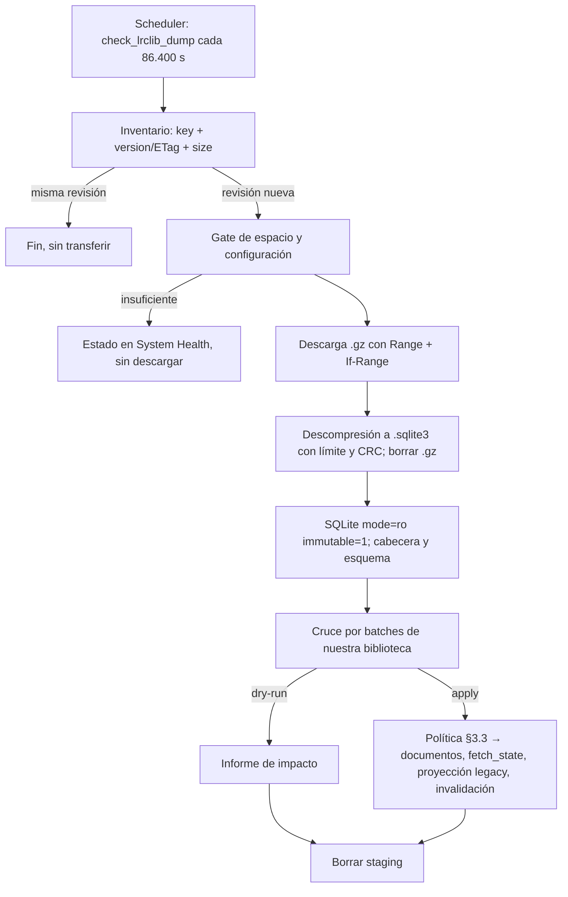

# Letras temporizadas, karaoke y créditos — Plan consolidado

> **Estado (2026-11-18):** consolidado de tres planes de letras sobre `main` en `5e7a9d6ec` (head de migraciones `166_decks_cues.py`). Hecho: PR1/C1 del plan de karaoke (`0f91999aa`, `fix(lyrics): preserve cached lyrics and refresh eligible tracks`) y la parte frontend del overhaul de mayo (contenido de letras compartido en Listen, último commit relevante `a193a1b2f`). Pendiente: F0 (sacar LRCLIB del request), PR2–PR5 del plan de karaoke, el spike K5/K6B y la fase F6 de créditos, ediciones y derechos.
>
> Sustituye a: `2026-10-28-karaoke-lyrics-plan.md` (crate-v3, 2026-10-28), `07-lyrics-credits-design.md` y `07-lyrics-credits-implementation-plan.md` (roadmap 2027 de musicdock, revisados el 2026-09-09) y `2026-05-07-lyrics-performance-ui-overhaul.md` (musicdock, 2026-05-07).

**Para agentes:** sigue `AGENTS.md` y el `AGENTS.md` del área que toques. Un PR por rama/worktree desde `main` actualizado, RED → cambio mínimo → GREEN. No pases un gate humano (§4, «Gates humanos») sin aprobación explícita de Diego. Nada de producción sin autorización específica. Tests acotados durante el trabajo; suite completa una vez al cerrar cada PR (backend completo en CI Linux; algunos tests de infra fallan solo en macOS). Fixtures propios, PostgreSQL/Redis aislados y red simulada: ningún test descarga el dump ni letras comerciales completas. La documentación canónica (`docs/technical/`) se actualiza en el PR que entrega cada comportamiento.

**Stack:** Python/FastAPI/Pydantic/SQLAlchemy/Alembic, Dramatiq (pools `fast` y `maintenance`) y scheduler existente, `sqlite3` de la stdlib en solo lectura durante la ingesta, gzip/HTTP Range; React 19/TypeScript/Vitest/Playwright en Listen y Admin; Go en el readplane solo donde ya lee letras. PyYAML ya está disponible; el parser XML seguro se elige en PR2.

---

## 1. Contexto y objetivos

- **Objetivo principal:** que cada pista tenga la mejor letra disponible para *esa grabación* (texto → línea → palabra/sílaba), que no se pierda nunca una letra válida y que Listen la muestre con resaltado progresivo cuando haya tiempos reales por palabra o sílaba.
- **Objetivo inmediato:** ningún request HTTP hace I/O externo lento. Hoy `GET /api/lyrics` llama a LRCLIB de forma síncrona en cada miss o entrada caducada (hasta 10 s por petición). Es la primera fase (F0).
- **Objetivo posterior:** créditos de composición/interpretación/producción, obras y ediciones con identidad, procedencia y derechos explícitos, sin rehacer lo que el modelo de letras ya cubre (F6).

**Arquitectura:** un documento normalizado por grabación en PostgreSQL, alimentado por cuatro fuentes con una única política de promoción: importación manual, LRCLIB remoto (siempre desde workers), ingesta episódica del dump de LRCLIB y, más adelante, alineación propia. El renderer de Listen consume ese documento; la caché legacy por artista/título (`track_lyrics`) se mantiene como proyección compatible.

### Datos de producción (consulta de solo lectura, 2026-10-28; revalidar en G2)

| Dato | Valor |
| --- | --- |
| Biblioteca | 1.054 artistas, 10.906 álbumes, **137.752 pistas** |
| Disco de música `/mnt/music` (`/dev/sdc`) | 5,5 TB, 4,0 TB usados, **1,2 TB libres** (78 %) y creciendo |
| Disco raíz (`DATA_DIR`, Docker, PostgreSQL) | 49 GB, **14 GB libres** (72 %) |
| Servidor | 8 vCPU, 62 GB RAM, sin GPU |
| `track_lyrics` | 82.948 filas, 167 MB: 29.384 synced (35 %), 16.431 solo plain (20 %), 37.133 negativas (45 %) |
| Pistas sin fila por `track_id` | 59.121 (43 %; aproximado, la caché casa por nombre) |
| Filas tocadas en 30 días / último día | 14.591 / 41 |

La caché solo se mueve bajo demanda: más de la mitad de la biblioteca está sin letra o con negativo, y PR1 no añade ningún mecanismo programado que lo mejore.

## 2. Estado actual en `main` (verificado)

### 2.1. Hecho

**PR1/C1 (`0f91999aa`, 2026-10-28):**

- `app/crate/lyrics_cache_policy.py`: política pura `lyrics_rank` (none < plain < synced), `should_replace_lyrics`, `has_lyrics`, `is_fresh`, `normalize_refresh_mode` (`missing` | `due` | `upgrade`).
- `app/crate/db/repositories/lyrics.py`: `merge_lyrics` con `SELECT ... FOR UPDATE`; un 404 o un candidato peor ya no borran una letra válida; un negativo solo se guarda si no había contenido.
- `app/crate/lyrics.py` `get_or_fetch_lyrics`: ante timeout/5xx devuelve lo guardado si tiene contenido.
- `app/crate/db/queries/lyrics.py` `list_tracks_for_lyrics(refresh_mode=...)` y `app/crate/worker_handlers/enrichment.py` `_handle_sync_lyrics` mapean `refresh_mode`; `app/crate/api/schemas/management.py` lo acepta; el botón de álbum (`app/ui/src/components/album/AlbumHeader.tsx`) usa `due`.
- Tests: `app/tests/test_lyrics_cache_policy.py`, `app/tests/test_lyrics_refresh_safety.py` (404 conserva, plain no pisa synced, stale sobrevive a fallos, negativo caducado se recomprueba, selección por modo, reloj inyectado).

**Frontend del overhaul de 2026-05-07 (hecho con otra forma que la propuesta):**

- Parser LRC único en `app/listen/src/components/player/extended/lyrics-data.ts` (`parseSyncedLyrics`), reexportado por `useFullscreenPlayerLyrics.ts`; no existe `lib/lyrics-parser.ts` ni hace falta.
- Contenido compartido drawer/fullscreen en `PlayerLyricsContent.tsx` + `PlayerLyricsSurface.tsx`; `LyricsPanel.tsx` (drawer `w-[480px] max-w-full` con título y artista), `extended/LyricsTab.tsx`, `FullscreenPlayer*`.
- `SyncedLyrics.tsx`: filas estáticas y una hoja `LyricsClock` que usa `usePlayerTimeReader` (`app/listen/src/contexts/player-time-reader.ts`) y `PlayerProgressContext`; RAF solo mientras suena y con motion permitido; progreso por línea vía `--lyric-progress`. Es la base del karaoke de PR4.

### 2.2. Pendiente (defectos y huecos comprobados)

| Sitio | Comportamiento hoy | Fase |
| --- | --- | --- |
| `app/crate/api/lyrics.py` `api_lyrics` (handler `def`, threadpool) → `crate.lyrics.get_or_fetch_lyrics` → `fetch_and_store_lrclib_lyrics` | En miss **o** entrada caducada (>30 días) hace `requests.get("https://lrclib.net/api/get", timeout=10)` dentro del request. Sin `requests.Session`, sin coalescencia entre peticiones concurrentes (el `FOR UPDATE` solo serializa la escritura) y sin `crate.provider_rate_limits.wait_for_provider_slot` | F0 |
| `app/tests/test_lyrics_cache.py::test_api_lyrics_stores_not_found_miss` | Asegura que el GET llama a LRCLIB una vez: codifica el defecto | F0 |
| `sync_lyrics_for_tracks` | Throttle por `time.sleep(delay_seconds)` por proceso, no compartido | F0 |
| Caché | TTL de 30 días; solo se renueva al leer o con un `sync_lyrics` manual. No hay tarea programada de letras en `app/crate/scheduler.py` | PR3 |
| Identidad | `track_lyrics` casa por `(provider, artist_key, title_key)`; estudio y directo del mismo título comparten letra y tiempos | PR2 |
| OpenSubsonic | `app/crate/subsonic/services/discovery.py` `get_lyrics` / `get_lyrics_by_song_id` leen `get_cached_lyrics(..., max_age_seconds=None)` sin red (correcto) pero por artista/título. `crate/subsonic/capabilities.py` ya anuncia `songLyrics` v1 y v2; `api/subsonic/legacy.py` valida `enhanced` y lo ignora | PR3/PR5 |
| Readplane | `app/readplane/internal/catalog/store.go` `lyricsStatus` lee `track_lyrics` (por `track_id` o `entity_uid`) para el estado de letras del detalle de álbum, igual que `queries/lyrics.py` `get_album_track_lyrics_status` en FastAPI | PR2 (paridad) |
| `lyrics-data.ts` | `{time, text}` en segundos por línea; regex solo `[mm:ss.xx]`; descarta líneas vacías temporizadas | PR4 |
| `use-lyrics.ts` | Consulta `/api/lyrics?artist&title` al cambiar de pista o reintentar; no se entera de una mejora en background | F0/PR3 |
| `SyncedLyrics.tsx` | Subrayado hasta la línea siguiente; `querySelectorAll` en cada aplicación del reloj | PR4 |
| Dump, documentos, importación, créditos, obras | No existe nada (`track_lyric_documents`, `lyrics_formats/`, `lyrics_dump*`, staging) | PR2–PR5, F6 |

Nota de nombres: en este repo «editorial» ya designa las playlists editoriales (`app/crate/agent_editorial.py`, `app/crate/db/repositories/editorial_plans.py`, migración `126_editorial_playlists`, `app/tests/test_editorial_migration.py`). Los módulos, rutas y tests `editorial*` que proponía el roadmap 07 colisionan; F6 usa `credits`/`editions`.

## 3. Diseño de referencia

### 3.1. Contrato del documento

Tiempos enteros en ms desde el inicio del audio. Modelo Pydantic en backend y equivalente TypeScript:

```ts
interface LyricSegment {
  text: string; // incluye los espacios que le corresponden
  startMs: number;
  endMs: number | null;
}

interface TimedLyricLine {
  text: string;
  startMs: number;
  endMs: number | null;
  segments: LyricSegment[];
}

interface LyricDocument {
  schemaVersion: 1;
  revision: string;
  granularity: "plain" | "line" | "word" | "syllable" | "segment";
  timingOrigin: "source" | "aligned";
  source: "import" | "lrclib" | "generated";
  language: string | null;
  durationMs: number | null;
  plainText: string | null;
  lines: TimedLyricLine[];
}
```

Reglas:

- `segments.map(s => s.text).join("") === line.text`. Se conservan Unicode, puntuación y espacios. Un `<` literal es texto, no motivo de rechazo; se renderiza escapado.
- `startMs >= 0`; `endMs >= startMs` cuando exista. Valores finitos, orden estable y límites (1 MiB por fichero, 10.000 segmentos).
- Se conservan solapes y líneas simultáneas. El fin ausente sigue siendo `null`: la UI puede acotar la presentación, no lo persiste como medición.
- Silencios y líneas vacías temporizadas se conservan como función temporal, no como texto cantado.
- `hasWordSync` o spans TTML acreditan `segment`. Solo es `word`/`syllable` si la fuente lo acredita.
- `revision` cambia con el texto, los tiempos o la grabación asociada, nunca por volver a comprobar.
- Traducciones, coros y agentes quedan en el original; el subconjunto TTML inicial soporta la capa principal y las líneas simultáneas.
- Las líneas del contrato nuevo van en ms; el legacy LRC va en segundos. La conversión es explícita en el adaptador, nunca heurística.

### 3.2. API y persistencia

- **Se mantiene:** `GET /api/lyrics?artist&title` y `LyricsResponse` (`app/crate/api/schemas/utility.py`), mismo cuerpo JSON. Desde F0 nunca hace red; el estado «buscando» viaja en cabeceras (§4.F0).
- **Nuevo (PR2):** `POST /api/lyrics/resolve` con body `{track: {global_track_uid?, entity_uid?, track_id?}}`, al menos una referencia válida y permisos resueltos en el servidor. Respuesta `{document: LyricDocument | null, state, syncedLyrics, plainLyrics}` con `state: "ready" | "pending" | "none" | "unavailable"`. La ausencia de letra no es error HTTP; referencia inválida o fallo de transporte sí son errores distinguibles. Tampoco hace red: en miss encola la misma tarea que F0.
- **Nuevo (PR2):** `POST /api/lyrics/import`, multipart con referencia local y fichero. Exige el permiso de edición de metadatos del álbum y solo afecta a esa pista.
- **Migración aditiva única** (siguiente revisión libre; hoy el head es `166`, revalidar al empezar):
  - `track_lyric_documents`: clave única por grabación, referencias, JSON normalizado, formato/original, procedencia (fuente, transporte, id upstream, revisión del dump, hash), revisión, `protected`, `stale`, fechas.
  - `track_lyric_fetch_state`: grabación + transporte (`lrclib_remote` / `lrclib_dump`), `last_attempt_at`, `last_success_at`, `next_check_at`, resultado, error, contador de fallos, id upstream, hash y revisión del dump. Índice parcial por `next_check_at`.
  - `lyrics_dump_runs`: revisión (`key + version/ETag + size`), modo, estado, contadores, tamaños, errores y fechas.
- `track_lyrics` no se migra destructivamente. Se sigue escribiendo como proyección legacy **solo** cuando la asociación artista/título es inequívoca (no hay dos grabaciones con documentos distintos bajo la misma clave).
- Lecturas y escrituras dentro de `app/crate/db/`: `read_scope`/`transaction_scope` breves, `session=` hacia abajo y batches con `ANY(:ids)`.

### 3.3. Política de selección y frescura

Aplica a todas las fuentes: API (vía worker), sync manual, scheduler, ingesta y alineación. `force=true` salta la frescura del objetivo concreto; **no** salta identidad, permisos, protección manual, límites del proveedor ni esta política. PR1 implementa la versión mínima sobre `track_lyrics`; PR3 la completa sobre documentos.

1. **Identidad primero.** Grabación, álbum y duración (±2 s) antes de comparar precisión. Una letra de otra versión no es candidata por tener más timestamps.
2. **La importación manual está protegida.** Una consulta forzada puede registrar alternativas, pero no las sustituye. Reemplazar o borrar exige acción explícita.
3. **Validar el documento.** Texto útil, formato reconocido, orden y límites temporales, cobertura coherente. `hasWordSync=true` o un string no vacío no bastan.
4. **Promover por mejora real:** ausencia → plain → línea → segmentos válidos con cobertura suficiente. No se acepta menos texto ni peor cobertura por más granularidad: dos líneas con word-sync no sustituyen una canción completa por línea.
5. **Igual granularidad:** solo con una revisión upstream acreditada más reciente que mantenga la validez. Un hash distinto sin revisión ordenable es un cambio detectado, no una mejora.
6. **Sin retrocesos entre transportes.** Un dump antiguo no pisa una revisión remota posterior por procesarse hoy. Se compara la revisión del registro, no la fecha de descarga.
7. **404, error o candidato peor no borran nada.** El negativo se guarda solo si no había contenido y la ausencia es válida. 429/timeout/5xx/formato roto no significan «sin letra».
8. **Documentos coherentes.** No se mezcla el synced de una versión con el plain de otra; el plain se deriva del documento temporizado.
9. **Audio sustituido.** Si cambia la revisión del fichero, una alineación propia queda `stale` y se degrada a texto o línea si procede.

**Elegibilidad del refresco remoto** (valores propuestos, confirmar en G0). El dump cubre la biblioteca de forma masiva; el remoto solo lo publicado después del snapshot y lo que se escucha.

| Estado elegido | Remoto elegible | Condición adicional |
| --- | --- | --- |
| Sin letra (negativo confirmado) | 30 días | Pista añadida después del último dump aplicado, **o** reproducida/abierta en los últimos 90 días |
| Solo plain | 14 días | Igual |
| Por línea | 60 días | Solo reproducida/abierta en 90 días (busca mejora a palabra) |
| Palabra/sílaba/segmento válido | Sin refresco automático | El siguiente dump o una acción manual |
| Importación manual | Nunca automático | — |
| Generación propia vigente | Sin regenerar por TTL | Puede promoverse una fuente mejor según la política |
| Error transitorio | Backoff con jitter y `Retry-After` | Se sirve la última versión válida |

- **Presupuesto remoto automático:** 500 comprobaciones por instancia y día, configurable, compartido entre scheduler y revalidaciones lanzadas por clientes. Los primeros lookups interactivos (F0) y las pistas recién importadas no consumen presupuesto, pero respetan el rate limit compartido y la deduplicación.
- La actividad sale del historial de reproducción y de los rollups existentes, en batch. Nunca `COUNT` sobre `library_tracks` por request ni para seleccionar.
- Admin muestra el backlog real (pendientes, comprobadas, promovidas) en Tasks/System Health; no hay un `last_checked_at` global que aparente cubrir el catálogo.

**Lectura, errores e invalidación:**

- Con documento vigente se responde desde PostgreSQL. Si la frescura venció, se sirve igualmente y se encola **una** revalidación deduplicada (stale-while-revalidate).
- Sin documento, el request encola una consulta interactiva deduplicada y responde `pending` (cambia respecto al plan de octubre, que permitía consultar LRCLIB dentro del request con deadline; ver §5.2).
- OpenSubsonic no hace red en el request: lee el documento canónico por id de canción y usa el fallback legacy.
- Tras promover y confirmar la transacción se invalida por grabación/revisión con `crate.api.cache_events.broadcast_invalidation`, agrupado por batch y sin texto en el evento.
- `useLyrics` escucha con `onCacheInvalidation` (`app/listen/src/lib/cache.ts`) la invalidación de la pista visible y hace un refetch por revisión. Sin `currentTime`/`isPlaying` en dependencias; se mantienen pista y posición.

### 3.4. Ingesta del dump de LRCLIB

Inspección pública con HTTP Range (sin descarga completa), 2026-10-28:

| Dato | Valor |
| --- | --- |
| Objeto vigente | `lrclib-db-dump-20261012T090639Z.sqlite3.gz`, publicado el 2026-10-12 |
| Tamaño comprimido | 47.837.763.733 B = **44,55 GiB** |
| SQLite declarado (cabecera) | 63.905.241 páginas × 4096 = **243,78 GiB** |
| Integridad publicada | `checksums` vacío; ETag multipart (no es un SHA del fichero) |
| Tablas | `tracks` (`name_lower`, `artist_name_lower`, `album_name_lower`, `duration`, `last_lyrics_id`) y `lyrics` (`plain_lyrics`, `synced_lyrics`, `lyricsfile`, `has_word_sync`, `instrumental`) |
| Índices útiles | `idx_tracks_metadata_no_album (name_lower, artist_name_lower, duration)`, `UNIQUE(name_lower, artist_name_lower, album_name_lower, duration)`, parcial `idx_lyrics_has_word_sync` |
| Inventario | JSON `objects/truncated` del endpoint que usa `lrclib.net/db-dumps`; no es una API versionada |
| Frecuencia | No garantizada; el inventario solo lista el último objeto |

Muestra de la API pública: 96 registros de seis temas, ninguno con `hasWordSync=true`. La cobertura real de palabra se mide en el dry-run.



1. **Configuración.** Si `LYRICS_DUMP_STAGING_DIR` está vacío, no se programa nada. `LYRICS_DUMP_MODE` = `dry-run` (por defecto) o `apply`; `LYRICS_DUMP_RESERVE_GIB` (propuesto: 200) es espacio que la ingesta nunca usa.
2. **Comprobación diaria.** `check_lrclib_dump` lee el inventario; si `truncated` o el formato no encaja, falla con estado visible y sin adivinar. Revisión = `key + version/ETag + size`: mismo nombre con otro ETag es revisión nueva. `schedule:last_run` indica encolado, no éxito.
3. **Job.** `ingest_lrclib_dump` en la cola maintenance, deduplicado por revisión, concurrencia 1, lock renovable con token, progreso y cancelación cooperativa entre chunks y batches. Ninguna transacción abierta durante red o disco. El timeout se fija con la medición del primer dry-run; no se hereda el de `sync_lyrics` (7200 s).
4. **Gate de espacio.** Antes de descargar se lee la cabecera SQLite con Range. Hace falta `libre ≥ gz + lógico + reserva` (hoy unos 290 GiB más la reserva, sobre 1,2 TB libres). Si no hay espacio: `skipped_no_space`, sin escribir.
5. **Descarga.** A `.part` en streaming, límite = tamaño del inventario. Resume con `Range` + `If-Range: <ETag>`; un 200 a un resume reinicia, nunca concatena. SHA-256 local solo para trazabilidad.
6. **Descompresión.** En streaming a `.sqlite3`, límite de salida = tamaño lógico declarado, CRC gzip validado. No se usa ISIZE (32 bits). El `.gz` se borra en cuanto la descompresión es válida.
7. **Apertura.** `file:...?mode=ro&immutable=1`. Se validan cabecera, tablas, columnas, índices requeridos y consultas de prueba. Sin `PRAGMA quick_check` completo: una página corrupta aborta sin publicar.
8. **Cruce.** Recorrido de `library_tracks` por cursor de id en batches de 1000 (título, artista, álbum, duración, `entity_uid`). Normalización con un port de `prepare_input` de upstream (`server/src/utils.rs`) y fixtures de equivalencia; `.lower()` no basta. Consulta `(name_lower, artist_name_lower)` con `duration BETWEEN d-2 AND d+2` sobre `idx_tracks_metadata_no_album` más el join `last_lyrics_id → lyrics`. Se prefiere coincidencia de álbum; si no desempata, `ambiguous` (no se elige el más detallado). Se guardan id de pista y de letra upstream, hash del payload y revisión del dump.
9. **Dry-run (obligatorio en la primera revisión, G2).** No toca documentos. Informe JSON en `${DATA_DIR}/lyrics/dump-runs/<revision>.json` y en el resultado de la tarea: matched/ambiguous/no match; promociones posibles por transición (negativo→plain/línea/palabra, plain→línea/palabra, línea→palabra); unchanged/protected/rejected; pistas con `has_word_sync` o `lyricsfile` válido; `instrumental` acreditado; tiempos por fase e I/O. Decide si se activa `apply` y cuánto vale K3 en la práctica.
10. **Apply.** Candidatos por la política §3.3 en batches con `transaction_scope` corto: documentos, `fetch_state` (`lrclib_dump`), proyección legacy inequívoca e invalidación agrupada. Mismo id y hash que lo elegido: solo avanza la frescura.
11. **Limpieza.** Staging borrado siempre (éxito, fallo o cancelación); se conservan `lyrics_dump_runs` y el informe. Si el job cae tras descomprimir, el siguiente intento reutiliza el `.sqlite3` solo si coinciden revisión y tamaño validados.
12. **Recursos.** `nice`/`ionice` en la ventana de baja actividad configurada (el disco de música sirve streaming y análisis). Pausa si el resource governor existente lo indica.
13. **Staging en el disco de música (decidido por Diego el 2026-10-28).** Directorio oculto dedicado `/mnt/music/.crate-lyrics-staging`, montado aparte solo en el maintenance worker como `LYRICS_DUMP_STAGING_DIR`. Tests de que watcher, scanner y demás recorridos de la biblioteca lo ignoran. Vacío fuera de una ingesta en curso.
14. **Pistas posteriores al dump.** Usan el lookup remoto del pipeline de contenido (`_process_new_content_lyrics` en `enrichment.py`), como hoy. La siguiente ingesta las incluye.

## 4. Fases

Orden por dependencias: **F0 → PR2 → (PR3 ∥ PR4) → PR5 → F6**. El spike K5 es independiente y empieza en cuanto haya corpus anotado. F6.0 (matriz de derechos) puede ir en paralelo desde ya porque no toca código.

### F0 — LRCLIB fuera del request

Corrección independiente, **sin migración**, entra en un release de mantenimiento antes que PR2. Trae al presente la parte backend no hecha del plan de 2026-05-07 y el principio de «la API de lectura no consulta proveedores» del roadmap 07.

- **Comportamiento de `GET /api/lyrics`:**
  - Hit fresco → responde desde PostgreSQL.
  - Hit caducado (> `LYRICS_TTL_SECONDS`) → responde lo guardado y encola una revalidación deduplicada (stale-while-revalidate).
  - Negativo fresco → `{null, null}` sin encolar.
  - Miss o negativo caducado → encola `fetch_lyrics` y responde `{null, null}` con cabeceras `X-Crate-Lyrics-State: pending` y `X-Crate-Lyrics-Key: <token>` (hash corto de `lyrics_key(artist)` + `lyrics_key(title)`, calculado en el servidor para que el cliente no replique la normalización).
  - Si encolar falla, se registra y se responde `{null, null}` con 200; el request nunca espera red.
  - Una sola transacción por request (`session=` hacia abajo): lectura + `create_task_dedup` opcional.
- **Tarea `fetch_lyrics`:** `TaskPoolConfig("fast", 0, 60, 1)` en `app/crate/actors.py` (análoga a `fetch_cover`), `TaskTypeInfo` en `task_registry.py`, handler `_handle_fetch_lyrics` en `worker_handlers/enrichment.py` registrado en el mapa de handlers. Dedup con `create_task_dedup(dedup_key="lyrics:lrclib:<artist_key>:<title_key>")` (advisory lock existente; sustituye al `SET NX` en Redis que proponía mayo). El handler llama a `fetch_and_store_lrclib_lyrics` (política PR1) y, solo si el contenido cambió, `broadcast_invalidation("lyrics:<token>")`.
- **Transporte LRCLIB:** `requests.Session` de módulo en `app/crate/lyrics.py` con User-Agent identificable y timeout explícito; cada llamada pasa por `crate.provider_rate_limits.wait_for_provider_slot("lrclib", <intervalo>)`, compartido entre procesos y con `sync_lyrics_for_tracks` (el `delay_seconds` actual queda como mínimo adicional por compatibilidad). 429 respeta `Retry-After`.
- **Listen:** `use-lyrics.ts` lee las cabeceras; con `pending` muestra el estado «buscando» en `PlayerLyricsContent.tsx` (nueva clave i18n, sin emojis), se suscribe con `onCacheInvalidation` al scope `lyrics:<token>` y hace **un** refetch. Si el canal SSE está degradado (`onCacheEventsHealthChange`), reintento acotado (por ejemplo 3 intentos con backoff) y después vacío. Cambio de pista cancela suscripción y fetch. Sin `currentTime`/`isPlaying` en dependencias.
- **Compatibilidad:** el cuerpo JSON no cambia. Clientes antiguos ven vacío en el primer miss (antes esperaban hasta 10 s) y la letra al reabrir. Cambio de comportamiento documentado en `docs/technical/05-enrichment-acquisition-and-integrations.md`.
- **Descartado del plan de mayo:** caché Redis de letras (PostgreSQL por clave única cumple el presupuesto de §5.4 y una segunda caché añade invalidación sin necesidad medida); borrado programado de negativos de más de 90 días (los negativos son estado con TTL según PR1 y §3.3, borrarlos provoca tormentas de re-consulta); cola `default` (se usa el pool `fast`, el masivo sigue en `maintenance`).
- **Crear:** `app/tests/test_lyrics_request_offload.py`.
- **Modificar:** `app/crate/api/lyrics.py`, `app/crate/lyrics.py`, `app/crate/actors.py`, `app/crate/task_registry.py`, `app/crate/worker_handlers/enrichment.py`, `app/tests/test_lyrics_cache.py` (`test_api_lyrics_stores_not_found_miss` pasa a afirmar cero red y una tarea), `app/tests/test_lyrics_api.py` (`test_get_lyrics_passes_artist_and_title_to_fetcher`), `app/listen/src/components/player/extended/use-lyrics.ts` y su test, `PlayerLyricsContent.tsx` y su test, locales de Listen.
- **RED:**
  - el GET con red parcheada para fallar no la llama nunca (miss, caducado, negativo);
  - N peticiones concurrentes del mismo miss crean una tarea;
  - hit caducado devuelve contenido y encola una revalidación;
  - negativo fresco no encola;
  - fallo al encolar → 200 vacío;
  - handler: guarda y difunde solo si cambió; 429/timeout no escriben negativo; usa el slot compartido;
  - Listen: `pending` → invalidación → un refetch; cambio de pista cancela; SSE degradado → reintentos acotados.
- **Run:** `cd app && ../.venv/bin/python -m pytest tests/test_lyrics_request_offload.py tests/test_lyrics_api.py tests/test_lyrics_cache.py tests/test_lyrics_refresh_safety.py tests/test_task_registry.py -q` y `npm run --workspace=app/listen test -- src/components/player/extended/use-lyrics.test.tsx src/components/player/PlayerLyricsContent.test.tsx --maxWorkers=1`.
- **Commit:** `fix(lyrics): move LRCLIB lookups out of the request path`.

### PR2 — K1 + K2: documento por grabación, formatos e importación

Depende de F0.

- **Crear:**
  - `app/crate/lyrics_formats/{__init__,models,lrc,ttml,lyricsfile}.py`;
  - `app/crate/api/schemas/lyrics.py`;
  - `app/crate/db/queries/lyric_track_refs.py` (resolución de `global_track_uid`/`entity_uid`/`track_id` con las identidades existentes, incluido `app/crate/db/repositories/entity_identity_keys.py` y `global_catalog_tracks.musicbrainz_recording_mbid`);
  - `app/crate/db/repositories/{lyric_documents,lyric_fetch_state}.py`;
  - la migración aditiva de §3.2 (las tres tablas en una revisión);
  - `app/tests/test_lyric_documents.py`, `test_lyric_recording_identity.py`, `test_lyric_documents_migration.py`, `test_lyrics_formats.py`, `test_lyrics_import.py`, `test_lyrics_provider.py` y `app/tests/fixtures/lyrics/`;
  - `app/ui/src/components/album/LyricsImportDialog.tsx` y su test;
  - escenas `tools/design-system-preview/review-k2-lyrics-import.{html,tsx}` y entrada en `tools/crate-ui-showcase/` (registro + contrato, `npm run design-system:showcase:check`).
- **Modificar:**
  - `app/crate/api/lyrics.py` (rutas `resolve` e `import`), `app/crate/lyrics.py` (consumir `lyricsfile` reconocido antes que los campos legacy, enviar álbum y duración a LRCLIB; la coalescencia ya existe desde F0);
  - `app/ui/src/pages/Album.tsx`, `app/ui/src/components/album/TrackTable.tsx` y su test;
  - estado/granularidad aditivos en `browse` y `queries/lyrics.py` `get_album_track_lyrics_status` solo si el UI lo necesita, sin documentos completos en el listado ni N+1. Si cambia la fuente del estado, `app/readplane/internal/catalog/store.go` `lyricsStatus` cambia en paridad con test Go de tabla.
- **Fixtures propios:** LRC por línea, Enhanced LRC por palabra, TTML por sílaba; línea vacía/instrumental, palabras partidas, dos voces simultáneas, fuente sin fin; malformados, YAML con claves duplicadas/alias, XML con DTD/entidades; homónimos y estudio/directo con duración distinta.
- **RED:**
  - estudio y directo del mismo título no comparten documento;
  - una referencia local y su global mapeada resuelven lo mismo; referencias contradictorias se rechazan;
  - el offset LRC se aplica una vez; whitespace TTML;
  - versión Lyricsfile desconocida → fallback;
  - un refresh no pisa una importación;
  - 404/429 (`Retry-After`)/timeout/documento inválido en el proveedor con respuestas grabadas;
  - `resolve` en miss devuelve `pending` sin red;
  - el endpoint legacy da exactamente el mismo JSON.
- **Parsers:** YAML seguro sin alias ni duplicados; XML sin DTD/entidades externas; límites de §3.1; errores sin escritura parcial.
- **Gate G1 (visual):** `http://127.0.0.1:5186/review-k2-lyrics-import.html` con el diálogo real: importar palabra, sílaba y un fichero de versión incorrecta; permisos, errores y confirmación.
- **Run:** `cd app && ../.venv/bin/python -m pytest tests/test_lyric_documents.py tests/test_lyric_recording_identity.py tests/test_lyric_documents_migration.py tests/test_lyrics_formats.py tests/test_lyrics_import.py tests/test_lyrics_provider.py tests/test_lyrics_api.py tests/test_lyrics_cache.py -q`, `npm run --workspace=app/ui test -- src/components/album/LyricsImportDialog.test.tsx src/components/album/TrackTable.test.tsx --maxWorkers=1` y, si se toca, `(cd app/readplane && go test ./internal/catalog/...)`.
- **Commit:** `feat(lyrics): add recording-bound lyric documents and timed imports`.

### PR3 — C2 + ingesta del dump

Depende de PR2. Puede ir en paralelo con PR4.

- **Crear:**
  - `app/crate/lyrics_promotion.py` (§3.3 completa sobre documentos; F0 y `sync_lyrics` pasan a usarla);
  - `app/crate/lyrics_dump.py` (inventario, gate, descarga, descompresión, apertura, cruce, informe);
  - `app/crate/lyrics_dump_normalize.py` (port de `prepare_input`);
  - `app/crate/db/repositories/lyrics_dump_runs.py`;
  - tests `app/tests/test_lyrics_promotion.py`, `test_lyrics_refresh_schedule.py`, `test_lyrics_refresh_concurrency.py`, `test_lyrics_dump_inventory.py`, `test_lyrics_dump_ingest.py`, `test_lyrics_dump_normalize.py`;
  - `app/listen/src/components/player/extended/lyrics-refresh.test.tsx`;
  - `tools/lyrics-dump-lab/make_fixture.py` (SQLite pequeño con el esquema real y letras inventadas).
- **Modificar:**
  - `app/crate/scheduler.py`, `task_registry.py`, `actors.py`, `worker.py`, `worker_handlers/enrichment.py`: tareas `refresh_due_lyrics` y `check_lrclib_dump`/`ingest_lrclib_dump`;
  - `app/crate/config.py` y `.env.example`;
  - `docker-compose.yaml` y `docker-compose.home.yaml`: montaje opcional de staging solo en el maintenance worker; el asset embebido del instalador se regenera si cambia la fuente;
  - `app/crate/subsonic/services/discovery.py`: documento canónico por id de canción, sin red;
  - `use-lyrics.ts` y `app/listen/src/lib/cache.ts`: el scope `lyrics:<token>` de F0 pasa a ser por grabación/revisión, por el mismo canal (sin segundo SSE);
  - Tasks/System Health en Admin: estado del dump, backlog y presupuesto.
- **RED con reloj fijo y fixtures:**

  | Caso | Esperado |
  | --- | --- |
  | Plain elegible y remoto devuelve synced | Se promueve sin hueco visible |
  | Synced y candidato por palabra válido y completo | Se promueve |
  | Dos líneas por palabra frente a canción completa por línea | No se degrada |
  | `hasWordSync=true` con tiempos inválidos | Rechazado; selección intacta |
  | Mismo payload | Solo avanza la frescura; sin nueva revisión ni invalidación |
  | Hash distinto sin revisión upstream | Cambio detectado; no se reemplaza |
  | 404/429/503/timeout tras un hit | Sigue disponible; backoff respetado |
  | Presupuesto diario agotado | Pendientes visibles y reanudables; nada marcado como comprobado |
  | Pista sin actividad y anterior al dump | No consume presupuesto remoto |
  | Importación confirmada + `force=true` | Consulta permitida; sin sobrescribir |
  | Dos peticiones simultáneas o respuesta vieja | Una consulta y ningún retroceso |
  | Inventario igual / mismo nombre con otro ETag / `truncated` | Sin descarga / revisión nueva / fallo visible |
  | Espacio insuficiente | `skipped_no_space`, sin escribir |
  | Resume con 200 / CRC incorrecto / salida mayor que la declarada | Reinicio / aborto / aborto; staging borrado |
  | Esquema sin columnas requeridas | Aborto antes de cruzar |
  | Cancelación o caída a mitad de batch | Sin publicación parcial incoherente; staging limpio o reutilizable |
  | Dry-run | Informe con todos los contadores; ningún documento tocado |
  | Apply | Solo promociones válidas, proyección legacy inequívoca e invalidación agrupada |
  | Estudio y directo con mismo artista/título | Cada id recibe su documento; el legacy no mezcla tiempos |
  | Listen abierto y nueva letra tras commit | Un refetch; misma pista y posición |
  | OpenSubsonic tras promoción | Nueva letra sin red en el request |
  | Watcher/scanner con staging presente | Lo ignoran |

- **Gate G2 (prod):** con el código desplegado, Diego autoriza el espacio de staging y un dry-run sobre la revisión vigente. Con el informe decide `apply`.
- **Run:** `cd app && ../.venv/bin/python -m pytest tests/test_lyrics_promotion.py tests/test_lyrics_refresh_schedule.py tests/test_lyrics_refresh_concurrency.py tests/test_lyrics_dump_inventory.py tests/test_lyrics_dump_ingest.py tests/test_lyrics_dump_normalize.py tests/test_scheduler.py tests/test_task_registry.py tests/test_subsonic_discovery.py -q` y `npm run --workspace=app/listen test -- src/components/player/extended/use-lyrics.test.tsx src/components/player/extended/lyrics-refresh.test.tsx src/lib/cache.test.ts --maxWorkers=1`.
- **Commits:** `feat(lyrics): promote better lyrics in background` y `feat(lyrics): ingest LRCLIB dumps into recording documents`.

### PR4 — K3: karaoke en Listen

Depende de PR2. Puede ir en paralelo con PR3.

- **Crear:**
  - `app/listen/src/components/player/lyrics-timing.ts` y su test (resolución de activos sin DOM);
  - `KaraokeLyrics.tsx` y su test;
  - `extended/lyrics-data.test.ts`;
  - escenas `tools/design-system-preview/review-k3-karaoke-lyrics.{html,tsx}`, `tools/crate-ui-showcase/reviews/KaraokeLyricsReview.tsx`, la story y `karaoke-lyrics.spec.ts`.
- **Modificar:** `extended/lyrics-data.ts` (ms y contrato §3.1, sin descartar líneas vacías temporizadas), `use-lyrics.ts` (resolución por referencia vía `POST /api/lyrics/resolve`, cancelación en cambio rápido y fallback legacy explícito), `PlayerLyricsContent.tsx`, `SyncedLyrics.tsx` y `player-lyrics.css`. Se extiende la hoja `LyricsClock` existente (`usePlayerTimeReader`, `PlayerProgressContext` en `app/listen/src/contexts/`); se reutilizan `app/listen/src/lib/track-reference.ts` y, antes de crear otro reloj, se revisan `app/listen/src/lib/playback-engine.ts` y sus adaptadores. Las filas/segmentos se cachean una vez por documento en lugar de `querySelectorAll` por tick.
- **RED con reloj falso:** solo se resalta el segmento activo; un seek atrás revierte; varias líneas activas; un instrumental no prolonga la palabra anterior; pause/resume, buffering, repeat; respuesta vieja tras cambiar de pista; duración desconocida; 5.000 segmentos.
- **Reglas:**
  - DOM estático y una hoja de reloj pequeña;
  - relleno progresivo solo con inicio y fin fiables; sin fin, activación discreta;
  - interpolar solo entre muestras del motor y corregir en cada muestra/seek;
  - RAF parado en pausa, ocultación, desmontaje o letras cerradas;
  - sin estado React por frame ni lectura de layout por tick;
  - drawer, extended y fullscreen comparten renderer;
  - misma identidad visual V3: el acento de Crate es la única novedad, sin glows ni escalados;
  - wrap, Unicode/RTL y sílabas consecutivas sin espacios añadidos;
  - nada de ticks en `aria-live`;
  - con reduced motion se mantiene el estado activo sin barridos;
  - velocidad, seek y cambio de engine conservan la posición de la grabación (Smart Mix no redefine el timeline de la letra).
- **Gate G3 (visual):** la escena de `:5186` y una prueba en el Xiaomi y en desktop con audio propio.
- **Run:** `npm run --workspace=app/listen test -- src/components/player/lyrics-timing.test.ts src/components/player/KaraokeLyrics.test.tsx src/components/player/extended/lyrics-data.test.ts src/components/player/extended/use-lyrics.test.tsx src/components/player/SyncedLyrics.test.tsx src/components/player/PlayerLyricsContent.test.tsx --maxWorkers=1` y `npx playwright test --config tools/crate-ui-showcase/playwright.config.mjs tools/crate-ui-showcase/karaoke-lyrics.spec.ts tools/crate-ui-showcase/player-reading.spec.ts --workers=1`.
- **Commit:** `feat(listen): render timed karaoke lyrics with playback clock`.

### PR5 — K4 + K6A: offline, portabilidad, OpenSubsonic y exportación

Depende de PR3 y PR4. Antes de empezar, Diego responde la pregunta abierta O3 (derechos de offline/exportación).

- **Crear:** `app/listen/src/lib/lyrics-cache.ts` y su test, `app/crate/lyrics_formats/writer.py` (Lyricsfile 1.0 solo con `version/metadata/lines/words/plain`, sin `offset_ms`, `end_ms` omitido si no se conoce), `app/tests/test_lyricsfile_writer.py`, `app/tests/test_lyrics_portability.py` y `tests/listen-visual/karaoke-lyrics.spec.ts`.
- **Modificar:**
  - modelo, almacenamiento y assets offline (`app/listen/src/lib/offline-*.ts`, `app/listen/src/contexts/use-offline-manifest-sync.ts`);
  - `app/crate/api/offline.py` y su esquema;
  - `portable_metadata` (`app/crate/db/queries/portable_metadata.py`, `app/crate/db/repositories/portable_metadata.py`, hoy sobre `track_lyrics` vía `merge_lyrics`, y su restauración);
  - `app/crate/subsonic/services/discovery.py` y `app/crate/api/subsonic/legacy.py`: `songLyrics` con `enhanced=true` (cues desde segmentos reales y offsets UTF-8 del texto final). Hoy v2 ya se anuncia en `capabilities.py` y `enhanced` se ignora; ver O5.
- **RED:**
  - modo avión con audio y letra descargados → karaoke;
  - una letra de otro servidor/usuario/grabación no aparece; borrar cuenta/servidor purga el texto;
  - una descarga de audio no falla por falta de letra; un cambio de letra no vuelve a descargar el audio;
  - el service worker no prolonga la vida de una letra fuera de su manifiesto;
  - round-trip del writer contra los parsers de PR2;
  - offsets UTF-8 con acentos, emoji y dúos.
- **Gate G4:** QA en web/Tauri, Android/iOS (pausa, seek, background, cambio de pista, offline) y en el sender de Cast con la posición del receiver. Un target sin reloj fiable mantiene el fallback documentado.
- **Commit:** `feat(lyrics): preserve karaoke across offline, export and Subsonic clients`.

### Spike K5 — alineación propia (G5) y K6B

- **Crear:** `tools/lyrics-alignment-lab/{README.md,evaluate.py,schemas/evaluation-v1.json}`. Audio, modelos y resultados pesados fuera de Git.
- **Corpus:** unos 12 fragmentos de 30–60 s con marcas manuales de palabra y sílaba: voces limpias en inglés y español, rap, punk/hardcore y voces distorsionadas. Solo material propio o con permiso. **Requiere anotación humana.**
- **Candidatos:** WhisperX en modo alineación con texto conocido (sin ASR completo), con y sin separación de voz; SOFA para límites fonéticos (su diccionario por defecto, OpenCpop, no cubre inglés ni español: elegir pesos e inventario compatibles); Stable-ts solo como referencia (repo pausado).
- **Medir:** error de inicio/fin, palabras sin alinear, errores > 300 ms, CPU/RAM y tiempo por minuto de audio en el hardware de prod (8 vCPU, sin GPU).
- **Umbrales propuestos:** p90 de error de inicio de palabra ≤ 150 ms; < 5 % de palabras con error > 300 ms; nada inventado ni regresivo. Sílabas: p90 ≤ 100 ms más revisión perceptiva. Char-level, silabificación textual o reparto uniforme no cuentan.
- **G5:** tabla y ejemplos audibles a Diego; se decide por separado para palabra y sílaba, y por idioma/género.
- **K6B (solo tras G5):** adenda con el candidato y sus dependencias en una imagen o worker aislado (nunca en `app/requirements-api.txt`); tarea `generate_lyricsfile` opt-in con concurrencia 1, cancelación y clave grabación + revisión de audio + hash de texto + modelo; salida en `${DATA_DIR}/lyrics/generated/<entity_uid>/<revision>/track.lyricsfile.yaml` con escritura temporal + rename; publicación por §3.3 con revalidación de fuente antes de publicar; sin backfill global por defecto. `DATA_DIR` vive en el disco raíz (14 GB libres): calcular el volumen antes de generar.

### F6 — Créditos, ediciones y metadatos editoriales

Viene del roadmap 07; solo lo que el modelo de letras no cubre. Depende de PR3 (workers, promoción, invalidación) y de G6. Nombres `credits`/`editions` para no chocar con las playlists editoriales existentes.

**F6.0 — Matriz de derechos y proveedores (gate G6, sin código).** Por proveedor y uso: display, caché, offline, sync, exportación, federación, territorio, atribución, retirada, coste, evidencia fechada y responsable de revisión. Casos conocidos: LRCLIB es el proveedor actual y su documentación no prueba por sí sola permiso para todos los usos de Crate; MusicBrainz distingue core CC0 de datos suplementarios CC BY-NC-SA 3.0 (clasificar cada campo/feed antes de habilitarlo, no etiquetar todos los créditos como CC0); Cover Art Archive es fuente de artwork, no de créditos ni de derechos de texto. No es un dictamen jurídico. Bloquea contenido real no autorizado, no el desarrollo con fixtures, y no justifica retirar synced.

**F6.1 — Modelo (migración aditiva propia).**

- **Obra:** entidad nueva solo cuando no haya identidad reutilizable, con UID y claves externas (work MBID, ISWC). No duplica `library_tracks` ni `global_catalog_*`.
- **Assertions de crédito por fuente** sobre obra, grabación o edición: persona/organización (con identidad externa, no solo nombre), rol normalizado + rol original, instrumentos/atributos, orden, `source`, `source_id`, `retrieved_at`, `source_version`, confianza con motivo, evidencia acotada y clase de derechos. Rol no mapeado → `other` + valor original; nunca se borra ni se fabrica.
- **Selección separada de assertions**, precedencia por campo: override de Admin auditado > assertions de fuentes con match fuerte > tags locales como fallback. Un null de una fuente no borra una assertion superior. Ambigüedad → conflicto, nunca un valor arbitrario.
- **Estados por entidad/fuente:** `fresh`, `stale`, `pending`, `conflict`, `not_found` (solo tras respuesta definitiva y con TTL), `unavailable` (timeouts/429/5xx), `restricted`. Se reutiliza el patrón de `track_lyric_fetch_state` (intento, éxito, `retry_after`, revisión, razón acotada) en lugar de inventar otro.
- **Ediciones:** reutilizar `global_catalog_albums`, MBIDs y tipos de release existentes (`app/crate/db/queries/global_catalog.py`); añadir solo la proyección de relaciones obra/grabación/edición y campos ausentes. Ediciones externas sin pistas locales se muestran como no disponibles, sin crear álbumes vacíos ni implicar permiso de reproducción.
- Filas existentes se clasifican como procedencia legacy con autorización por verificar; ninguna migración inventa licencias. Backfill sin fusionar pistas ambiguas por título.

**F6.2 — Workers.** Adapter de MusicBrainz (relaciones de grabación: intérpretes, producción, ingeniería, mezcla, masterización; de obra: composición y letra) integrado en el enriquecimiento existente (`app/crate/worker_handlers/enrichment.py`, `app/crate/musicbrainz_ext.py`), con `wait_for_provider_slot` compartido con el enriquecimiento actual (≈1 req/s por IP) y dedup por entidad/proveedor/revisión vía `create_task_dedup`. Persistir assertions, selección y evento en una transacción; red sin locks de DB; invalidación por `broadcast_invalidation`. Backfill por cursor estable con progreso/pausa/reanudación, priorizando uso reciente; no reintentar `not_found` antes de su TTL. Sin LLM para completar créditos ni letras sin evidencia.

**F6.3 — API.** Lecturas sin red: créditos de pista (grabación + obra), de álbum (edición y agregados sin atribuir todos los roles a todas las pistas), de artista (paginados por cursor) y ediciones de álbum. Admin: refresh 202 con recibo (idempotency key, sin red en el request), conflictos paginados, override/revert con motivo, revisión esperada y `audit_log`; un override nunca concede licencia ni salta una retirada. Rutas y ubicación concretas (por ejemplo bajo `/api/credits` y `/api/admin/credits`) se fijan al implementar tras comprobar colisiones con los catch-all; scope local/global explícito, nunca un storage id como recording id.

**F6.4 — UI.** Listen: panel de créditos agrupados por rol y enlace a obra/ediciones en el InfoTab del player (`app/listen/src/components/player/extended/InfoTab*.tsx`) y en `app/listen/src/pages/Album.tsx`; distingue no disponible, pendiente, ambiguo y restringido; texto escapado con límites. Admin: inspección de fuentes/match/derechos, reintento y override/revert en el detalle de álbum (`app/ui/src/pages/Album.tsx`). Componentes en `@crate/ui` solo si los usan ambas apps; entrada en `tools/crate-ui-showcase/`. Gate G7 visual.

**F6.5 — Política de derechos sobre letras (solo si G6 lo exige).** Campos de política por revisión en `track_lyric_documents` (mostrar, cachear hasta, offline hasta, exportar, federar, atribución, `license_expires_at`/revocación) y estado `restricted` sin texto, comprobado en backend, cliente y offline; un payload viejo no reactiva texto expirado y un 304 no renueva derechos. Antes de activar, cuantificar cuánto contenido legacy quedaría oculto por falta de autorización. Rollback conserva políticas y nunca reactiva textos revocados.

**F6.6 — Readplane (solo con medición que lo justifique).** Rutas Go de solo lectura con snapshots versionados por identidad/ACL/política/revisión y la misma decisión de expiración que FastAPI; fallback a FastAPI si no hay snapshot válido; fixture de paridad Python/Go con permiso cambiado y tiempo vencido.

- **Tests (nombres propuestos):** `app/tests/test_recording_credits_{migration,repository,resolver,worker,api,admin}.py`, `test_editions.py`, `test_lyrics_rights.py` (si F6.5); Listen/Admin con Vitest junto a cada componente. Casos: álbum, EP, single, directo, recopilatorio, obra con dos grabaciones, persona homónima, dos fuentes discrepantes, datos parciales, edición sin disponibilidad, rol desconocido, override de licencia rechazado, conflicto de revisión, proveedor caído sin falsos `not_found`.
- **Commits (orientativos):** `feat(credits): store sourced credit assertions for works and recordings`, `feat(credits): resolve credits from MusicBrainz in enrichment`, `feat(listen): show recording credits and related editions`.

### Gates humanos

| Gate | Cuándo | Qué decide Diego |
| --- | --- | --- |
| G0 | Antes de PR2 (PR1 ya entró) | Contrato §3.1, plazos de elegibilidad, presupuesto remoto, orden de fases y UX de `pending` de F0 |
| G1 | PR2 | Diálogo de importación en el preview |
| G2 | Tras desplegar PR3 | Dry-run en prod (staging temporal en `/mnt/music/.crate-lyrics-staging`, ya aprobado) y después `apply` |
| G3 | PR4 | Karaoke en desktop y en el Xiaomi |
| G4 | PR5 | QA por target y baselines visuales |
| G5 | Spike K5 | Si existe K6B, y para qué idiomas y granularidad |
| G6 | Antes de PR5 (offline/export) y de F6.2 con datos reales | Matriz de derechos y proveedores |
| G7 | F6.4 | Paneles de créditos/ediciones en el preview |

## 5. Decisiones y preguntas abiertas

### 5.1. Decisiones

1. **Ningún request hace red de proveedor.** Letras, créditos y Subsonic leen PostgreSQL; la red va en workers deduplicados con rate limit compartido (F0, §3.3).
2. **Un documento interno, varios importadores.** El renderer no conoce TTML/YAML/LRC. Se conserva el original para diagnóstico y reimportación.
3. **Identidad por grabación.** Se resuelve `global_track_uid`, `entity_uid` o `track_id` con las identidades existentes. Varias referencias al mismo fichero comparten documento. Nunca se fusionan grabaciones por artista/título o similitud: estudio y directo no comparten tiempos. Artista+título son pistas de búsqueda, no identidad.
4. **Una selección activa por grabación** en `track_lyric_documents`, sin histórico de todos los proveedores. Una importación confirmada queda protegida frente a refrescos automáticos.
5. **Separar consulta de documento.** `track_lyric_fetch_state` registra intentos, éxitos, errores y próxima comprobación por grabación y transporte. Comprobar no cambia la `revision`.
6. **Una política de promoción para todas las fuentes** (§3.3). Ningún camino hace UPSERT ciego.
7. **Compatibilidad aditiva.** `GET /api/lyrics` conserva ruta y cuerpo; lo nuevo va en endpoints nuevos y cabeceras.
8. **Granularidad y procedencia explícitas.** Palabra, sílaba y segmento no son equivalentes. Sin karaoke sintético.
9. **Dump como fuente episódica, no como servicio.** Una primera pasada remota serían unas 112K consultas (224 días a 500/día); un mirror permanente (unos 532 GiB) no cabe en el disco raíz y se comería cerca del 45 % del libre del disco de música. La ingesta descarga, cruza, vuelca coincidencias y **borra todo** (pico unos 290 GiB, nada persistente). Sin servicio `crate-lyrics`, perfil de Compose, imagen, `/readyz` ni circuit breaker local.
10. **Refresco remoto priorizado por uso** y por pistas posteriores al dump; nada de rotación uniforme del catálogo.
11. **Karaoke en Listen**, fuera de `@crate/ui`; el preview del import en Admin muestra texto y tiempos sin duplicar el renderer.
12. **Inferencia fuera del playback.** La reproducción nunca espera ni descarga un modelo; la alineación es opt-in tras G5.
13. **Créditos con el mismo esqueleto** (assertions por fuente + selección + fetch state + override auditado) y sin namespace `editorial`.

### 5.2. Discrepancias entre fuentes y cómo se resuelven

| Tema | Plan karaoke (octubre) | Roadmap 07 / plan de mayo | Resolución |
| --- | --- | --- | --- |
| Primer lookup sin documento | Consulta LRCLIB remoto dentro de un deadline en el request | Sin red en lecturas; worker + `pending` | Sin red (F0). Única desviación del plan de octubre, impuesta por la regla de no hacer I/O externo lento en HTTP |
| Modelo de letras | `track_lyric_documents` nueva, una selección por grabación, `track_lyrics` como proyección | Ampliar `track_lyrics` con candidatos/revisiones inmutables y selección por identidad/idioma/formato | Karaoke |
| API nueva | `POST /api/lyrics/resolve` | `GET /api/editorial/tracks/{uid}/lyrics?identity_scope=` | Karaoke; se adopta solo el campo `state` en la respuesta |
| Estados | Resultado en `fetch_state` | `fresh/stale/pending/conflict/not_found/unavailable/restricted` | `fetch_state` para letras; los estados de 07 para créditos (F6.1) |
| Backfill masivo | Dump episódico | Backfill por proveedor con cursor | Dump; el remoto solo para lo posterior y lo escuchado |
| Circuit breaker | Eliminado (era del servicio local) | Circuit breaker por proveedor | Backoff con `Retry-After` + slot compartido; sin breaker salvo que la medición lo pida |
| Dedup/lock | Coalescencia por grabación | Redis `SET NX` (mayo) | `create_task_dedup` (advisory lock existente) |
| Caché | PostgreSQL | Redis L2 (mayo) | PostgreSQL; Redis descartado sin medición |
| Negativos | Estado con TTL | Borrado a los 90 días (mayo) | Estado con TTL |
| Readplane | No sirve letras | Snapshots editoriales en Go | Solo paridad del estado de álbum (PR2); snapshots en F6.6 si se mide necesidad |

### 5.3. Preguntas abiertas

- **O1 (G0).** ¿Se confirman los plazos de elegibilidad (30/14/60 días), la ventana de actividad de 90 días y el presupuesto de 500/día?
- **O2 (G0).** UX de `pending` en F0: ¿cabeceras + refetch por invalidación con reintentos acotados (propuesta) o un campo opcional en `LyricsResponse` (rompe «mismo JSON»)?
- **O3 (G6, antes de PR5).** ¿La instancia es de uso personal/privado y basta con documentarlo, o aplica la matriz de derechos a offline/exportación/Subsonic de letras de LRCLIB? Si aplica, PR5 depende de F6.5.
- **O4 (PR2).** `instrumental`: el roadmap 07 lo quiere como estado respaldado por fuente (nunca inferido de una ausencia) y el dump trae la columna, pero el contrato §3.1 no lo representa. Propuesta: `instrumental: boolean` en `LyricDocument` solo cuando la fuente lo acredita, con `lines` vacías.
- **O5 (PR5).** `songLyrics` v2 ya se anuncia y `enhanced` se ignora. ¿Es conforme a la spec devolver v2 sin cues hasta PR5, o se baja el anuncio a v1 mientras tanto?
- **O6 (PR2).** Idioma: el roadmap 07 contempla varias selecciones por idioma; el plan de karaoke, una por grabación con `language`. Se mantiene una; ¿hace falta reservar ya el idioma en la clave única?
- **O7 (F6.1).** ¿Obra como tabla propia o como relación sobre `global_catalog_tracks` mientras no haya ISWC/work MBID? Decidir con el informe de cobertura de MusicBrainz en nuestra biblioteca.
- **O8 (F6.3).** Prefijo definitivo de las rutas de créditos/ediciones y si las de álbum viven en el detalle existente o en rutas propias.
- **O9 (K5).** Corpus anotado: quién anota y con qué material propio o con permiso.

### 5.4. Presupuestos

- `GET /api/lyrics` y `resolve`: p95 ≤ 100 ms con ≤ 3 lecturas SQL acotadas y como mucho un INSERT de tarea; cero llamadas externas; un proveedor caído no sube el p99. Ningún escaneo ni agregado global por request.
- Parseo y validación al importar o promover; el endpoint caliente lee JSON normalizado.
- Karaoke por frame: p95 ≤ 2 ms en desktop y ≤ 5 ms en el móvil de referencia. Cero bucles con la vista cerrada o en pausa. Fixture de 5.000 segmentos sin bloquear controles; sin virtualización salvo medición.
- Ingesta: sin transacciones largas; batches de 1000; staging en `ionice`; pico de disco medido en `lyrics_dump_runs`.
- Remoto: secuencial por proveedor, intervalo recomendado por LRCLIB, `Retry-After`, deduplicación por grabación y presupuesto diario. MusicBrainz ≈1 req/s por IP compartido con el enriquecimiento actual; no se promete un tiempo de backfill.

## 6. Riesgos

- **Disco raíz al 72 % (14 GB libres)** con PostgreSQL y `DATA_DIR`. Los documentos ocupan cientos de MB, pero es el cuello de botella real del servidor; tratarlo aparte. K6B debe calcular volumen antes de generar.
- **Disco de música al 78 %.** La reserva de G2 protege el crecimiento de la biblioteca; si cae por debajo, la ingesta se salta sola.
- **Inventario del dump sin API versionada.** Encapsulado, cubierto con fixtures y con fallo visible ante un cambio.
- **Cobertura real de word-sync desconocida.** El dry-run la mide. Si es baja, el karaoke depende de la importación manual y de K5; PR4 sigue mejorando la vista por línea sin regresiones.
- **Cambio de comportamiento de F0 en clientes antiguos** (vacío en el primer miss). Mitigado por la invalidación y porque PR3 rellena masivamente desde el dump.
- **Derechos de contenido sin verificar** (LRCLIB, suplementarios de MusicBrainz). G6 lo hace explícito; F6.5 puede ocultar contenido legacy y hay que medir el impacto antes de activarlo.

## 7. Fuera de alcance

Editor de karaoke, transcripción libre de la biblioteca, traducción o romanización, eliminación de voz, puntuación de canto, ASS, letras en el receiver de TV, distribución de letras o créditos entre peers (necesita contrato de federación propio), publicar nuestras letras en LRCLIB, backfill de alineación masivo, generación de créditos o letras con LLM sin evidencia, edición editorial colaborativa por usuarios, compra o negociación de licencias, caché Redis de letras y servicio/mirror permanente del dump.

## 8. Fuentes

- [LRCLIB docs](https://lrclib.net/docs), [dumps](https://lrclib.net/db-dumps), [esquema inicial](https://github.com/tranxuanthang/lrclib/blob/main/server/migrations/01-initial/up.sql), [Lyricsfile en el esquema](https://github.com/tranxuanthang/lrclib/blob/main/server/migrations/05-add-lyricsfile-to-lyrics/up.sql), [queries de tracks](https://github.com/tranxuanthang/lrclib/blob/main/server/src/repositories/track_repository.rs), [normalización](https://github.com/tranxuanthang/lrclib/blob/main/server/src/utils.rs).
- [Formato SQLite](https://www.sqlite.org/fileformat.html#the_database_header).
- [Spec Lyricsfile](https://github.com/tranxuanthang/lyricsfile/blob/main/SPECIFICATION.md), [TTML2](https://www.w3.org/TR/ttml2/), [convenciones TTML de letras](https://github.com/amll-dev/applemusic-like-lyrics/blob/main/packages/docs/src/content/docs/en/guides/lyric/ttml.md), [OpenSubsonic songLyrics](https://opensubsonic.netlify.app/docs/extensions/songlyrics/).
- [WhisperX alignment](https://github.com/m-bain/whisperX/blob/main/whisperx/alignment.py), [SOFA](https://github.com/qiuqiao/SOFA), [G2P de SOFA](https://github.com/qiuqiao/SOFA/blob/main/modules/g2p/readme_g2p.md), [Stable-ts](https://github.com/jianfch/stable-ts).
- [Licencias de MusicBrainz](https://musicbrainz.org/doc/About/Data_License), [rate limiting de MusicBrainz](https://musicbrainz.org/doc/MusicBrainz_API/Rate_Limiting), [API de Cover Art Archive](https://musicbrainz.org/doc/Cover_Art_Archive/API).
- Evidencia local de la inspección del dump: `/tmp/crate-lyrics-research/` (inventario, cabecera y esquema activo); se traslada a fixtures sintéticos en PR3.
